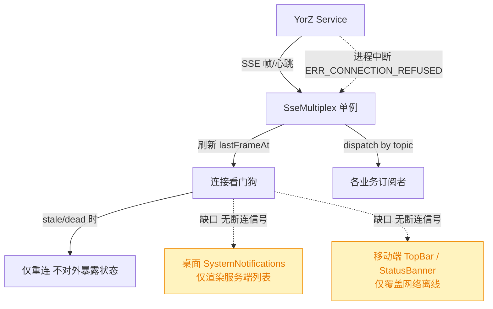
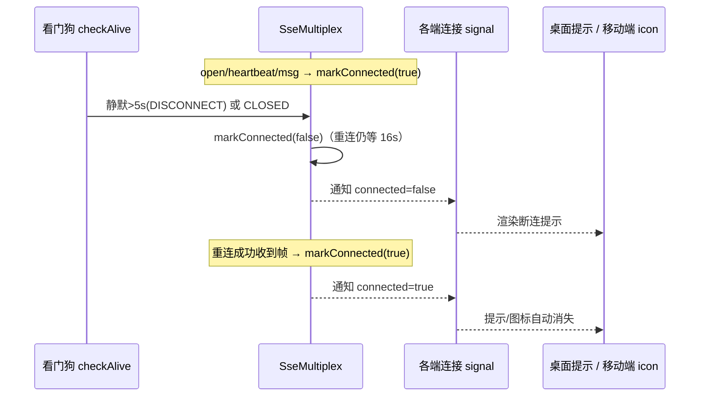
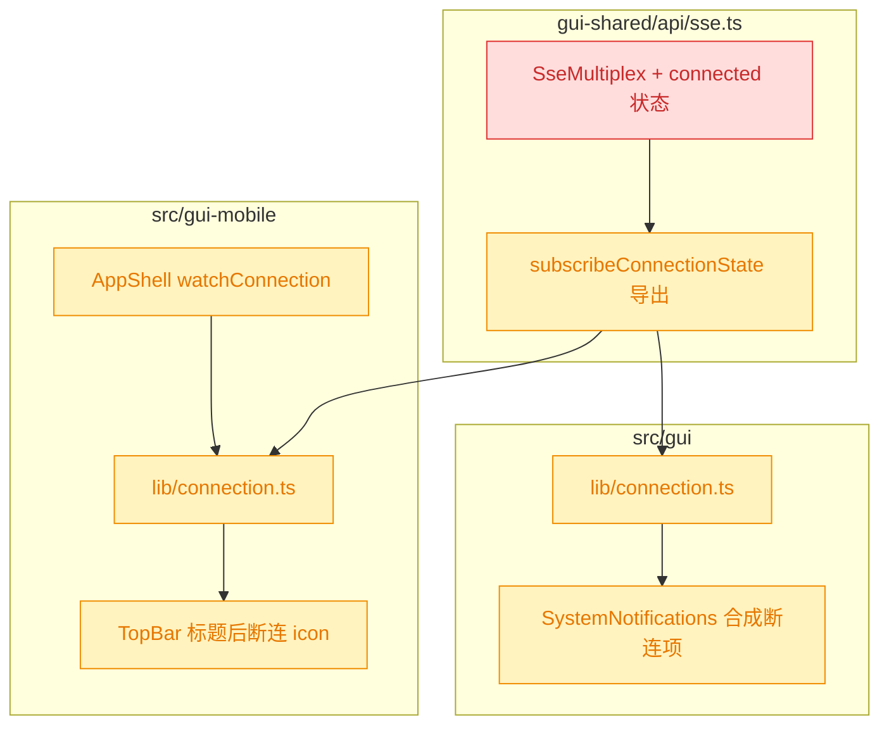

# 服务断连前端告知

## 1. 背景

当 YorZ Service 进程意外中断（崩溃 / 被杀 / 终端关闭）后，GUI / 移动端的实时通道（SSE）会断开，控制台可见：

```
GET http://localhost:7424/api/events/stream?clientId=...&token=... net::ERR_CONNECTION_REFUSED
```

此时前端得不到任何推送，正在运行的项目（spec / 会话）会一直停留在「执行中」状态，用户无从得知服务已经掉线，误以为任务仍在跑。

需求原文：

> 如果服务意外中断，项目一直处于执行中状态，期望告知用户中断状态，`@src/gui/src/components/SystemNotifications.tsx` 提示用户执行 `yorz serve start`。移动端则在 header 栏 title 后面新增一个显眼的断开链接 icon。

## 2. 需求

- R1 前端能可靠感知「与 Service 的实时通道已断开」，并与「浏览器网络离线」区分开。
- R2 桌面端（`src/gui`）：在 `SystemNotifications` 中呈现断连提示，文案引导用户在终端执行 `yorz serve start` 重新拉起服务。
- R3 移动端（`src/gui-mobile`）：在顶栏（TopBar）标题之后新增一个显眼的「断开连接」图标，作为服务掉线的状态指示。
- R4 连接恢复后，上述提示 / 图标自动消失，无需用户手动清理或刷新。

## 3. 现状分析

实时通道由 `src/gui-shared/api/sse.ts` 的单例 `SseMultiplex` 统一承载：每个标签页仅开一条 `EventSource`，各业务通过 `subscribe(topic, handler)` 复用。它已内置**连接看门狗**：

- 服务端每 5s 发一次 `server-heartbeat`；mux 收到任何帧（`open` / `server-heartbeat` / `msg`）都会刷新 `lastFrameAt`。
- 看门狗每 `WATCHDOG_INTERVAL_MS`(5s) 跑一次 `checkAlive()`：当 `lastFrameAt` 超过 `STALE_AFTER_MS`(16s) 没更新（stale），或 `readyState === CLOSED`（dead，反代回 5xx 时出现），即判定连接已死并 `reconnect()` 重建。

**缺口**：看门狗只负责「重连」，连接的死活状态**没有对外暴露**；`readyState()` 仅被测试与 e2e stub 使用，业务 UI 无任何「断连」信号来源。因此：

- 桌面 `SystemNotifications` 只渲染服务端下发的 `SystemNotification[]`（`items().length > 0` 才显示），服务掉线时根本拉不到列表，无法呈现断连。
- 移动端 `StatusBanner` 只覆盖「浏览器网络离线(`navigator.onLine`)」与「PWA 有新版本」，不覆盖「服务端进程断开」；`TopBar` 仅有标题与动作槽，无状态指示位。



<details>
<summary>关键文件与现状锚点</summary>

- `src/gui-shared/api/sse.ts`
  - `class SseMultiplex`：`private lastFrameAt`、`startWatchdog()`、`checkAlive()`（`stale = Date.now()-lastFrameAt > STALE_AFTER_MS`；`dead = source.readyState === 2`）、`reconnect()`。
  - 常量 `STALE_AFTER_MS = 16_000`、`WATCHDOG_INTERVAL_MS = 5_000`。
  - `ensureOpen()` 内 `open` / `server-heartbeat` / `msg` 监听器均刷新 `lastFrameAt`。
  - 对外仅 `makeSubscription().readyState()` 暴露 `mux.readyState()`；无连接健康订阅 API。
  - `__resetMuxForTests()` 供测试重置单例。
- `src/gui/src/components/SystemNotifications.tsx`：`<Show when={items().length > 0}>` 包裹整个 Popover；`subscribeSystemNotifications` 仅订阅 `system-notifications` topic（该订阅本身保证桌面 shell 挂载期间 EventSource 常开）。
- `src/gui-mobile/src/components/TopBar.tsx`：三槽布局 `leading / <h1 title> / actions`，标题 `min-w-0 truncate`。
- `src/gui-mobile/src/components/Page.tsx`：TopBar 的**唯一**消费者（所有页面经 Page 渲染）。
- `src/gui-mobile/src/components/StatusBanner.tsx`：`online()`(`CloudOff`) + `needRefresh()` 两态共用一条横幅。
- `src/gui-mobile/src/lib/network.ts`：`online` signal + `watchNetwork()`，是「shared 无框架状态 → 各端 solid signal 封装」的既有范式。
- `src/gui-mobile/src/AppShell.tsx`：`watchNetwork()` 在此调用；无全局 SSE 订阅。
- 测试样例：`src/gui-shared/api/__tests__/sse-watchdog.test.ts`（`FakeEventSource` + `__resetMuxForTests`）。

</details>

## 4. 技术实现方案

总体思路：**在 SSE mux 复用现有看门狗产出一个「连接健康」信号，向上贯通到两端 UI**。不引入新的探活机制（不新增轮询 / 心跳），只把 mux 已经掌握的死活状态对外暴露。

### 4.1 共享层：mux 暴露连接健康信号

在 `SseMultiplex` 增加连接健康状态并对外提供订阅 API（`src/gui-shared/api/sse.ts`）：

- 新增私有状态 `connected: boolean`（乐观初值 `true`）与监听者集合。
- **置为已连接**：`open` / `server-heartbeat` / `msg` 任一帧到达时 → `markConnected(true)`。
- **置为断连**：`checkAlive()` 静默超过 `DISCONNECT_AFTER_MS`(5s) 或 `readyState===CLOSED` 时 → `markConnected(false)`；**仅置断、不在此置连**（置连只由真实帧驱动，避免重连到仍不可达的服务时 `lastFrameAt` 被 `ensureOpen` 重置而误报在线）。
- **重连阈值与断连阈值解耦**：`reconnect()` 仍沿用更长的 `STALE_AFTER_MS`(16s)，断连 UI 信号用更短的 `DISCONNECT_AFTER_MS`(5s)。
- `markConnected(next)` 仅在值变化时通知监听者，避免每个心跳都广播。
- 新增 `subscribeConnectionState(listener)`：注册即**立刻回调一次当前值**；并在注册时 `ensureOpen()`，保证即便页面当前没有任何业务订阅，也能把 EventSource 拉起、让看门狗开始探活（解决移动端二级页可能无全局订阅的问题）。返回注销函数，注销后若无业务订阅则不再强开。

> 决策说明（断连阈值 5s，与重连阈值解耦）：断连 UI 信号用新常量 `DISCONNECT_AFTER_MS`(5s)，不复用重连的 `STALE_AFTER_MS`(16s)。理由——用户希望掉线更快被告知；但重连的 16s = 3 个心跳周期余量是为了避免主线程 jank / 后台标签页定时器节流时误判成「重连风暴」，不能一并下调。故解耦：断连判定更敏感(5s)、重连仍保守(16s)。代价：5s 约等于一个心跳周期，单次心跳抖动可能让「断开」瞬时闪一下；看门狗每 5s 巡检一次，故实际告知延迟约 5–10s（仍远快于原 16–21s）。该取舍由用户明确选择 5s，接受。
>
> 决策记录：将「16s staleness 判死」改为 5s —— 用户要求更快告知断连；实现上解耦为断连 5s / 重连仍 16s，保留重连防抖余量。

> 决策说明（shared 不绑定框架）：`sse.ts` 位于 `gui-shared` 且不依赖 solid，故这里只暴露命令式 `subscribe` API；由各端用自己的 signal 封装（复用 `network.ts` 既有范式），而非在 shared 里引入 solid。



<details>
<summary>mux 连接健康 API 设计（精确层）</summary>

- `src/gui-shared/api/sse.ts`：
  - 类内新增：`private connected = true`、`private connListeners = new Set<(c: boolean) => void>()`。
  - `private markConnected(next: boolean): void`：`if (this.connected === next) return; this.connected = next; for (const l of this.connListeners) try { l(next) } catch {}`。
  - 三处帧监听（`open` / `server-heartbeat` / `msg`）在刷新 `lastFrameAt` 后追加 `this.markConnected(true)`。
  - 新增常量 `DISCONNECT_AFTER_MS = 5_000`（断连 UI 阈值），`STALE_AFTER_MS = 16_000` 保留给重连。
  - `checkAlive()`：计算 `silentFor = Date.now() - this.lastFrameAt`；`if (silentFor > DISCONNECT_AFTER_MS || dead) this.markConnected(false)`；`if (silentFor > STALE_AFTER_MS || dead) this.reconnect()`。置连只由帧监听负责。
  - `isConnected(): boolean { return this.connected }`。
  - `subscribeConnectionState(listener): () => void`：加入集合 → `this.ensureOpen()` → `listener(this.connected)`；返回清理：从集合删除。
  - `dispose()` 清空 `connListeners` 并重置 `connected = true`。
- 顶层导出：`export function subscribeConnectionState(listener: (connected: boolean) => void): () => void { return mux.subscribeConnectionState(listener) }`。
- 各端 signal 封装（新文件，二选一放置，命名对齐 `network.ts`）：
  - `src/gui/src/lib/connection.ts` 与 `src/gui-mobile/src/lib/connection.ts`：`const [connected, setConnected] = createSignal(true)`；`watchConnection()` 内 `subscribeConnectionState(setConnected)` + `onCleanup(unsub)`；导出 `connected`。

</details>

### 4.2 桌面端：SystemNotifications 合成断连提示

`SystemNotifications` 当前整体包在 `<Show when={items().length > 0}>` 内。改为：**断连时即便服务端列表为空也要显示**。

- 组件内订阅连接 signal（`watchConnection()` → `connected()`）。
- 外层 `Show` 条件改为 `items().length > 0 || !connected()`。
- 断连时在列表顶部渲染一条**前端合成**的提示项（不来自服务端、无删除/更新按钮）：标题「服务已断开」，正文引导执行 `yorz serve start`。保留原有红点徽标（`bg-destructive`），断连时同样点亮。
- `connected()` 恢复为 true 后，若服务端列表也为空，则整个 Popover 随 `Show` 收起——满足 R4 自动消失。

> 决策说明（合成项而非服务端通知）：断连时拉不到服务端列表，提示必须由前端连接信号驱动，故采用「客户端合成项 + 文案引导」，置顶于真实通知之上；不新增服务端通知类型。该呈现落在用户指定的 `SystemNotifications.tsx`，与现有红点徽标 + Popover 列表的既有交互一致。

<details>
<summary>桌面改动要点（精确层）</summary>

- `src/gui/src/components/SystemNotifications.tsx`：
  - import `connected`, `watchConnection`（新 `../lib/connection.js`）。
  - 顶部 `watchConnection()`；外层 `<Show when={items().length > 0 || !connected()}>`。
  - 在 `<For>` 列表之前插入 `<Show when={!connected()}>` 的合成提示行：复用现有行 `div` 结构，标题 `t('systemNotifications.disconnectedTitle')`，正文 `t('systemNotifications.disconnectedMessage')`（含 `yorz serve start`，命令用 `<code>` 或等宽样式突出），不渲染任何操作按钮。
- i18n 新增键（`src/gui/src/i18n/zh-CN.ts` 与 `en.ts` 的 `systemNotifications`）：
  - `disconnectedTitle`: 「服务已断开」/「Service disconnected」。
  - `disconnectedMessage`: 「与 YorZ 服务的连接已中断，正在执行的任务状态可能已停止。请在终端执行 `yorz serve start` 重新启动服务。」/ 英文对应。

</details>

### 4.3 移动端：TopBar 标题后的断连 icon

移动端用户无法执行 `yorz serve start`（那是桌面终端命令），故移动端只需**显眼的状态指示**，不引导命令。

- 新增 `src/gui-mobile/src/lib/connection.ts`（范式同 `network.ts`），在 `AppShell` 挂载时 `watchConnection()`（紧邻现有 `watchNetwork()`）。
- 在 `TopBar` 的 `<h1>` 标题**之后**注入断连 icon（由全局 `connected()` 驱动，`<Show when={!connected()}>`）。因 `Page` 是 `TopBar` 唯一消费者，注入点放在 `TopBar` 内即可覆盖全部页面，无需逐页传参。
- 图标选用 lucide `Unplug`（与 `StatusBanner` 网络离线用的 `CloudOff` 区分：此处语义是「服务端链路断开」），着 `text-destructive` 等显眼语义色；加 `aria-label`，点击弹一条 toast 说明「服务已断开」。

> 决策说明（图标 / 放置 / 交互自定）：图标种类、位置「标题后」、点击弹 toast 均为可逆的低成本 UI 选择，按需求「标题后显眼 icon」直接落定，不作为待确认项打断用户；与网络离线横幅在图标与语义上刻意区分，避免两种「断」被混淆。

<details>
<summary>移动端改动要点（精确层）</summary>

- `src/gui-mobile/src/lib/connection.ts`：同 4.1 封装；`connected` signal + `watchConnection()`。
- `src/gui-mobile/src/AppShell.tsx`：在 `watchNetwork()` 下一行加 `watchConnection()`。
- `src/gui-mobile/src/components/TopBar.tsx`：
  - import `connected`（`@/lib/connection.js`）、`Unplug`（lucide-solid）、`showToast`（`./Toast.jsx`）、`t`。
  - 在 `<h1>…</h1>` 之后插入：`<Show when={!connected()}><button class="tap-target text-destructive active:opacity-60" aria-label={t('connection.disconnected')} onClick={() => showToast(t('connection.disconnectedToast'), 'error')}><Unplug size={18} /></button></Show>`。放在标题与 `actions` 右槽之间，保证「紧贴标题之后」。
- i18n 新增键（`src/gui-mobile/src/i18n/zh-CN.ts` 与 `en.ts`）：`connection.disconnected`「服务已断开」、`connection.disconnectedToast`「与 YorZ 服务的连接已中断，请稍候或重新启动服务」。

</details>

### 4.4 改造后结构与影响面



- 🟡 `sse.ts`：仅新增成员与导出，不改既有 `subscribe` / 看门狗行为，向后兼容。
- 🟡 两端 `connection.ts` 为新增文件；`SystemNotifications` / `TopBar` / 两端 `AppShell` 为增量改动。
- 验证：补充 `sse` 连接健康单测（沿用 `FakeEventSource`：心跳→connected、超时→disconnected、重连收帧→恢复）；跑现有 `sse-watchdog` 测试、typecheck、两端构建。

## 5. 待确认项

_暂无_

## 6. 任务清单

- [x] 在 src/gui-shared/api/sse.ts 的 SseMultiplex 增加 connected 状态、markConnected、isConnected 与 subscribeConnectionState，并在 open/heartbeat/msg 置连、checkAlive 的 stale||dead 置断、dispose 清理（验收：tsc 通过，三处帧监听与 checkAlive 均调用 markConnected）
- [x] 顶层导出 subscribeConnectionState（src/gui-shared/api/sse.ts）并经 src/gui/src/lib/sse.ts shim 透传（验收：两端可 import subscribeConnectionState）
- [x] 新增 src/gui/src/lib/connection.ts：connected signal + watchConnection()（验收：范式对齐 network.ts，tsc 通过）
- [x] 改造 src/gui/src/components/SystemNotifications.tsx：watchConnection，外层 Show 条件加 !connected()，断连时在列表顶部渲染无操作按钮的合成提示项（验收：断连时 Popover 可见并显示 yorz serve start 引导，恢复后在服务端列表为空时自动收起）
- [x] 为 src/gui/src/i18n/zh-CN.ts 与 en.ts 的 systemNotifications 增加 disconnectedTitle/disconnectedMessage（含 yorz serve start）（验收：无缺键，两语言对齐）
- [x] 新增 src/gui-mobile/src/lib/connection.ts 并在 src/gui-mobile/src/AppShell.tsx 调用 watchConnection()（验收：紧邻 watchNetwork()，tsc 通过）
- [x] 改造 src/gui-mobile/src/components/TopBar.tsx：在 h1 标题后按 !connected() 渲染显眼 Unplug 断连 icon，点击弹 toast（验收：断连时所有页面顶栏标题后出现 destructive 色 icon，点击提示服务已断开）
- [x] 为 src/gui-mobile/src/i18n/zh-CN.ts 与 en.ts 增加 connection.disconnected/disconnectedToast（验收：无缺键，两语言对齐）
- [x] 新增连接健康单测（src/gui-shared/api/**tests**）：心跳置连、超时置断、重连收帧恢复（验收：vitest 通过）
- [x] 运行类型检查与两端构建校验改动（验收：typecheck 与 build:gui / build:gui-mobile 通过，或记录环境限制）
- [x] 变更：断连阈值 16s→5s，解耦为新常量 DISCONNECT_AFTER_MS=5_000（断连 UI）与保留 STALE_AFTER_MS=16_000（重连）；checkAlive 分别判定，置连只由帧驱动（验收：sse 单测含「5s 判断连但 16s 前不重连」用例，vitest/typecheck 通过）

## 7. 执行记录

- 共享层（src/gui-shared/api/sse.ts）：SseMultiplex 新增 `connected`/`connListeners`、`markConnected`（仅变化时广播）、`isConnected`、`subscribeConnectionState`（注册即回调当前值并 `ensureOpen`）；`open`/`server-heartbeat`/`msg` 三处帧监听补 `markConnected(true)`，`checkAlive` 的 `stale||dead` 分支在 `reconnect` 前补 `markConnected(false)`，`dispose` 清理监听并复位。顶层导出 `subscribeConnectionState`，经 `src/gui/src/lib/sse.ts` 的 `export *` shim 自动透传。
- 桌面端：新增 `src/gui/src/lib/connection.ts`（connected signal + watchConnection）；`SystemNotifications.tsx` 调用 watchConnection，外层 Show 条件改 `items().length > 0 || !connected()`，列表顶部新增前端合成断连行（destructive 标题 + `yorz serve start` 等宽高亮，无操作按钮）；i18n 补 `systemNotifications.disconnectedTitle/disconnectedMessage`（zh/en）。
- 移动端：新增 `src/gui-mobile/src/lib/connection.ts`；`AppShell.tsx` 在 watchNetwork 后调用 watchConnection；`TopBar.tsx` 在 h1 标题后按 `!connected()` 渲染 destructive 色 `Unplug` 图标，点击 `showToast`；i18n 补 `connection.disconnected/disconnectedToast`（zh/en）。
- 验证：`vitest run sse-connection-state.test.ts sse-watchdog.test.ts` → 9 passed（新增 5 用例覆盖：订阅即回调且 ensureOpen、超时判死置 false、重连收帧恢复 true、持续心跳不翻转、注销后不再通知）；`nr typecheck`(tsc -b) 通过；`nr build:gui` 与 `nr build:gui-mobile` 均成功。
- 收尾：全部非 manual 任务完成，待确认项为暂无、无批注、无追加任务，标记 done。
- 变更（断连阈值 16s→5s）：按用户要求把断连告知阈值由 16s 改为 5s。实现上解耦——新增常量 `DISCONNECT_AFTER_MS = 5_000` 专供断连 UI 信号，`STALE_AFTER_MS = 16_000` 保留给 `reconnect()`；`checkAlive` 改为计算 `silentFor`，`> DISCONNECT_AFTER_MS || dead` 时 `markConnected(false)`、`> STALE_AFTER_MS || dead` 时 `reconnect()`，置连仍只由帧监听驱动（避免重连到不可达服务时 `ensureOpen` 重置 `lastFrameAt` 被误判为已恢复）。保留 16s 重连余量的理由：防主线程 jank / 后台节流误判成重连风暴。代价：5s≈一个心跳周期，单次心跳抖动可能让图标瞬时闪一下；巡检每 5s 一次，实际告知延迟约 5–10s。
- 变更验证：`vitest run sse-connection-state.test.ts sse-watchdog.test.ts` → 10 passed（新增「断连 5s 置断但 16s 前不重连」解耦用例）；`nr typecheck` 通过；`nr build:gui` 与 `nr build:gui-mobile` 均成功。
