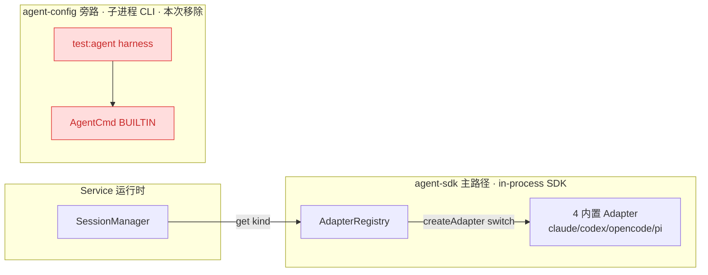
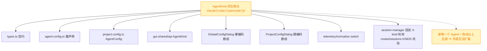
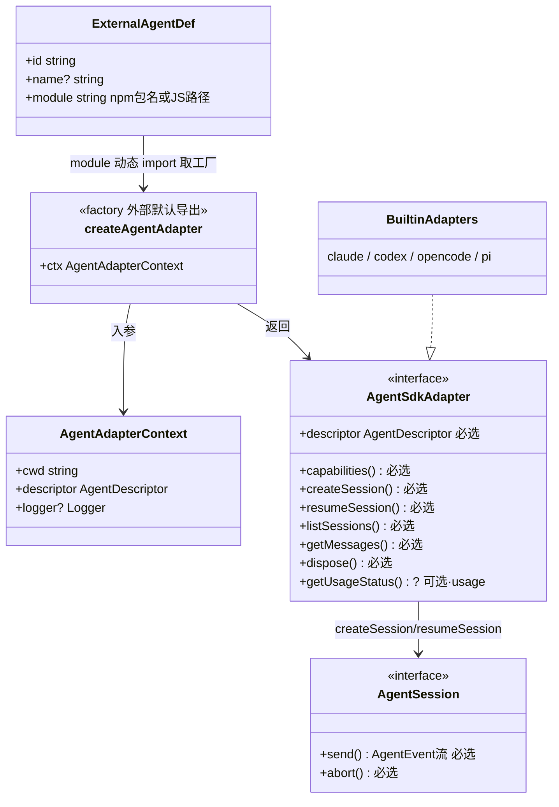
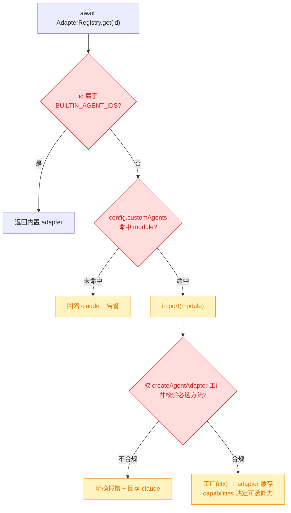
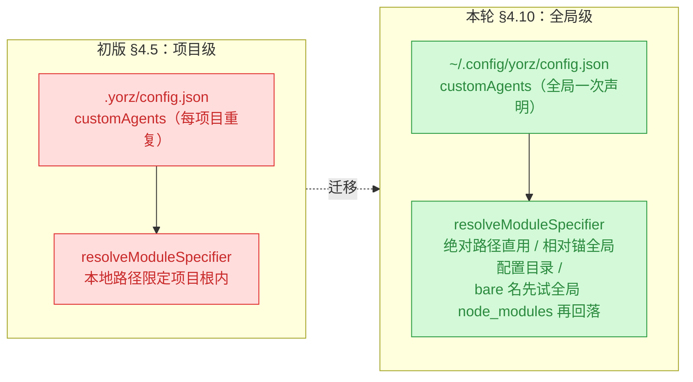
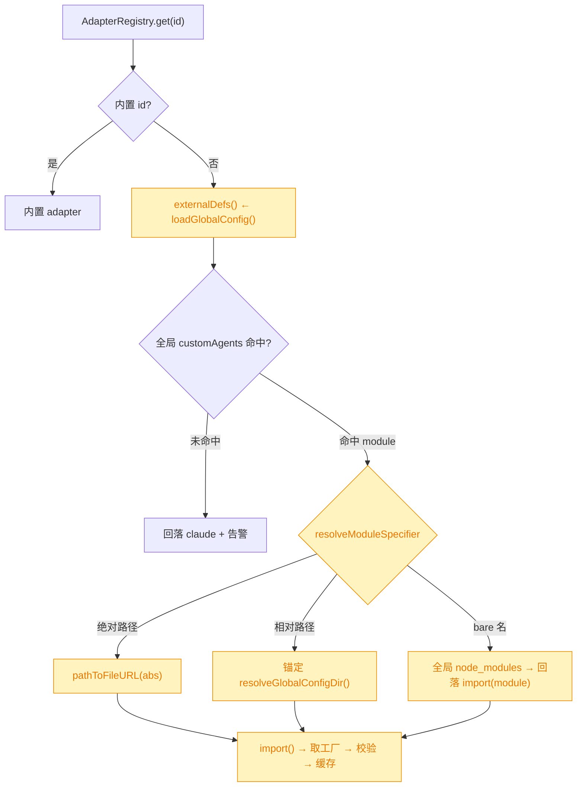

# 外部 Agent 按契约接入

## 1. 背景

当前 `src/service/agent-sdk/` 已有 `AgentSdkAdapter` 契约与 `AdapterRegistry`，内置 claude / codex / opencode / pi 四个 adapter。但 `AgentKind` 是硬编码联合类型、`createAdapter` 是写死的 switch，每接入一个新 Agent 都要改源码。需要一套约定与接口，让用户无需改动应用源码即可扩展接入其它 Agent，接入所需配置放到 `.yorz/config.json`。

## 2. 需求

- 先制定（或收敛）统一接入契约；契约应区分**必选接口**与**可选接口**（如 usage）。
- 把内置 Agent 重构到该契约之上，内置与外部走同一条路径、无特权。
- 实现外部 Agent 按契约接入的接口；接入载体为 **npm 包 / 配置入口 JS，由宿主动态 `import` 引入**，使外部 Agent 可实现与内置对等的完整能力。
- 外部 Agent 接入所需配置放到 `.yorz/config.json` 中。
- 移除 CLI（command/args 子进程）接入方式。

## 3. 现状分析

当前存在**两套平行的 Agent 子系统**，且"有哪些 Agent"这一信息以**闭合联合 + 硬编码数组**的形式散落在前后端 ≥8 处，彼此靠约定保持一致，没有单一真相源。

- **运行时主路径：`agent-sdk/` 的 in-process SDK 适配器。** 契约 `AgentSdkAdapter` 本身设计良好（统一 `send()` → `AgentEvent` 流、`capabilities()` 能力位、可选 `getUsageStatus()`）。四个内置 adapter 各自 `import` 官方 npm SDK。唯一消费方是 `SessionManager`，经 `AdapterRegistry.get(kind)` 取用。
- **旁路：`agent-config.ts` 的 `AgentCmd`（子进程 CLI 模型）。** 含 `cmd / args / streamFormat / env` 抽象与 `YORZ_AGENT_CMD` 入口，现仅服务 `test:agent` harness。本次需求明确要移除这类 CLI 接入方式。
- **扩展的真正障碍：`AgentKind` 是闭合联合 `'claude'|'codex'|'opencode'|'pi'`**，在 types.ts、agent-config.ts、gui-shared/api、project-config.ts、两个 ConfigDialog、session-manager、routes/sessions 等处各自重声明；`normalizeUsage` 按 kind `switch`；GUI 下拉是写死数组。每加一个 Agent 都要改这一圈源码——外部用户无从扩展。
- **历史信号**：`project-config.ts` 的 `normalizeAgent` 注释显示曾有 `kind: 'custom'`（含 cmd/args）档位后被移除降级为 claude。说明"自定义 Agent"做过又删，本次是重新设计一套更干净的契约化方案。
- **关键约束**：`normalizeConfig()` 是**白名单输出**——任何未在白名单内的字段会在下次 `saveProjectConfig` 时被静默丢弃；新增 `customAgents` 必须同步进白名单。





<details>
<summary>精确层：关键符号与行号</summary>

- 契约与注册：`src/service/agent-sdk/types.ts:3`（`AgentKind`）、`:90`（`AgentSdkAdapter`）；`registry.ts:7`（`createAdapter` switch）、`:22`（`AdapterRegistry`）。
- 唯一消费方：`src/service/session-manager.ts:3,107,125`（持有 `AdapterRegistry`）、`:222,:326,:354,:379`（`adapters.get(kind)` 同步调用点）、`:221`（`for (const kind of ['claude','codex','opencode','pi'] as AgentKind[])` 固定轮询 native listSessions）、`:313` `resolveKind`。
- 旁路 CLI 模型（本次移除）：`src/service/agent-config.ts:8`（`AgentCmd`）、`:73`（`BUILTIN`）、`:134`（`resolveAgentCmd`，`:137` `YORZ_AGENT_CMD`）；`:47`（`resolveAgentKind` **保留**，运行时解析 agent.kind）。调用方 `scripts/test-agent.mjs`。
- 配置 schema：`src/service/project-config.ts:7`（`AgentConfig` 含 `inherit`）、`:14`（`ProjectConfig`）、`:98`（白名单 `normalizeConfig`，注释 `:104-105` 明示新字段须加入）、`:133`（`normalizeAgent`，`:148-150` 已移除 `kind:'custom'` 的降级注释）。
- usage 分支：`src/service/telemetry/normalize.ts:12`（`normalizeUsage(kind, raw)` 按 kind 分派；默认分支落 `fromClaude`）。
- GUI 枚举（各自本地重声明 + i18n 标签，非从 service 查询）：`src/gui/src/components/GlobalConfigDialog.tsx:39,242`、`ProjectConfigDialog.tsx:25,120`、`src/gui-mobile/src/pages/settings/ProjectSettings.tsx`、`src/gui-shared/api/index.ts:145,201,247`；标签在 `src/gui/src/i18n/{en,zh-CN}.ts`（`agentClaude/agentOpencode/agentCodex/agentPi`）。
- 路由校验：`src/service/routes/sessions.ts:34`（`KINDS`）、`:97`（body.agentKind 校验）。
- 内置 adapter 依赖：claude=`@anthropic-ai/claude-agent-sdk`（纯托管）；codex=`@openai/codex-sdk`+读 `~/.codex`；opencode=`@opencode-ai/sdk`（唯一拉起本地 HTTP server，有 `dispose`）；pi=`@earendil-works/pi-coding-agent`+读 `~/.pi/agent`。

</details>

## 4. 技术实现方案

核心思路：**把"有哪些 Agent"从编译期闭合联合降级为运行期可发现的开放注册表**，内置与外部共用同一注册入口、同一 `AgentSdkAdapter` 契约、无特权路径。**外部 Agent 的载体为「动态 import」**——以 npm 包或项目内 JS 入口文件提供一个实现契约的工厂，由宿主运行期 `import()` 加载，从而获得与内置 adapter **对等的完整能力**；契约明确分为**必选 / 可选**两层。移除原 CLI（command/args 子进程）接入方式。

### 4.1 契约分层：必选 / 可选

`AgentSdkAdapter` 分两层，`capabilities()` 声明运行期能力位，消费方据此降级：

- **必选**（外部 Agent 必须实现）：`descriptor`、`capabilities`、`createSession`、`resumeSession`、`listSessions`、`getMessages`、`dispose`；`AgentSession` 的 `send()`（产出标准 `AgentEvent` 流）与 `abort()`。
- **可选**（未实现则宿主降级）：`getUsageStatus?`（usage）。

> 依用户批复「除了 usageStatus，全部必选」：相对原设想（曾拟将 `listSessions`/`getMessages` 放宽为可选），本次维持二者**必选**（与现状一致），并将原可选的 `dispose` **提升为必选**（无清理需求的 adapter 实现空 `async dispose(){}` 即可，与 claude/codex 现状对齐）；唯一可选项为 `getUsageStatus`。方法必选 ≠ 能力恒有：`capabilities()` 仍保留 `listSessions`/`getMessages`/`usageStatus` 三个运行期能力位——方法恒在，但 adapter 可声明「虽实现但当前不可枚举/不可查」（如 opencode/pi 的 `usageStatus:false`，方法可返回空），消费方据位降级。usage 由各 adapter 自行产出规范化 `metrics`（内置继续调用 `normalizeUsage`，外部自备或省略），因此 `normalizeUsage` 无需新增外部分支。

### 4.2 开放 AgentId 与描述符

`AgentKind` 语义改为开放 `type AgentId = string`；由 `agent-sdk` 导出唯一 `BUILTIN_AGENT_IDS` 常量作为内置真相源，各处引用它而非重复字面量。新增 `AgentDescriptor { id, displayName, source: 'builtin'|'external', capabilities }`，作为 GUI 枚举与路由校验的单一数据源。

### 4.3 外部接入契约（动态 import 约定）

外部 Agent = 一个可被 `import()` 的模块（npm 包名或项目内 JS 路径），**默认导出或具名导出 `createAgentAdapter` 工厂**；工厂接收宿主注入的 `AgentAdapterContext`（至少 `cwd`、`descriptor`，可注入 `logger`），返回实现 4.1 契约的 `AgentSdkAdapter`。YorZ 经主包子路径导出入口 **`@yorz/cli/agent-sdk`** 对外暴露契约类型，供外部作者 `import type`（见 4.8 决策记录，对应原待确认 5.1）。

### 4.4 注册表化 AdapterRegistry（异步加载）

`createAdapter` 写死 switch 改为注册表；`AdapterRegistry.get(id)` 改为**异步**：内置 id → 内置工厂；外部 id → 查 `customAgents[id].module` → `import()` 动态加载 → 取工厂 → 构造并缓存 adapter。加载/校验失败（模块不存在、无工厂导出、未实现必选方法）→ 明确报错并安全回落 `claude`。`session-manager` 的 `adapters.get` 四处调用随之改 `await`；固定 4-kind 轮询改为**遍历 registry 中声明 `listSessions` 能力的 adapter**。registry 另暴露 `listDescriptors()` 汇总"内置 + config 外部"清单。

### 4.5 config.json schema 扩展

`ProjectConfig` 新增 `customAgents: ExternalAgentDef[]`，`ExternalAgentDef = { id, name?, module }`（**不含** command/args/streamFormat/env）。`module` 为 npm 包名或项目根相对路径；`name` 缺省时取模块 `descriptor.displayName`。`agent.kind` 可取任一 `customAgents[].id`。独立 `normalizeCustomAgents()` 白名单校验（缺 id/module 的条目丢弃，与 `normalizeCommands` 同构），并加入 `normalizeConfig` 白名单与 `defaultProjectConfig()`。

### 4.6 移除 CLI 配置方式

删除 `agent-config.ts` 的 `AgentCmd` / `BUILTIN` / `resolveAgentCmd` / `readAgentCmd` / `YORZ_AGENT_CMD`（CLI 子进程配置路径）；**保留** `resolveAgentKind`（运行时解析 `agent.kind` 所需，建议顺带并入 `project-config.ts` 以消除重复解析）。`test:agent` harness（`scripts/test-agent.mjs`）现依赖 `resolveAgentCmd`，改为经 SDK adapter 注册表驱动。

### 4.7 GUI 枚举动态化（已决定纳入本轮）

新增 `GET /agents` 返回 `AgentDescriptor[]`，GUI 两个 ConfigDialog 与 mobile 设置页改为从接口拉取渲染下拉，取代硬编码数组；外部 Agent 的 `displayName` 来自其 descriptor，内置沿用 i18n 标签。

### 4.8 决策记录

> 决策记录：外部 Agent 接入载体 —— 用户否决·换方案：原「子进程/CLI」改为**动态 import（npm 包 / 本地 JS 入口）**，使外部 Agent 获得与内置对等的完整能力；随之**移除 CLI 配置方式**。安全权衡：动态 import 在宿主进程内以同等权限执行外部代码、无沙箱；经用户明确选择「完整能力」而接受此信任模型（仅加载 config 显式声明的 module、本地路径限定项目根内、加载失败安全回落 claude）。
>
> 决策记录：契约分层为必选/可选 —— 用户批复「除了 usageStatus，全部必选」。据此收敛为：`descriptor`/`capabilities`/`createSession`/`resumeSession`/`listSessions`/`getMessages`/`dispose` 与 `AgentSession.send`/`abort` 皆**必选**，仅 `getUsageStatus`（usage）**可选**。相对初版设想做了两处回调：① `listSessions`/`getMessages` 不再放宽为可选、维持必选（与现状一致）；② `dispose` 由可选**提升为必选**（claude/codex 需补空实现）。`capabilities()` 保留为运行期能力位（方法恒在、能力可声明不可用），与方法必选不冲突。
>
> 决策记录：外部契约类型的暴露方式（原待确认 5.1）—— 用户选择「由现有主包 `@yorz/cli` 增设类型导出入口（`@yorz/cli/agent-sdk`）对外暴露契约类型」，理由：本轮改动最小、无需新增发布物、契约与主包同版本演进。被否决备选：独立类型包 `@yorz/agent-sdk`（新增发布包与 CI 成本）、仅文档描述（外部作者无类型约束）。
>
> 决策记录：原待确认 5.2（GUI 动态化）用户未表态；因新载体使外部 Agent 成为一等公民、GUI 可选是其自然要求且改动低风险可逆，决定纳入本轮。
>
> 决策记录：外部模块发现方式 —— 仅支持 config.json `customAgents.module` 显式声明，不做 npm 命名约定自动发现（降低隐式执行外部代码的风险面），后续需要再加。
>
> 决策记录：`AgentId` 开放化保留内置字面量、向后兼容，属读代码即可确定的类型级决策。

### 4.9 目标架构与解析流程





<details>
<summary>精确层：新增/改动类型与 config 样例</summary>

```ts
// agent-sdk/types.ts
export type AgentId = string // 原 AgentKind，开放化；内置字面量保留为常量
export const BUILTIN_AGENT_IDS = ['claude', 'codex', 'opencode', 'pi'] as const
export interface AgentDescriptor {
  id: AgentId
  displayName: string
  source: 'builtin' | 'external'
  capabilities: Capabilities
}
// 宿主注入给外部工厂的上下文
export interface AgentAdapterContext {
  cwd: string
  descriptor: AgentDescriptor
  logger?: Pick<Console, 'info' | 'warn' | 'error'>
}
// 外部模块约定导出的工厂签名
export type CreateAgentAdapter = (ctx: AgentAdapterContext) => AgentSdkAdapter

// AgentSdkAdapter 契约分层（相对现状的改动）
//  - 新增 readonly descriptor: AgentDescriptor
//  - listSessions()/getMessages() 维持必选（与现状一致）
//  - dispose() 由可选(dispose?)提升为必选(dispose)：claude/codex 补空实现
//  - 仅 getUsageStatus?() 维持可选

// project-config.ts：新增字段 + 白名单
export interface ExternalAgentDef {
  id: string // 不得与内置 id 冲突
  name?: string // 缺省取模块 descriptor.displayName
  module: string // npm 包名 或 项目根相对 JS 路径
}
// ProjectConfig 增 customAgents: ExternalAgentDef[]
// normalizeConfig 返回对象补 customAgents: normalizeCustomAgents(obj.customAgents)
// defaultProjectConfig() 补 customAgents: []
```

外部 Agent 包作者侧（约定）：

```ts
import type { CreateAgentAdapter } from '@yorz/cli/agent-sdk'
const createAgentAdapter: CreateAgentAdapter = (ctx) => ({
  descriptor: {
    id: 'my-agent',
    displayName: 'My Agent',
    source: 'external',
    // 方法虽必选，但能力位可声明当前不可用（消费方据此降级）
    capabilities: { listSessions: false, getMessages: false, usageStatus: false },
  },
  capabilities() {
    return this.descriptor.capabilities
  },
  async createSession() {
    /* ... */
  },
  async resumeSession(id) {
    /* ... */
  },
  // 必选：即便能力位为 false 也要实现（可返回空）
  async listSessions() {
    return []
  },
  async getMessages(id) {
    return []
  },
  async dispose() {
    /* 无清理需求可留空 */
  },
  // getUsageStatus 为唯一可选项：不支持则省略
})
export default createAgentAdapter
```

`.yorz/config.json` 外部 Agent 接入样例：

```json
{
  "version": 1,
  "agent": { "kind": "my-agent" },
  "customAgents": [
    { "id": "my-agent", "name": "My Agent", "module": "yorz-agent-my-agent" },
    { "id": "local-agent", "module": "./agents/my-adapter.js" }
  ]
}
```

改动面清单（breaking=契约签名级，affected=跟随适配）：

- breaking：`agent-sdk/types.ts`（AgentKind→AgentId + 新类型 + listSessions/getMessages 转可选）、`registry.ts`（switch→异步注册表 + 动态 import loader）、`agent-config.ts`（移除 AgentCmd 等 CLI-spawn）。
- affected：`project-config.ts`、`telemetry/normalize.ts`、`session-manager.ts`（`adapters.get` 改 await、:221 轮询改按能力）、`routes/sessions.ts:34/97`、新增 `GET /agents`、`gui-shared/api/index.ts`、两个 ConfigDialog + mobile 设置页、i18n、`scripts/test-agent.mjs`、主包类型导出入口。

</details>

### 4.10 追加任务（refct）：外部 Agent 全局化与开放模块解析

**追加需求**（`## 追加任务` 的 `[open] [refct]` 条目）：外部接入 Agent 应是**全局**的、与具体 yorz 项目无关；`module` 应允许**全局安装的 npm 包**与**入口文件绝对路径**。

这是对 §4.5 的修正：初版把 `customAgents` 放在**项目级** `.yorz/config.json`，且本地路径被 `resolveModuleSpecifier` 强制**限定在项目根内**。二者都把「本应全局、跨项目复用」的外部 Agent 绑死在单个项目上——每个项目都要重复声明同一个 Agent，且无法引用项目根之外（含全局 npm、绝对路径）的实现。本轮将其提升为全局声明、放开模块解析。

**改动要点：**

1. **`customAgents` 从项目级迁移到全局级**：定义从 `ProjectConfig` 移到 `GlobalConfig`（`~/.config/yorz/config.json`），`ExternalAgentDef` 类型随之移到 `global-config.ts`。注册表 `AdapterRegistry.externalDefs()` 改读 `loadGlobalConfig` 而非 `loadProjectConfig`；为可测试性，`AdapterRegistry` 构造新增可选 `globalConfigPath`，由 `SessionManager`（经 `SessionManagerOptions`）从 `project-registry` 透传 `this.globalConfigPath`。adapter 仍以项目 `cwd` 构造（会话在项目目录内运行），但「有哪些外部 Agent」来自全局。
2. **开放模块解析**（`resolveModuleSpecifier` 重写，移除项目根守卫）：
   - **绝对路径**（`isAbsolute`）→ 直接 `pathToFileURL` 加载，不做任何根限定。
   - **相对路径**（`./` / `../`）→ 锚定**全局配置目录** `resolveGlobalConfigDir()`（外部 Agent 已全局化，项目根不再是语义锚点）。
   - **bare specifier**（npm 包名）→ 先尝试解析**全局 node_modules**（`npm install -g` 的包：经 `createRequire` 锚定由 `process.execPath` 推导的全局模块目录），解析失败回落普通 `import(module)`（覆盖随 yorz 捆绑/本地 dev 的同级包）。
3. **全局默认 Agent 开放到外部 id**：外部 Agent 既已全局，`GlobalAgentConfig.defaultKind` 不再限于内置四项——放开为开放 string（`normalizeAgent` 保留任意非空、默认 `claude`），`routes/global-config.ts` 的 `parseBody` 校验放开；新增全局 `GET /agents`（无项目维度，经临时 `AdapterRegistry(cwd, globalConfigPath).listDescriptors()` 返回内置+全局外部 descriptor），GUI 的 `GlobalConfigDialog` 与 gui-mobile `GlobalSettings` 默认 Agent 下拉由硬编码四项改为拉取该接口。这解除了初版「全局默认不能引用项目级外部 id」的技术约束。
4. **项目级清理**：`project-config.ts` 删除 `ExternalAgentDef` / `ProjectConfig.customAgents` / `normalizeCustomAgents` 及白名单与默认项；`routes/project-config.ts` 的 PUT 不再回填 `customAgents`。`agent.kind`（项目级）仍为开放 string，可引用全局 `customAgents[].id`，由注册表在 resolve 时校验并回落 claude。

> 决策记录：外部 Agent 作用域 项目级→全局级 —— 依追加任务，`customAgents` 定义移至 `GlobalConfig`（`~/.config/yorz/config.json`），与 yorz 项目解耦，一次声明全项目复用。被否决备选：项目级+全局级双层合并（增加合并/冲突语义与两处白名单，收益不足，追加任务明确「跟项目无关」故取单一全局源）。向后兼容：本特性尚未发布，不为项目级旧字段做迁移——项目 config 中残留的 `customAgents` 会被项目白名单静默丢弃。
>
> 决策记录：开放模块解析的路径锚点 —— 绝对路径直用、相对路径锚定全局配置目录、bare 名先试全局 node_modules 再回落普通解析；移除「本地路径必须位于项目根内」的 §4.8 文件系统守卫。理由：外部 Agent 已全局化，项目根不再是语义锚点；信任模型本就是「仅加载 config 显式声明的 module、以宿主同等权限执行」（§4.8 决策记录），全局声明天然在用户自管的全局配置内，故移除根守卫与该信任模型一致。属可由设计推定的决策，不入待确认项。
>
> 决策记录：全局默认 Agent 开放到外部 id —— 外部既已全局，`defaultKind` 放开为开放 string 并新增全局 `GET /agents` 供 GUI 渲染。理由：若全局默认仍只能选内置，则全局声明的外部 Agent 只能在项目级被选中，与「全局一等公民」自相矛盾；此改动低风险、与项目级下拉动态化（§4.7）同构。





## 5. 待确认项

_暂无_

## 6. 任务清单

- [x] agent-sdk/types.ts 开放类型：新增 `AgentId=string`、`BUILTIN_AGENT_IDS`、`AgentDescriptor`、`AgentAdapterContext`、`CreateAgentAdapter`，`AgentKind` 保留为 `AgentId` 别名；`AgentSdkAdapter` 增 `readonly descriptor`，`dispose()` 由可选改必选，`listSessions`/`getMessages` 维持必选、`getUsageStatus?` 维持可选（验收：tsc -b 通过且 BUILTIN_AGENT_IDS 含 claude/codex/opencode/pi）
- [x] 四内置 adapter 补 `descriptor`（id+displayName+source:'builtin'+capabilities），claude/codex 补空 `async dispose(){}`（验收：四 adapter implements 新契约，tsc -b 通过）
- [x] registry.ts 注册表化：内置 id→工厂表；`AdapterRegistry.get(id)` 改 async，外部 id→查 customAgents.module→动态 import→取 createAgentAdapter→校验必选方法→构造缓存，失败告警并回落 claude；新增 `listDescriptors()` 汇总内置+config 外部（验收：get 返回 Promise，新增单测覆盖内置/外部/失败回落）
- [x] session-manager.ts 跟随 async：createSession/getMessages/getUsageStatus/ensureLive 的 `adapters.get` 改 `await`；listSessions 的固定 4-kind 轮询改为遍历 `listDescriptors()` 中 `capabilities().listSessions` 为真者；新增 `listDescriptors()` 透传（验收：tsc -b 通过，session-manager.test.ts 绿）
- [x] project-config.ts 扩展 schema：新增 `ExternalAgentDef` 与 `ProjectConfig.customAgents`，实现 `normalizeCustomAgents()`（缺 id/module 丢弃、去重、拒绝与内置 id 冲突），并入 `normalizeConfig` 白名单与 `defaultProjectConfig()`；`agent.kind` 放开为任意 string（内置或 customAgents[].id）（验收：新增单测，saveProjectConfig round-trip 保留 customAgents）
- [x] agent-config.ts 移除 CLI 配置：删除 `AgentCmd`/`AgentName`/`AgentStreamFormat`/`BUILTIN`/`resolveAgentByName`/`resolveAgentCmd`/`readAgentCmd`/`YORZ_AGENT_CMD`；`resolveAgentKind` 保留并移入 project-config.ts，返回 `AgentId`（支持 customAgents id）（验收：全仓无 CLI-spawn 残留引用，tsc -b 通过）
- [x] 测试/harness 跟随：`src/skill/yorz-spec/__tests__/runner.ts` 改为经 SDK adapter 注册表驱动（不再 resolveAgentCmd/spawn CLI）；删除或重写 `src/service/__tests__/agent-config.test.ts`；审计并改造 `spec-review.test.ts`/`appends-route.test.ts` 的 `YORZ_AGENT_CMD`+fake-claude 用法为 SDK mock（验收：pnpm test 全绿）
- [x] routes/sessions.ts：`KINDS` 硬编码校验改为按 registry 的 descriptors 校验 `body.agentKind`；新增 `GET /projects/:projectId/agents` 返回 `AgentDescriptor[]`（经 SessionManager.listDescriptors）（验收：接口返回内置+外部 descriptor，非法 agentKind 落空兜底）
- [x] gui-shared/api/index.ts：`AgentKind`/`AgentConfig` 放开为 string，新增 `AgentDescriptor` 类型与 `GET agents` 客户端方法（验收：gui 构建 tsc 通过）
- [x] GUI 枚举动态化：GlobalConfigDialog、ProjectConfigDialog、gui-mobile ProjectSettings 下拉由硬编码数组改为拉取 `GET agents` 渲染（内置用 i18n 标签、外部用 descriptor.displayName）（验收：构建通过，下拉展示内置+外部）
- [x] 契约类型导出入口：package.json 增 `exports["./agent-sdk"]` 指向契约类型/运行期入口并补 `files`/d.ts 产出，使外部可 `import type { CreateAgentAdapter, AgentSdkAdapter } from '@yorz/cli/agent-sdk'`（验收：pnpm build 产出该子入口，样例可解析类型）
- [x] 文档同步：`docs/User-Guide*.md` 移除 `YORZ_AGENT_CMD` 行，新增 `customAgents` 外部接入说明与 `.yorz/config.json` 样例（验收：文档与 schema 一致）
- [x] 全量校验：pnpm typecheck + pnpm test 全绿，pnpm build 成功（验收：三命令均 0 退出）
- [x] [refct] global-config.ts 承接 customAgents：新增 `ExternalAgentDef` 与 `GlobalConfig.customAgents`，实现 `normalizeCustomAgents()`（缺 id/module 丢弃、拒绝内置 id 冲突、去重），并入 `normalizeConfig` 白名单与 `defaultGlobalConfig()`；`GlobalAgentConfig.defaultKind` 放开为开放 string（`normalizeAgent` 保留任意非空、默认 claude，`GlobalAgentKind` 降级为 string 别名）（验收：新增单测，saveGlobalConfig round-trip 保留 customAgents）
- [x] [refct] project-config.ts 移除项目级 customAgents：删除 `ExternalAgentDef`/`ProjectConfig.customAgents`/`normalizeCustomAgents` 及白名单与 `defaultProjectConfig()` 条目；`agent.kind` 仍为开放 string（验收：tsc 通过，项目 config round-trip 不含 customAgents）
- [x] [refct] registry.ts 读全局+开放解析：`ExternalAgentDef` 改从 global-config 导入；`AdapterRegistry` 构造新增可选 `globalConfigPath`，`externalDefs()` 改读 `loadGlobalConfig`；重写 `resolveModuleSpecifier`（绝对路径直用 / 相对锚 `resolveGlobalConfigDir()` / bare 名先试全局 node_modules 再回落 `import()`），移除项目根守卫（验收：registry 单测覆盖绝对路径加载 + 全局 customAgents + 未知 id 回落）
- [x] [refct] session-manager.ts + project-registry.ts 透传 globalConfigPath：`SessionManagerOptions` 增 `globalConfigPath?`，构造 `new AdapterRegistry(cwd, globalConfigPath)`；materialize 构造 SessionManager 时传入 `this.globalConfigPath`（验收：tsc 通过，session 能解析全局外部 agent）
- [x] [refct] 路由：`routes/global-config.ts` 的 `parseBody` 放开 `defaultKind` 为任意非空 string，新增全局 `GET /agents`（经临时 `AdapterRegistry(process.cwd(), globalConfigPath).listDescriptors()` 返回内置+全局外部）；`routes/project-config.ts` PUT 不再回填 customAgents（验收：全局 /agents 返回内置+外部，PUT 不含 customAgents）
- [x] [refct] gui-shared/api：`GlobalConfig.agent.defaultKind` 放开为 string，新增 `listGlobalAgents()`（`GET /api/agents`）（验收：gui 构建 tsc 通过）
- [x] [refct] GUI 全局默认动态化：`GlobalConfigDialog` 与 gui-mobile `GlobalSettings` 默认 Agent 下拉由硬编码四项改为拉取全局 `/agents`（内置用 i18n 标签、外部用 descriptor.displayName）（验收：构建通过，下拉含内置+全局外部）
- [x] [refct] 测试迁移：删除 `project-config.custom-agents.test.ts`，新建 `global-config.custom-agents.test.ts`（归一化/round-trip/开放 defaultKind）；更新 `agent-sdk/__tests__/registry.test.ts` 改写全局 config + 传 globalConfigPath + 新增绝对路径加载用例（验收：pnpm test 全绿）
- [x] [refct] 文档同步：`docs/User-Guide{,-CN}.md` §8.5 外部 Agent 小节改为「全局 customAgents」（放 `~/.config/yorz/config.json`），module 支持全局 npm 包 / 绝对路径 / 相对全局配置目录；更新样例与安全说明（验收：文档与 schema 一致）
- [x] [refct] 全量校验（追加轮）：pnpm typecheck + pnpm test + pnpm build 全绿（验收：三命令均 0 退出）

## 7. 追加任务

- [fixed] [refct] 2026-10-17 21:17:46 | @docs/User-Guide-CN.md:L347
  - 描述：@docs/User-Guide-CN.md:L347
    应该允许 npm 全局项目和入口文件绝对路径，外部接入Agent应该是全局的，跟 yorz 中的项目无关。

## 8. 执行记录

- 2026-10-17 契约层（types.ts）：新增 `AgentId`/`BUILTIN_AGENT_IDS`/`isBuiltinAgentId`/`AgentDescriptor`/`AgentAdapterContext`/`CreateAgentAdapter`；`AgentKind` 降级为 `AgentId` 别名（开放）；`AgentSdkAdapter` 增 `readonly descriptor`、`dispose()` 转必选、仅 `getUsageStatus?` 可选。
- 2026-10-17 四内置 adapter：claude/codex/opencode/pi 均补 `readonly descriptor`（capabilities 与 `capabilities()` 共用同一对象），claude/codex 补空 `async dispose(){}`（opencode/pi 已有）。
- 2026-10-17 registry.ts：改为内置工厂表 + 异步 `get(id)`（外部 id → `externalDefs()` 查 customAgents → `resolveModuleSpecifier`（本地路径限定项目根内）→ 动态 `import()` → 取 `createAgentAdapter`/`default` → `assertContract` 校验必选方法与 descriptor → 构造缓存；任何失败 `log().warn/error` 并回落 claude）；新增 `listDescriptors()`（内置 + 外部，失败外部合成 caps 全 false 的 descriptor）。`dispose()` 遍历调用（方法必选）。
- 2026-10-17 session-manager.ts：四处 `adapters.get` 改 `await`；`listSessions` 固定 4-kind 轮询改为遍历 `listDescriptors()` 按 `capabilities.listSessions` 过滤；新增 `listAgentDescriptors()` 透传。
- 2026-10-17 project-config.ts：`AgentConfig` 放开为 `{kind:'inherit'}|{kind:string}`；新增 `ExternalAgentDef` + `ProjectConfig.customAgents` + `normalizeCustomAgents()`（缺 id/module 丢弃、拒绝内置 id 冲突、去重）并入白名单与默认；`normalizeAgent` 保留任意非空 kind。`project-registry.ts` 的 `resolveProjectAgentKind` 放开（'inherit'→全局默认，其余原样返回）。
- 2026-10-17 移除 CLI：删除整个 `src/service/agent-config.ts` 与 `agent-config.test.ts`。注：`resolveAgentKind` 原本**无任何生产调用方**（运行时解析走 `project-registry.resolveProjectAgentKind`），故按「保留运行时解析能力」的本意直接由后者承接，不另行保留 dead code。
- 2026-10-17 harness/测试：`runner.ts` 改为用 `AdapterRegistry` 在进程内驱动（`get`→`createSession`→`send` 排空事件流），删除 `spawnAgent`/CLI 依赖；审计结论——`spec-review.test.ts`/`appends-route.test.ts` 的 `YORZ_AGENT_CMD`+fake-claude 早已是 no-op（生产派发走 SDK，不读该环境变量），清理相关死代码并删除 `fixtures/fake-claude.js`。
- 2026-10-17 路由：`routes/sessions.ts` 删除 `KINDS`，`POST sessions` 的 agentKind 按 `listAgentDescriptors()` 校验，新增 `GET /projects/:projectId/agents`；`routes/project-config.ts` 的 `parseAgent` 放开为任意非空 kind、PUT 回填 `customAgents`。
- 2026-10-17 GUI：`gui-shared/api` 的 `AgentKind`/`AgentConfig` 放开为 string，新增 `AgentDescriptor`/`AgentCapabilities` 类型与 `api.listAgents`；`ProjectConfigDialog`、gui-mobile `ProjectSettings` 下拉改为拉 `GET agents` 动态渲染（内置 i18n 标签、外部 displayName）。`GlobalConfigDialog` 维持内置集——全局默认不能引用项目级外部 id（技术约束，非待确认）。
- 2026-10-17 契约导出：新增 `src/agent-sdk/index.ts` 公共入口（re-export 契约类型 + `BUILTIN_AGENT_IDS`/`isBuiltinAgentId` + metrics 类型）；新增独立 `tsconfig.agent-sdk.json` 声明+JS emit 到 `dist/`；package.json 增 `exports["./agent-sdk"]` 与 `build:types` 并入 `build`。验证：`node -e import('@yorz/cli/agent-sdk')` 运行期导出 `BUILTIN_AGENT_IDS`/`isBuiltinAgentId`，d.ts 齐全。
- 2026-10-17 文档：`docs/User-Guide{,-CN}.md` 移除 `YORZ_AGENT_CMD` 环境变量行，§8.5 新增「接入外部 Agent（customAgents）」小节含 config 样例与安全/回落说明，config.json 字段清单补 `customAgents`。
- 2026-10-17 新增测试：`agent-sdk/__tests__/registry.test.ts`（内置解析/外部本地模块加载/未知 id 回落/无工厂回落/缺方法回落/路径越界回落/listDescriptors 汇总，7 例）、`__tests__/project-config.custom-agents.test.ts`（归一化/round-trip/开放 kind，4 例）。
- 2026-10-17 全量校验：`pnpm typecheck` 0 error；`pnpm test` 100 文件 991 通过 / 2 skipped；`pnpm build`（cli + types + gui + gui-mobile）成功，`dist/agent-sdk/index.{js,d.ts}` 产出且 `@yorz/cli/agent-sdk` 子路径可被 Node 解析。
- 2026-10-17 收尾：任务清单 13 项全部完成，待确认项 `_暂无_`、无 `！！！` 批注、无 `[open]` 追加任务；stage 置 `done`。
- 2026-10-17 追加轮（refct §4.10 外部 Agent 全局化）global-config.ts：新增 `ExternalAgentDef` + `GlobalConfig.customAgents` + `normalizeCustomAgents()`（缺 id/module 丢弃、拒绝内置 id 冲突、去重）并入白名单与 `defaultGlobalConfig()`；`GlobalAgentKind` 降级为开放 string，`normalizeAgent` 保留任意非空 defaultKind（默认 claude）。
- 2026-10-17 追加轮 project-config.ts：删除项目级 `ExternalAgentDef`/`ProjectConfig.customAgents`/`normalizeCustomAgents` 及白名单与默认项；`agent.kind` 仍为开放 string（可引用全局 customAgents id）。
- 2026-10-17 追加轮 registry.ts：`ExternalAgentDef` 改从 global-config 导入；`AdapterRegistry` 构造增可选 `globalConfigPath`，`externalDefs()` 改读 `loadGlobalConfig`；重写 `resolveModuleSpecifier`（绝对路径 `pathToFileURL` 直用 / 相对路径锚定 `dirname(globalConfigPath ?? resolveGlobalConfigPath())` / bare 名经 `createRequire` 试全局 `node_modules` 再回落 `import(module)`），移除项目根 containment 守卫。
- 2026-10-17 追加轮 session-manager.ts + project-registry.ts：`SessionManagerOptions` 增 `globalConfigPath?`，构造 `new AdapterRegistry(cwd, opts.globalConfigPath)`；materialize 构造 SessionManager 时透传 `this.globalConfigPath`。
- 2026-10-17 追加轮 路由：`routes/global-config.ts` 的 `parseBody` 放开 `defaultKind` 为任意非空 string，新增全局 `GET /agents`（临时 `AdapterRegistry(process.cwd(), globalConfigPath).listDescriptors()` + dispose）；`routes/project-config.ts` PUT 不再回填 customAgents（GET/PUT 的 /global-config body 子集不含 customAgents，PUT 的读-改-写天然保留全局 customAgents）。
- 2026-10-17 追加轮 GUI：`gui-shared/api` 的 `GlobalConfig.agent.defaultKind` 放开为 string，新增 `api.listGlobalAgents()`（`GET /api/agents`）；`GlobalConfigDialog` 与 gui-mobile `GlobalSettings` 默认 Agent 下拉由硬编码四项改为拉全局 `/agents` 动态渲染（内置 i18n 标签 / 外部 displayName，空结果回落内置集）。
- 2026-10-17 追加轮 测试迁移：删除 `project-config.custom-agents.test.ts`，新建 `global-config.custom-agents.test.ts`（归一化/round-trip/开放 defaultKind/空与非法回落，6 例）；`registry.test.ts` 改写为写全局 config + 传 globalConfigPath，新增绝对路径加载用例、相对模块缺失回落用例（8 例）。
- 2026-10-17 追加轮 文档：`docs/User-Guide{,-CN}.md` §7.1/§7.2 config.json 字段清单将 `customAgents` 从项目级移至全局级；§8.5「接入外部 Agent」改为全局 `~/.config/yorz/config.json` 声明，module 支持全局 npm 包 / 绝对路径 / 相对全局配置目录，更新样例与安全说明（移除项目根限定）。
- 2026-10-17 追加轮 全量校验：`pnpm typecheck` 0 error；`pnpm test` 100 文件 993 通过 / 2 skipped（telemetry 单测并行偶发 ENOENT，隔离/重跑均绿，与本轮改动无关）；`pnpm build`（cli + types + gui + gui-mobile）成功，`@yorz/cli/agent-sdk` 子路径运行期导出齐全。
- 2026-10-17 追加轮 收尾：追加任务清单 10 项全部完成，`[open]` 置 `[fixed]`，待确认项 `_暂无_`、无 `！！！` 批注、无遗留 `[open]`；stage 置 `done`。
