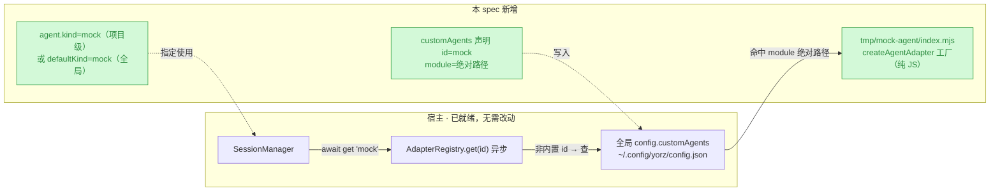
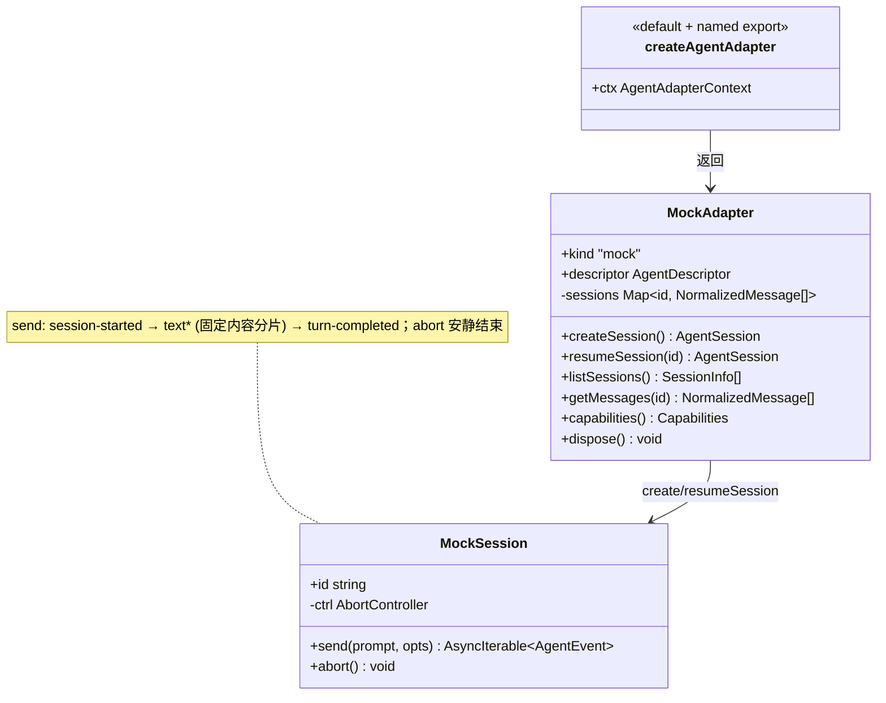
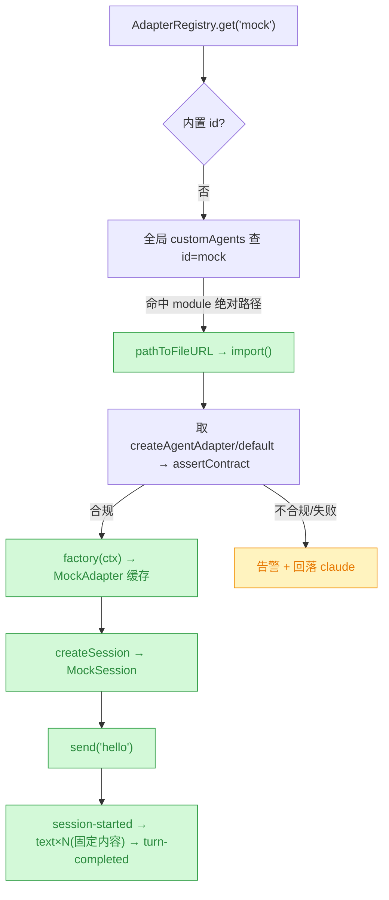

# 实现 Mock 外部 Agent

## 1. 背景

上一个 spec `261017.feat.external-agent-adapter-contract`（已 done）把"有哪些 Agent"从编译期闭合联合改成运行期开放注册表：外部 Agent 以可被 `import()` 的模块（npm 包 / 本地 JS）提供 `createAgentAdapter` 工厂，由宿主动态加载，并全局声明在 `~/.config/yorz/config.json` 的 `customAgents` 中。契约类型经 `@yorz/cli/agent-sdk` 子路径对外暴露。

当前仓库只有四个内置 adapter（claude/codex/opencode/pi）各自依赖真实 SDK，**没有一个不依赖外部服务、可离线运行的样例外部 Agent**，既无法快速验证"外部接入链路"是否真的通，也缺少给外部作者参考的最小实现。本 spec 补这块：实现一个 mock 外部 Agent，代码放到项目 `tmp/` 目录下，用固定内容演示消息处理与流式返回。

## 2. 需求

- 实现一个 **mock agent**，实现代码放到项目 `tmp/` 目录下。
- 期望在**配置中可以切换**到该 Agent。
- 能**处理消息**，**流式返回内容**（内容为固定的 mock 文本）。

## 3. 现状分析

外部 Agent 的接入链路已完整就绪，本需求是**消费方视角的首个落地样例**，无需改动既有生产代码——只需新增一个符合契约的 JS 模块 + 配置声明 + 验证。关键事实：

- **契约（必选/可选分层）**：`AgentSdkAdapter` 除 `getUsageStatus?` 外全部必选——`kind`、`descriptor`、`createSession`、`resumeSession`、`listSessions`、`getMessages`、`capabilities`、`dispose`；`AgentSession` 的 `send()`（产出 `AgentEvent` 流）与 `abort()` 必选。`capabilities()` 是运行期能力位，方法可实现为 no-op（返回 `[]`）同时声明该能力 `false`，消费方据位降级。
- **流式事件形状**：`send()` 是 `AsyncIterable<AgentEvent>`。典型顺序（参考 claude-adapter）：`session-started` → 多个 `text`(delta) → `turn-completed`；取消时监听 `SendOptions.signal`，`abort()` 触发 `AbortController`。
- **加载机制（registry.ts）**：`AdapterRegistry.get(id)` 异步；内置 id 走工厂表，其余 id 从**全局** config 的 `customAgents` 查 `module` → `resolveModuleSpecifier` → 动态 `import()` → 取 `createAgentAdapter`/`default` → `assertContract`（校验必选方法 + descriptor）→ 构造并缓存；任何失败告警并**回落 claude**。`resolveModuleSpecifier` 对**绝对路径**直接 `pathToFileURL` 加载（无项目根守卫）。
- **模块形态**：外部模块由运行期 `import()` 直接加载，**不经 tsc 编译**，故须是可被 Node 原生执行的 JS/ESM；项目 `package.json` 为 `"type":"module"`，但 `tmp/` 内文件用 `.mjs` 扩展名可无视就近 package.json 强制 ESM，最稳。契约类型（`@yorz/cli/agent-sdk`）仅用于 `import type`，运行期 JS 不应 `import` 它。
- **配置与切换**：`customAgents` 为**全局**字段（`~/.config/yorz/config.json`），`normalizeCustomAgents` 要求条目含非空 `id`+`module`、`id` 不得与内置冲突、去重。切到某 Agent 有两处入口：项目级 `.yorz/config.json` 的 `agent.kind`（本项目生效），或全局 `agent.defaultKind`（跨项目默认）；二者均已放开为任意开放 string。
- **消费方**：`SessionManager` 持有一个 `AdapterRegistry`，`createSession/getMessages/ensureLive` 等处 `await adapters.get(kind)`；会话记录由 SessionManager 自管，`listSessions` 仅遍历声明 `capabilities.listSessions` 为真的 adapter；`getMessages` 前先查 `capabilities.getMessages`，为假直接返回 `[]`。

精确层：契约必选面与加载/回落关键点

- 契约：`src/service/agent-sdk/types.ts:135`（`AgentSdkAdapter`，`getUsageStatus?` 唯一可选，`:119` `AgentSession.send/abort`）、`:46`（`AgentEvent` 联合）、`:105`（`Capabilities` 三位）。
- 公共类型入口：`src/agent-sdk/index.ts`（`@yorz/cli/agent-sdk`，re-export 契约 + `BUILTIN_AGENT_IDS`/`isBuiltinAgentId`）。
- 加载：`src/service/agent-sdk/registry.ts:79`（`get` 异步）、`:132`（`buildExternal` 取 `createAgentAdapter`/`default`）、`:165`（`resolveModuleSpecifier`，`:166-171` 绝对路径 `pathToFileURL` 直用）、`:207`（`assertContract` 必选方法 `REQUIRED_METHODS` `:36`）；失败回落 claude `:93-100`。
- 全局 config：`src/service/global-config.ts:36`（`GlobalConfig.customAgents`）、`:73`（`ExternalAgentDef{id,name?,module}`）、`:255`（`normalizeCustomAgents` 校验）、`:142/:149`（`resolveGlobalConfigDir/Path`）。
- 消费方：`src/service/session-manager.ts:151/340/368/393`（`await adapters.get`）、`:234`（按 `capabilities.listSessions` 遍历）、`:341`（`getMessages` 前查 `capabilities.getMessages`）。
- 参考实现：`src/service/agent-sdk/claude-adapter.ts:140`（`send` 事件顺序与 AbortController 用法）。
- 测试样板：`src/service/agent-sdk/__tests__/registry.test.ts`（`VALID_MODULE` 内联外部模块 + `globalWith` 临时全局 config + `globalConfigPath` 注入）。

## 4. 技术实现方案

核心思路：**只新增、不改既有生产代码**。在 `tmp/mock-agent/index.mjs` 写一个纯 ESM 的 `createAgentAdapter` 工厂，完整实现契约；用全局 `customAgents` 声明 + `agent.kind` 切换；并以 `AdapterRegistry`（注入临时 `globalConfigPath` 指向 mock）写一段自动化验证，确认"动态 import → 契约校验 → send 流式吐固定内容"端到端通。

### 4.1 Mock Agent 模块（tmp/mock-agent/index.mjs）

- **文件**：`tmp/mock-agent/index.mjs`（`.mjs` 强制 ESM，纯 JS，不 import 任何 `@yorz/*` 运行期符号；契约仅作心智参照）。
- **工厂**：`export function createAgentAdapter(ctx)` 并 `export default createAgentAdapter`（两种导出都兼容 registry 的 `mod.createAgentAdapter ?? mod.default`）。`ctx` 提供 `cwd`/`descriptor`/`logger`。
- **descriptor**：`{ id: ctx.descriptor.id, displayName: ctx.descriptor.name || 'Mock Agent', source:'external', capabilities }`。`id` 回显 `ctx.descriptor.id`（即 config 声明的 id），保证 `listDescriptors` 中 `descriptor.id === def.id`（否则宿主判定为加载失败合成降级 descriptor）。
- **capabilities**：`{ listSessions: true, getMessages: true, usageStatus: false }`——mock 用**进程内 Map** 维护会话与消息，故 listSessions/getMessages 声明可用；无配额 API 故 `usageStatus:false` 且省略 `getUsageStatus`（唯一可选项）。
- **send() 流式**：产出事件序列 `session-started` → 把固定 mock 文本按**分片**多次 `yield { type:'text', delta }`（模拟流式；可在片间 `await` 一个短 sleep 以更像真实流，sleep 长度设为小常量，支持被 abort 打断）→ `yield { type:'turn-completed', usage:{...}, metrics? }`。固定内容是一段带用户 prompt 回显的 Markdown 常量（例如 "🤖 Mock Agent 收到：<prompt>\n\n这是固定的流式演示内容……"）。
- **取消**：`send(prompt, opts)` 监听 `opts.signal`，`abort()` 调用内部 `AbortController.abort()`；中途被取消时停止 yield 并安静结束（对齐 claude-adapter：aborted 时 `return`，不吐 error）。
- **会话/消息存储**：adapter 实例持有 `Map<sessionId, NormalizedMessage[]>`。`createSession` 生成 `randomUUID` 并建空记录；`resumeSession(id)` 绑定已存在或新建该 id；`send` 时把 user prompt 与 assistant 固定回复追加进该会话；`listSessions` 返回 Map 内会话的 `SessionInfo[]`；`getMessages(id)` 返回该会话 `NormalizedMessage[]`。进程内存储在 SessionManager 生命周期内有效（registry 缓存同一 adapter 实例），重启即清空——对 mock 足够。
- **dispose**：清空 Map，`async dispose(){ this.sessions.clear() }`（无长驻资源）。

### 4.2 配置切换（全局 customAgents + agent.kind）

- **声明（全局）**：在 `~/.config/yorz/config.json` 的 `customAgents` 增一条 `{ "id":"mock", "name":"Mock Agent", "module":"<项目绝对路径>/tmp/mock-agent/index.mjs" }`。`customAgents` 是全局字段、与项目解耦；因该文件在项目 `tmp/` 内、而相对路径会锚定全局配置目录，故 **module 必须用绝对路径**（registry 对绝对路径 `pathToFileURL` 直用、无根守卫）。
- **切换（二选一）**：
  - 项目级：本项目 `.yorz/config.json` 置 `agent.kind = "mock"` → 仅本项目用 mock。
  - 全局级：`~/.config/yorz/config.json` 置 `agent.defaultKind = "mock"` → 跨项目默认 mock。
- 本 spec 采用**项目级切换**作为默认演示（影响面最小、可随时改回 claude），全局切换在文档中一并说明。修改全局/项目 config 为可逆的小改动，由 execute 落地并记录。

### 4.3 验证（自动化，不依赖真实全局 config）

新增脚本 `tmp/mock-agent/verify.mjs`：构造临时全局 config（含指向 `tmp/mock-agent/index.mjs` 的 `customAgents`）→ `new AdapterRegistry(cwd, tmpGlobalConfigPath)` → `get('mock')` 断言拿到的是 mock（非 claude 回落，`descriptor.id==='mock'`）→ `createSession` → 排空 `send('hello')` 事件流，断言出现 `session-started`、至少一个 `text`、`turn-completed`，且 text 拼接等于固定内容 → `listDescriptors()` 含 mock → `getMessages` 回放。该脚本经 `tsx`（仓库已用）运行，import 编译产物或源 registry 皆可——优先 import `src/service/agent-sdk/registry.ts`（经 tsx 直接跑 TS）。这样无需污染真实 `~/.config` 即证明链路通。

> 说明：此验证与 `src/service/agent-sdk/__tests__/registry.test.ts` 的现有 `VALID_MODULE` 用例机制一致，本 spec 不改动既有测试，仅在 tmp 内提供可独立运行的验证脚本（代码在 tmp，符合"实现放 tmp"的要求）。

### 4.4 决策记录

> 决策记录：mock 代码形态为 `tmp/mock-agent/index.mjs`（纯 ESM JS）—— 外部模块由运行期 `import()` 直接加载、不过 tsc，须 Node 原生可执行；`.mjs` 强制 ESM 规避就近 package.json 歧义。被否决：放 `src/` 下写 TS（会被打进产物且非"tmp"、还需编译）。属读代码即可定的技术决策。
>
> 决策记录：capabilities 取 `listSessions:true/getMessages:true/usageStatus:false` + 进程内 Map 存储 —— 让 mock 成为可演示完整对话历史的"完整"样例；usage 无配额 API 故关闭并省略唯一可选的 `getUsageStatus`。被否决：三位全 false 的极简版（send 能流式但重开会话历史为空，演示性差）。
>
> 决策记录：module 用绝对路径 —— `customAgents` 全局、相对路径锚定全局配置目录，而 mock 文件在项目 `tmp/` 内，只有绝对路径能稳定命中（registry 对绝对路径直用、无根守卫）。属由加载机制推定的决策。
>
> 决策记录：默认用项目级 `agent.kind` 切换 —— 影响面最小、可逆、不改变其它项目默认；全局 `defaultKind` 切换作为等价备选写入文档。
>
> 决策记录：验证走 tmp 内独立脚本（临时全局 config + AdapterRegistry）—— 不污染真实 `~/.config/yorz/config.json`，与现有 registry 单测同机制；不新增/改动 `src` 下测试，契合"实现放 tmp、最小改动"。

## 5. 待确认项

_暂无_

## 6. 任务清单

- [x] 新建 `tmp/mock-agent/index.mjs`：纯 ESM，`export function createAgentAdapter(ctx)` + `export default`，实现全契约（descriptor 回显 ctx.id、capabilities listSessions/getMessages true、usageStatus false 且省略 getUsageStatus、createSession/resumeSession/listSessions/getMessages/dispose、MockSession.send 流式吐固定 mock 内容分片 + abort 安静结束、进程内 Map 存会话消息）（验收：verify.mjs 跑通且 assertContract 不抛）
- [x] 新建 `tmp/mock-agent/verify.mjs`：构造临时全局 config（customAgents 指向 index.mjs 绝对路径）→ `new AdapterRegistry(cwd, tmpGlobalConfigPath)` → `get('mock')` 断言 `descriptor.id==='mock'`（非回落 claude）→ createSession → 排空 `send('hello')` 断言出现 session-started/≥1 text/turn-completed 且 text 拼接等于固定内容 → `listDescriptors()` 含 mock → `getMessages` 回放非空（验收：`npx tsx tmp/mock-agent/verify.mjs` 退出码 0 且打印 PASS）
- [x] 配置切换落地：全局 `~/.config/yorz/config.json` 的 `customAgents` 增 `{id:"mock",name:"Mock Agent",module:"<repo 绝对路径>/tmp/mock-agent/index.mjs"}`；项目 `.yorz/config.json` 置 `agent.kind="mock"`（验收：读回两处 config 均含 mock；执行记录注明改回 claude 的方式与全局 defaultKind 等价切换）
- [x] 运行验证并记录：执行 verify.mjs，确认 mock 被 registry 解析、send 流式返回固定内容、历史可回放（验收：verify 输出 PASS，执行记录贴关键断言结果）

## 7. 执行记录

- 2026-10-18 新建 spec 并完成 plan：输出背景/需求/现状分析（含加载链路 flowchart + 精确层）/技术方案（mock 模块设计、配置切换、验证脚本、决策记录、classDiagram + 解析流程图）；准入自检后待确认项为 `_暂无_`。
- 2026-10-18 实现 `tmp/mock-agent/index.mjs`：纯 ESM，`createAgentAdapter` 具名 + 默认双导出；MockAdapter 实现全契约（descriptor.id 回显 ctx.id、capabilities `listSessions/getMessages=true`、`usageStatus=false` 并省略 `getUsageStatus`）；MockSession.send 产出 `session-started → text×N(固定 Markdown 回显 prompt，按空白分片、片间 40ms sleep) → turn-completed`，监听 `signal`、`abort()` 走 AbortController、取消时安静 `return` 不吐 error；会话/消息以进程内 `Map` 存，`listSessions/getMessages` 据此回放。未改动任何既有生产代码。
- 2026-10-18 验证脚本 `tmp/mock-agent/verify.mjs`：临时全局 config（customAgents→index.mjs 绝对路径）+ `new AdapterRegistry(cwd, globalConfigPath)` 驱动全流程。`npx tsx tmp/mock-agent/verify.mjs` 退出码 0，全部断言通过：descriptor.id==='mock'/source==='external'（非回落）、capabilities.getMessages===true、首事件 session-started、≥1 text、turn-completed、文本含「固定的 mock 内容」且回显「hello」、listDescriptors 含 mock、getMessages 回放 user+assistant 两条、abort 后流安静结束不抛。
- 2026-10-18 配置切换：全局 `~/.config/yorz/config.json` 写入 `customAgents:[{id:"mock",name:"Mock Agent",module:"/Users/fenghen/my-space/YorZ/tmp/mock-agent/index.mjs"}]`（绝对路径，因 customAgents 全局、相对路径会锚全局配置目录）；本项目 `.yorz/config.json` 置 `agent.kind="mock"`。改回默认：将项目 `agent.kind` 改回 `"claude"`（或删该字段回落全局 defaultKind）即可；跨项目默认切换则改全局 `agent.defaultKind="mock"`。
- 2026-10-18 真实配置回归：不注入 globalConfigPath（读真实 `~/.config/yorz/config.json`）下 `AdapterRegistry.get('mock')` 解析为 `source=external`、`listDescriptors()` 为 `claude,codex,opencode,pi,mock`、`loadProjectConfig(cwd).agent` 为 `{kind:"mock"}`——确认 GUI/Service 口径下切换生效。
- 2026-10-18 收尾：任务清单 4 项全部完成，待确认项 `_暂无_`、无 `！！！` 批注、无 `[open]` 追加任务；stage 置 `done`。
