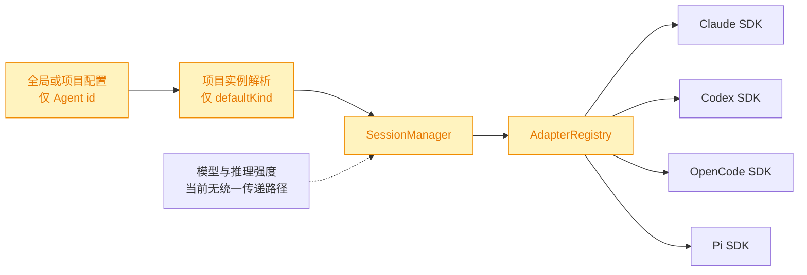
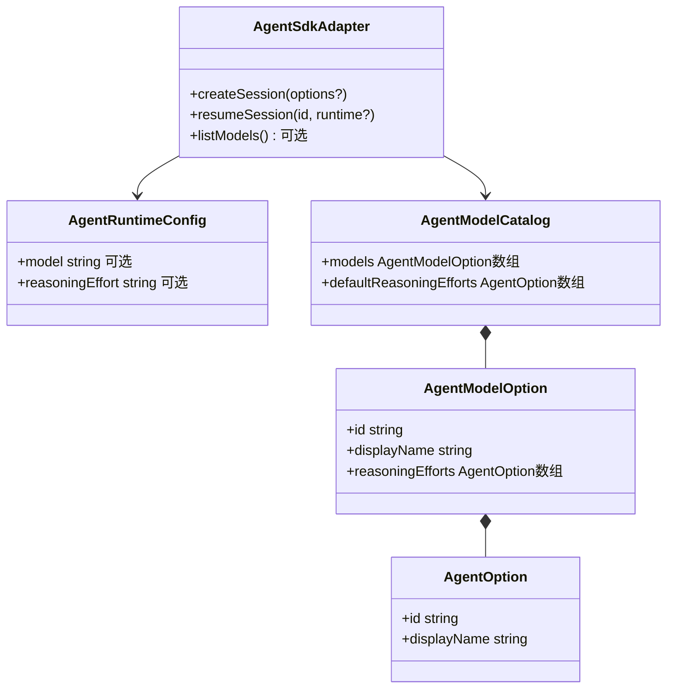
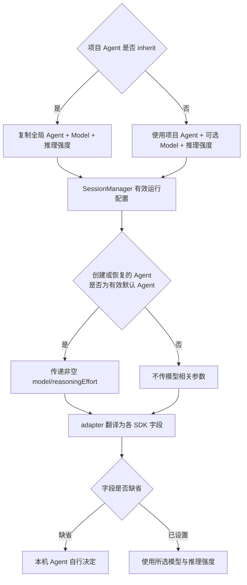
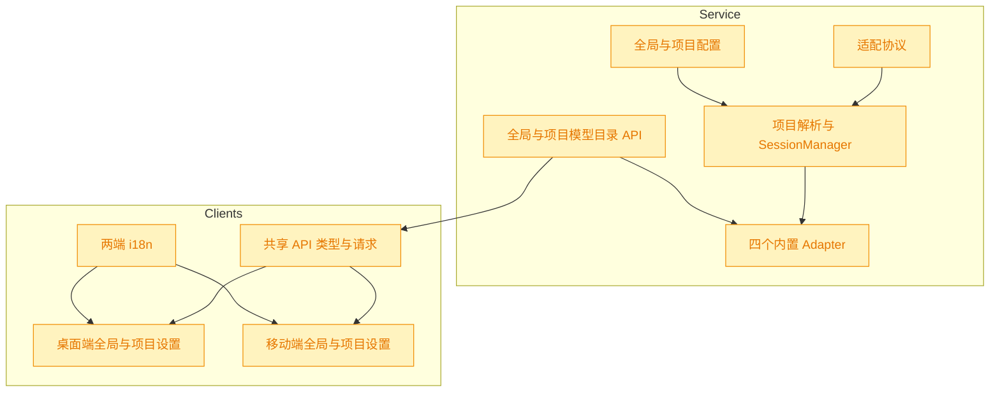

# Agent 模型与推理强度设置

## 1. 背景

当前全局设置和项目设置仅支持切换 Agent，尚不能选择模型与推理强度。用户希望在保留“不传参数、由本机 Agent 决定”兼容语义的前提下，补齐这两项能力。

## 2. 需求

- 扩展 Agent 适配协议，使适配器能够声明可用模型、推理强度及其传参方式。
- 全局设置和项目设置均支持配置 Agent、模型与推理强度。
- 桌面端与移动端 UI 重构为 `Agent → Models → 推理强度` 三个级联 Select。
- 模型或推理强度未设置时不向本机 Agent 传递对应参数，继续采用 Agent 自身默认值。
- 实施前验证 YorZ 内置 Agent 的模型与推理强度切换方式确实可行。

## 3. 现状分析

当前链路只把 Agent id 从配置传到 `SessionManager`，适配器创建或恢复会话时没有统一的运行参数，因此模型与推理强度既无法保存，也无法进入 SDK。全局配置使用 `agent.defaultKind`，项目配置使用 `agent.kind`（可为 `inherit`）；项目实例物化时只解析出 `defaultKind`。桌面端两个设置弹窗用 RadioGroup，移动端两个设置页用 Segmented，均只展示 Agent。

四个内置 Agent 的切换能力已先在本机完成无消息、无模型调用的验证，结论是均可落地，但候选来源和字段名不同：

- Claude Agent SDK：`Options.model` + `Options.effort`；`Query.supportedModels()` 本机返回 5 个模型，并逐模型给出 `supportedEffortLevels`。
- Codex SDK：`ThreadOptions.model` + `ThreadOptions.modelReasoningEffort`；SDK 没有模型枚举 API，但 `~/.codex/models_cache.json` 有模型、展示名和支持的推理等级。本机缓存有 5 个可见模型；实现时只暴露当前 SDK 类型接受的 `minimal/low/medium/high/xhigh`，过滤较新 CLI 缓存可能出现而旧 SDK 不接受的等级。
- OpenCode SDK：当前包的 v2 客户端在 `session.prompt` 支持 `model` + `variant`，`provider.list()` 能返回已连接 provider、模型和 variants。本机探测到 4 个已连接 provider、90 个模型；现有 adapter 使用 v1 入口，需切到同包 v2 入口以获得类型安全的 variant 传参和枚举。
- Pi Coding Agent SDK：`createAgentSession({ model, thinkingLevel })` 可直接传入；`ModelRuntime.getAvailable()` 本机返回 3 个已认证模型。模型对象带 `reasoning` 能力，Pi 会把 `off/minimal/low/medium/high/xhigh/max` 自动钳制到具体模型支持范围。

精确层：现有实现与本机验证依据

- 协议：`src/service/agent-sdk/types.ts` 的 `AgentSdkAdapter.createSession/resumeSession` 只接收标题或 session id；`SendOptions` 只有 signal。
- 配置：`src/service/global-config.ts` 的 `GlobalAgentConfig` 只有 `defaultKind`；`src/service/project-config.ts` 的 `AgentConfig` 只有 `kind`；两个 normalize 均为白名单输出。
- 运行：`src/service/project-registry.ts` 的 `resolveProjectAgentKind` 只解析 Agent id；`src/service/session-manager.ts` 以 id 获取 adapter 后创建/恢复会话。
- UI：`src/gui/src/components/GlobalConfigDialog.tsx`、`ProjectConfigDialog.tsx` 与移动端 `GlobalSettings.tsx`、`ProjectSettings.tsx` 均只维护 Agent 值。
- 验证依据来自仓库已安装版本的声明与只读探测：Claude `supportedModels()`；Codex `ThreadOptions` 与本机 `models_cache.json`；OpenCode v2 `SessionPromptData.variant`/`provider.list()`；Pi `CreateAgentSessionOptions`/`ModelRuntime.getAvailable()`。四次探测均退出码 0，未发送 prompt。

## 4. 技术实现方案

核心方案是把 Agent、模型、推理强度收敛为一份可选运行配置，并由 adapter 自己负责“枚举候选 + 翻译成本机 SDK 参数”。配置字段缺省时，SessionManager 不向 adapter 填值，adapter 也不向 SDK 传对应参数，严格保留当前由本机 Agent 决定的行为。

### 4.1 适配协议与候选模型目录

新增开放的 `AgentRuntimeConfig`、`AgentOption`、`AgentModelOption`、`AgentModelCatalog`。模型 id 与推理强度 id 都保持 string，避免把 Claude effort、Codex reasoning effort、OpenCode variant、Pi thinking level 锁死成一个伪统一枚举。

`createSession` 的 options 扩展为 `title/model/reasoningEffort`，`resumeSession` 增加可选 runtime options；旧调用方不传参数时行为不变。adapter 增加可选 `listModels?()`：实现者可返回模型目录及“未指定模型时可用的默认推理等级”，未实现的外部 Agent 仍可正常加载，只在 UI 中显示“由 Agent 决定”。注册表提供统一的 `listModels(agentId)` 降级入口，避免 GUI 理解具体 SDK。

`listModels` 采用可选方法而非新增必选方法，是兼容现有外部 Agent 的明确决策：已有 adapter 的工厂与 `assertContract` 无需同步升级；只有希望支持级联选择的外部 Agent 才实现目录方法并消费新增 options。被否决方案是把所有内置模型硬编码进 GUI——它无法反映本机账号、provider、缓存和模型更新，也会让两端重复业务逻辑。

### 4.2 四个内置 adapter 的映射

- Claude：模型目录来自 `supportedModels()`；目录探测使用独立 Query 并在读取后关闭。会话发送时仅在字段非空时写 `Options.model/effort`。
- Codex：从 adapter 已有的 storage root 下读取 `models_cache.json`，损坏或不存在时返回空目录；创建/恢复 Thread 时映射为 `model/modelReasoningEffort`，推理等级做 SDK 允许值白名单过滤。
- OpenCode：adapter 改用同一依赖包的 v2 入口；目录仅展开 `provider.list().connected` 中 provider 的启用模型，id 统一为 `provider/model`，variants 作为推理强度；prompt 时拆分模型 id 并传 `body.model`，推理强度传 `body.variant`。
- Pi：目录来自 `ModelRuntime.getAvailable()`，id 为 `provider/model`；创建 session 前由 runtime 精确查到 Model 对象，找不到则不传 model，由 Pi 自行决定；reasoning 模型暴露标准 thinking levels，创建时映射为 `thinkingLevel`。

### 4.3 配置继承与运行时解析

全局 `agent` 扩展为 `{ defaultKind, model?, reasoningEffort? }`，项目 `agent` 扩展为 `{ kind, model?, reasoningEffort? }`；normalize 与 PUT 路由只保留 trim 后非空的可选值。旧配置不含新字段时规范化结果仍不含新字段。

项目 `kind === inherit` 时继承全局 Agent、模型和推理强度整组配置；项目显式选择某个 Agent 时使用项目自己的可选模型与推理强度。SessionManager 保存解析后的有效配置，默认创建 spec/session 及恢复相同 kind 的会话时传给 adapter；用户临时切到其它 Agent 创建会话时不误套默认 Agent 的模型参数。

### 4.4 API 与三级联 UI

新增全局和项目级模型目录读取接口，按当前选中的 Agent 延迟探测，避免打开设置页时同时启动四套 SDK。GUI shared API 提供同构类型和请求方法。

桌面端全局/项目设置与移动端全局/项目设置统一呈现三个 Select：Agent、Models、推理强度。每个模型和推理强度 Select 都添加空值选项“由 Agent 决定”；Agent 改变时清空下游两项并加载新目录，Model 改变时清空推理强度并切换为该模型的候选。目录为空或加载失败时保留兼容空值并禁用无候选的 Select，不阻断其它设置。

项目选择“继承全局”时，模型和推理强度同样由全局整组继承，因此两项禁用并显示“跟随全局”；选择明确 Agent 后可配置项目覆写。桌面端沿用全局即时保存、项目弹窗提交保存；移动端沿用乐观读改写。新增所有可见文案分别进入桌面端和移动端 i18n 配置，不在组件中硬编码。

### 4.5 兼容性、测试与影响范围

旧配置与旧外部 Agent 均继续工作：新配置字段可选、会话 options 可选、`listModels` 可选；未设置时不向 SDK 传 model 或 reasoning。影响集中在协议、配置解析、项目运行时、两组 API 路由、四个 adapter、桌面/移动四个设置界面与各自 i18n。OpenCode v1→v2 是内部类型与字段名迁移，需用现有 adapter 测试覆盖消息、会话、abort、列表与 dispose，防止顺手破坏既有行为。

精确层：预计改动文件与验收重点

- 协议/注册表：`src/service/agent-sdk/types.ts`、`registry.ts`、公共导出 `src/agent-sdk/index.ts`。
- 内置实现：`claude-adapter.ts`、`codex-adapter.ts`、`opencode-adapter.ts`、`pi-adapter.ts` 及对应单测。
- 配置/运行：`global-config.ts`、`project-config.ts`、`project-registry.ts`、`session-manager.ts`、全局/项目 config routes 与 tests。
- API/UI：`src/gui-shared/api/index.ts`；桌面 `GlobalConfigDialog.tsx`、`ProjectConfigDialog.tsx`、`src/gui/src/i18n/{zh-CN,en}.ts`；移动 `GlobalSettings.tsx`、`ProjectSettings.tsx`、`SettingsControls.tsx`、`src/gui-mobile/src/i18n/{zh-CN,en}.ts`。
- 自动验证覆盖：旧配置缺字段；字段 trim/roundtrip；inherit 整组解析；缺省时 adapter SDK options 不含新键；各 adapter 目录映射与传参；模型接口降级；三级联清空与保存；`pnpm typecheck`、相关 vitest、两端 build。

## 5. 待确认项

_暂无_

## 6. 任务清单

- [x] 扩展 Agent SDK 公共协议与注册表：新增可选运行配置、模型目录类型、`listModels?()` 及统一降级查询，保持旧外部 adapter 可加载（验收：registry/类型测试覆盖有目录与无目录 adapter）
- [x] 为 Claude、Codex、OpenCode、Pi 四个内置 adapter 实现模型目录和 model/reasoning 传参，OpenCode 迁移同包 v2 API（验收：四组 adapter 单测验证目录映射、缺省不传、显式值映射及既有会话行为）
- [x] 扩展全局与项目配置 schema、normalize、PUT 解析和继承解析，使 model/reasoningEffort 可选且 `inherit` 继承整组全局值（验收：旧配置、roundtrip、空值清理、整组继承测试通过）
- [x] 将有效 Agent 运行配置接入 ProjectRegistry/SessionManager，并新增全局与项目级按 Agent 延迟读取模型目录的 API（验收：默认会话/恢复传配置、临时其它 Agent 不串配置、两个目录接口降级测试通过）
- [x] 重构桌面端全局与项目设置为 Agent → Models → 推理强度三级联 Select，并补齐桌面 i18n（验收：切上游清空下游、空值兼容、项目 inherit 禁用下游、类型检查通过）
- [x] 重构移动端全局与项目设置为同语义三级联 Select，补充移动设置 Select 控件与移动 i18n（验收：乐观读改写保留其它字段、级联/禁用行为正确、移动 build 通过）
- [x] 运行相关单测、`pnpm typecheck` 与桌面/移动构建，修复回归并记录验证结果（验收：命令全部退出码 0，或记录不可执行的客观原因）

## 7. 追加任务

- [open] [fix] 2026-10-22 22:06:09 | 1. 在 select 中切换模型、推理强度，经常失败，二次选择基本能成功；检查是否可复用@src/gui/src/components/ui/select.t
  - 描述：1. 在 select 中切换模型、推理强度，经常失败，二次选择基本能成功；检查是否可复用@src/gui/src/components/ui/select.tsx 组件
2. “由 Agent 决定”中英文文案都改成 “--”，表示空状态
3. 打开全局配置，长时间处于“加载中”状态，模型、推理强度应该异步加载，不要阻止UI渲染
- [open] [fix] 2026-10-22 22:33:53 | 1. 选择模型后，再次点击模型无反应；期望弹出模型选项
  - 描述：1. 选择模型后，再次点击模型无反应；期望弹出模型选项
2. 选择推理强度后，关闭弹窗再打开，未能选中所选值；期望重新打开设置弹窗 UI 能渲染选中值
3. 模型 select 组件，选中的模型名字较长时不应该折行；期望超过长度显示为省略号 ...
- [open] [fix] 2026-10-23 12:34:11 | 打开设置面板，点击切换 Agent、模型，页面会卡死崩溃
  - 描述：打开设置面板，点击切换 Agent、模型，页面会卡死崩溃
- [open] [fix] 2026-10-23 12:34:51 | 打开设置面板，点击切换 Agent、模型，页面会卡死崩溃
  - 描述：打开设置面板，点击切换 Agent、模型，页面会卡死崩溃

## 8. 执行记录

- 2026-10-22 扩展公共协议：新增可选 `AgentRuntimeConfig`、模型/推理候选与目录类型，扩展 create/resume options，并以可选 `listModels?()` 保持旧外部 adapter 兼容；注册表新增失败降级为空目录的惰性查询，公共包同步导出。`pnpm vitest run src/service/agent-sdk/__tests__/registry.test.ts` 通过（8/8）。
- 2026-10-22 四个内置 adapter 接入：Claude 映射 `model/effort` 并用 `supportedModels()`；Codex 映射 Thread options 并解析本地模型缓存、过滤 SDK 不支持等级；OpenCode 切换同包 v2 API，使用 `provider/model + variant`；Pi 解析 runtime 模型并传 `thinkingLevel`。四组 adapter 单测通过（33/33），随后 `pnpm typecheck` 通过。
- 2026-10-22 配置层接入：全局与项目 Agent schema/normalize/PUT parser 支持可选 `model/reasoningEffort`，空白值不落盘；新增整组继承解析，项目 `inherit` 不混用项目残留字段。配置与 registry 相关测试通过（49/49），`pnpm typecheck` 通过。
- 2026-10-22 运行与 API 接入：ProjectRegistry 将整组有效配置交给 SessionManager；默认 Agent 的新建/恢复会话携带 model/reasoning，临时切换其它 Agent 不串用默认参数；全局与项目新增按 Agent 惰性读取模型目录的 API，gui-shared 增同构类型/请求。SessionManager、ProjectRegistry、HTTP service 测试通过（57/57），`pnpm typecheck` 通过。
- 2026-10-22 桌面端 UI：全局与项目弹窗改为 Agent → 模型 → 推理强度三个级联 Select；切换上游会清空下游，目录惰性加载，空目录/失败保留“由 Agent 决定”，项目 inherit 禁用下游；新增共用 SettingsSelect 和双语 i18n。`pnpm typecheck && pnpm build:gui` 通过。
- 2026-10-22 移动端 UI：设置控件新增 44px 触控高度的 SettingsSelect；全局/项目页接入同语义级联、乐观读改写和双语 i18n，保留其它全局/项目字段。`pnpm typecheck && pnpm build:gui-mobile` 通过。
- 2026-10-22 收尾补强：全局 Agent 配置保存后刷新各项目 SessionManager 的默认运行配置，只影响后续新建/恢复会话，不中断当前运行中的会话；补充 SessionManager 与 HTTP 配置测试。
- 2026-10-22 最终验证：`pnpm typecheck` 通过；`pnpm test` 通过（101 个测试文件，1005 个用例通过、2 个跳过）；`pnpm build` 完整通过 CLI、类型声明、桌面端与移动端 PWA 构建；`git diff --check` 通过。尝试按浏览器验收流程连接本地服务时，当前环境没有可接管的应用内浏览器实例，故未执行截图级人工验收；本地服务已正常关闭。
