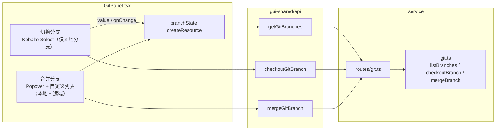
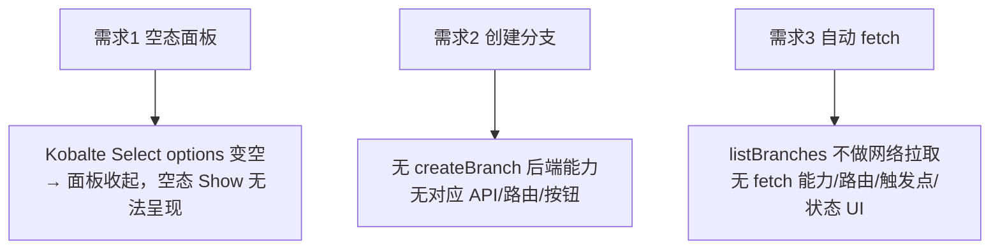
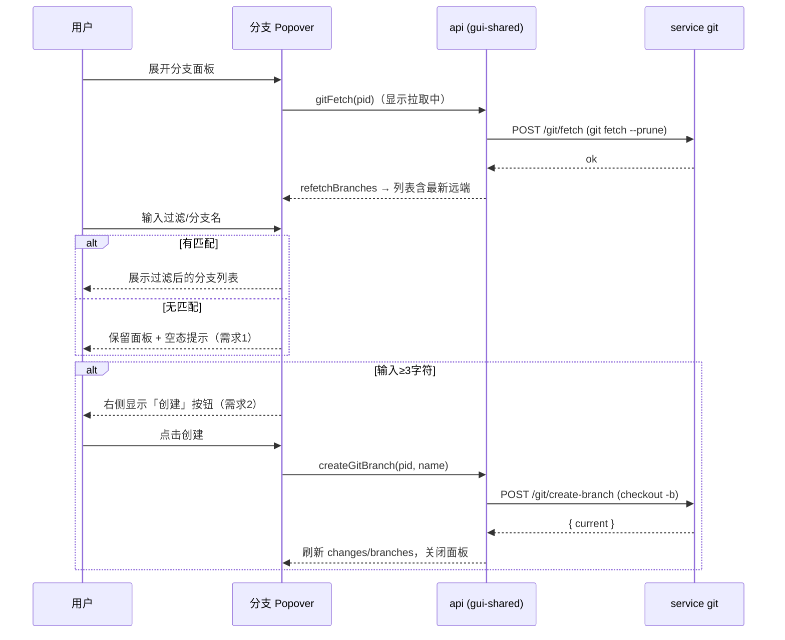
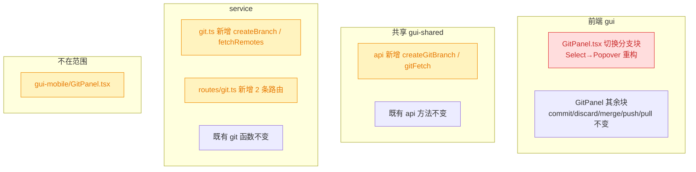
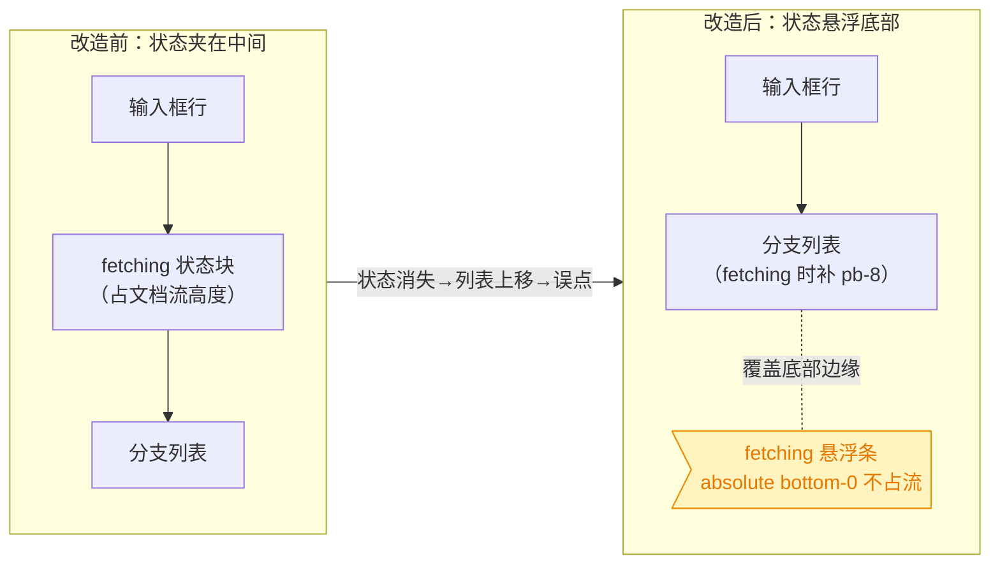

# GitPanel 分支面板增强

## 1. 背景

`src/gui/src/components/GitPanel.tsx` 是独立 Git 页与 spec Review 页共用的工作区面板。当前分支切换使用 Kobalte `Select`（仅列本地分支），合并使用 `Popover` + 自定义列表（列本地 + 远端分支）。本次针对分支切换/选择交互做三项增强。

## 2. 需求

1. **无匹配仍保持面板（空数据态）**：在分支下拉中输入过滤词、无任何匹配分支时，面板（含过滤输入框 + 空态提示）必须保持展示，解决「匹配无结果时整个面板消失、无法继续输入」的问题。
2. **输入≥1 字符显示「创建」按钮**：分支名称输入框中存在 1 个及以上字符时，在其右侧显示「创建」按钮，点击即以该名称创建分支（并切换过去）。
3. **展开分支面板自动 fetch**：展开分支面板时自动执行 `git fetch`，并在 UI 中显示 fetch 状态（进行中/完成），拉取后刷新分支列表，解决「看不见远端分支」的问题。

> 范围限定：本次仅改动 `src/gui`（及其共享的 `src/gui-shared/api`）与 service 端 git 能力；`src/gui-mobile` 的同名面板不在本次范围内。

## 3. 现状分析

### 3.1 组件与数据链路

GitPanel 的分支相关状态与后端能力现状如下（认知层）：



<details>
<summary>关键代码落点（精确层）</summary>

- 切换分支 `Select`：`src/gui/src/components/GitPanel.tsx:425-470`
  - `options={filteredBranches()}`（`filteredBranches` 定义于 `:128-133`，仅过滤 `branchState().branches` 本地分支）。
  - 过滤输入框在 `SelectContent` 内 `:457-465`，用 `onKeyDown={(e) => e.stopPropagation()}` 规避 Kobalte Select 首键关闭。
  - 空态提示 `:466-468` `<Show when={!loading && filteredBranches().length === 0}>` —— 但 Kobalte `Select` 在 `options` 变空时会收起/不渲染内容面板，导致该提示与过滤框一起消失（即需求 1 的 bug）。
- 合并 `Popover`（既有范式，列本地 + 远端、带自定义 `For` 列表与空态）：`:497-574`；注释 `:507-508` 明确指出「过滤框嵌套进 Kobalte Select 会在首次键入时关闭下拉」，故合并改用 Popover。
- `checkoutBranch`（service）：`src/service/git.ts:414-428`，用 `listBranches().branches` 做白名单，仅接受本地分支。
- `mergeBranch`：`src/service/git.ts:442-472`，白名单含本地 + 远端。
- `listBranches`：`src/service/git.ts:392-412`，`for-each-ref refs/heads` + `refs/remotes`，无网络拉取（故看不到新的远端分支）。
- 路由：`src/service/routes/git.ts:98-139`（branches / checkout / merge）。
- API 封装：`src/gui-shared/api/index.ts:467-482`（getGitBranches / checkoutGitBranch / mergeGitBranch）。

</details>

### 3.2 三个需求对应的现状缺口



### 3.3 追加任务现状（close icon 遮挡 / fetching 布局）

两项追加任务均落在「切换分支 Popover」内（`src/gui/src/components/GitPanel.tsx`）：

- **close icon（追加 [fix]）**：Kobalte `PopoverContent` 默认在右上角渲染一个关闭 `CloseButton`（`src/gui/src/components/ui/popover.tsx:43-57`，受 `hideCloseButton` 控制）。该关闭 icon 绝对定位于 `right-4 top-4`，会压在输入框右侧「创建」按钮之上造成遮挡。现状：切换分支 Popover 的 `PopoverContent` 已传入 `hideCloseButton`（`GitPanel.tsx:534`，随主需求提交 749e398 一并落地），故该 icon 实际已不渲染——此 [fix] 条目在代码层面已满足，仅待校验后翻转状态。
- **fetching 状态布局（追加 [refct]）**：拉取状态块 `GitPanel.tsx:560-568` 以 `<Show when={fetchStatus()==='fetching'||'failed'}>` 渲染，位置夹在「输入框行」（`:535-559`）与「分支列表滚动容器」（`:569-588`，`max-h-64 overflow-auto`）**之间**，且占据正常文档流高度。fetching 结束（状态由 `fetching` → `done`/`idle`）时该块整体消失，下方分支列表随之**上移一行**；若此刻用户正要点击某分支，目标项位置突变 → 误点非期望分支（本 refct 要解决的问题）。

## 4. 技术实现方案

三项需求围绕「分支切换下拉」收敛，故总体改造落在：**切换分支下拉由 Kobalte Select 重构为 Popover 范式（与合并选择器一致）** + **新增 service 端 `fetch` 与 `createBranch` 能力及对应 API**。

### 4.1 需求 1：无匹配保持空态面板 —— 切换分支下拉重构为 Popover

**决策：** 将「切换分支」从 Kobalte `Select` 重构为 `Popover` + 自定义可过滤列表，范式对齐既有「合并分支」选择器。

**理由（决策说明）：**

- 代码库已就「可过滤分支列表」确立 Popover 范式，并在 `:507-508` 明确记录 Kobalte Select 嵌套过滤框的固有缺陷；空 options 收起面板属同类 Kobalte 限制。沿用既有范式可一次性根治需求 1，且为需求 2 的内联「创建」按钮、需求 3 的 `onOpenChange` fetch 触发提供干净的挂载点。
- 被否决的备选：保留 Select 仅修空态。Kobalte Select 在 options 变空时的收起行为无稳定、低风险的修法，且与需求 2/3 的挂载需求冲突，返工成本更高。

**要点：**

- Popover 内部结构：顶部「分支名称输入框」（复用为过滤 + 新建名称），下方 `max-h` 滚动的分支列表（`For`），列表为空时渲染空态提示 `t('git.noBranches')`——因是我们自控渲染，面板与输入框始终保留。
- 列表数据源为「本地 + 远端」（按方案 2，远端可检出）：新增 `checkoutCandidates` memo（`[...branches, ...remoteBranches]`）与 `filteredCheckoutCandidates`（按 `branchQuery` 过滤）。
- 列表项点击即触发 `triggerBranchCheckout(branch)`，当前分支项禁用/高亮（对齐合并选择器的 self 处理）。
- 触发器按钮沿用现有 `GitBranch` 图标 + 当前分支名 + loading（checkout/fetch 时转圈）展示。

### 4.2 需求 2：输入≥2 字符显示「创建」按钮

**决策：** 在分支输入框右侧，当 `branchQuery().trim().length >= 1`（超过一个字符）时显示「创建」按钮；点击调用新增的 `createGitBranch(pid, name)`，后端以当前 HEAD 为基、`git checkout -b <name>` 创建并切换，成功后刷新分支状态并关闭 Popover。

**决策说明（可自行判定、不打断用户）：**

- **基点与切换行为**：`git checkout -b` 语义天然「从当前 HEAD 建分支并切换」，与用户「创建分支」心智一致；故创建即切换，复用 checkout 后的收尾逻辑（清空选择、刷新 changes、refetch branches）。
- **按钮显隐**：仅按「trim 后 ≥2 字符（超过一个字符）」显示（需求明确，追加任务由 ≥3 下调）；若输入与某本地分支精确同名，则按钮禁用并提示「分支已存在」（创建必失败，前移为禁用更友好）。
- **名称合法性**：非法分支名由 git 负责校验，后端把 `git` stderr 经既有 `gitFail` 透传为 400，前端 inline 展示；后端仅做基础非空/长度与 `check-ref-format` 兜底。
- 被否决备选：「创建后不切换」——与 `checkout -b` 直觉不符，且用户建新分支多为立即在其上工作。

<details>
<summary>service 端 createBranch 草案（精确层）</summary>

- `src/service/git.ts` 新增：

  ```ts
  export async function createBranch(cwd: string, name: string): Promise<{ current: string }>
  ```

  - trim 校验非空；用 `git check-ref-format --branch <name>` 兜底校验（非法 → `GitError('invalid_branch', ...)` → 400）。
  - 已存在（`listBranches().branches` 命中）→ `GitError('branch_exists', ...)`。
  - `runGitRaw(cwd, ['checkout', '-b', name])`；非 0 → `GitError('create_branch_failed', stderr)`。
  - 返回 `{ current: await currentBranch(cwd) }`。

- `src/service/routes/git.ts` 新增 `POST /projects/:projectId/git/create-branch`，body `{ name }`，复用 `readBody` / `gitFail`。
- `src/gui-shared/api/index.ts` 新增 `createGitBranch(pid, name)` → `POST .../git/create-branch`，返回 `{ ok: true; current: string }`。
- i18n 新增：`git.createBranch`（创建）、`git.creatingBranch`（创建中…）、`git.branchCreated`（已创建并切换到 {{branch}}）、`git.branchExists`（分支已存在）。

</details>

### 4.3 需求 3：展开分支面板自动 fetch 并显示状态

**决策：** Popover `onOpenChange(open=true)` 时触发一次 `git fetch`（带状态信号），fetch 期间在面板内显示「拉取中…」状态与触发器 loading，完成后 `refetchBranches()` 刷新列表。为避免每次开合都打网络，加一个「本次面板会话只自动 fetch 一次 / 或节流」的守卫。

**决策说明：**

- **fetch 命令**：`git fetch --prune`（默认全部 remote，`--prune` 清理已删除的远端分支引用），失败（如无 remote/离线）不阻断——以非侵入 inline 状态提示呈现，不弹错打断操作。
- **状态呈现**：新增 `fetching` 信号；面板头部显示 `Loader2` + `t('git.fetching')`，完成后短暂显示「已更新」或直接消失；触发器图标在 fetching 时转圈（与 checkout 复用 loading 态）。
- **触发范围（已定稿）**：按用户抉择采用方案 2——展开「切换分支」Popover 时自动 fetch，`onOpenChange(open=true)` 触发；切换下拉**同时列出本地 + 远端分支**作为检出目标（复用现有 `mergeCandidates` 式合并列表）。为避免每次开合都打网络，加「本组件生命周期内只自动 fetch 一次」的守卫信号 `branchFetchedOnce`。

### 4.4 远端分支可检出 —— 扩展 `checkoutBranch` 支持远端→本地跟踪分支

**决策：** 切换下拉选择远端分支（如 `origin/x`）时，自动创建并切换到同名本地跟踪分支。

**决策说明：**

- 白名单扩展为「本地 + 远端」；目标命中 `remoteBranches` 时按「远端→本地跟踪」处理：剥离首段 remote 前缀得本地名（`origin/feature/x` → `feature/x`）。
- 若本地名已存在 → 直接 `git checkout <local>`（避免重复创建失败）；否则 `git checkout -b <local> --track <remote>` 建跟踪分支并切换。
- 失败经 `gitFail` 透传为 400，前端 inline 展示。

> 决策记录：5.1 自动 fetch 触发范围与远端是否可检出 —— 用户选择「切换面板自动 fetch 且远端分支可检出」，理由：直接解决「看不见远端分支」，选远端分支即建本地跟踪分支切换过去。

<details>
<summary>service 端 fetch 草案（精确层）</summary>

- `src/service/git.ts` 新增：

  ```ts
  export async function fetchRemotes(cwd: string): Promise<{ ok: true; updated: boolean }>
  ```

  - `runGitRaw(cwd, ['fetch', '--prune'])`；非 0 → `GitError('fetch_failed', stderr)`（路由层转 400，前端 inline）。
  - 无 remote 时 git 通常静默成功；`updated` 可对比 fetch 前后 `for-each-ref refs/remotes` 的指纹得出（可选，先返回 `ok`）。

- `src/service/routes/git.ts` 新增 `POST /projects/:projectId/git/fetch`。
- `src/gui-shared/api/index.ts` 新增 `gitFetch(pid)` → `POST .../git/fetch`。
- i18n 新增：`git.fetching`（拉取远端中…）、`git.fetchFailed`（拉取远端失败）、`git.fetched`（远端已更新）。

</details>

### 4.5 改造后交互时序



### 4.6 影响范围（兼容性）



- 🔴 breaking（行为重构）：切换分支块由 Select 改 Popover——交互 DOM 结构变化，`review-controls-pane` 内可能影响依赖该 Select 的测试/选择器（需复核 e2e/组件测试）。
- 🟡 affected：新增 API/路由/git 函数为纯新增，向后兼容；`gui-mobile` 共享同一 api 文件但不调用新方法，不受影响。

### 4.7 追加任务方案（close icon 校验 + fetching 悬浮底部）

**追加 [fix]：移除过滤框 close icon**

- 决策：保持切换分支 `PopoverContent` 的 `hideCloseButton`（已存在于 `:534`），从根上不渲染右上角关闭 icon，使其不再遮挡「创建」按钮。
- 决策说明（可自行判定）：`hideCloseButton` 是 `popover.tsx` 既有、受支持的 prop；创建按钮仅存在于切换分支 Popover（合并 Popover 无该按钮），故仅此一处需确认。代码在主提交 749e398 中已落地，execute 阶段仅做静态校验（确认 `hideCloseButton` 在位、无回归），随即把 [fix] 翻转为 [fixed]，不额外改码。

**追加 [refct]：fetching 状态悬浮面板底部**

- 决策：将 fetching 状态块从「输入框与列表之间的文档流位置」移出，改为**绝对定位悬浮在 `PopoverContent` 底部**（`absolute inset-x-0 bottom-0`），不占据文档流高度；并给 `PopoverContent` 加 `relative` 作为定位锚点。
- 决策说明（可自行判定）：
  - **为何悬浮而非仅移到列表下方（普通 footer）**：普通 footer 虽也能让列表不再上移（列表锚定在顶部、footer 增删只改变底部），但仍会改变面板整体高度、底部有抖动；用户诉求是「悬浮在面板底部」。绝对定位彻底不占流、出现/消失均零布局位移，最契合诉求且一次根治误点。
  - **视觉**：悬浮条用 `border-t bg-popover rounded-b-md px-2 py-1 text-xs text-muted-foreground`，与面板圆角/背景一致，读作底部状态栏；内容沿用现有 `Loader2 + t('git.fetching')` 与 `t('git.fetchFailed')`。
  - **避免遮挡末项分支**：悬浮条仅在 `fetching|failed` 时出现，会覆盖列表底部边缘；给滚动列表容器在该状态下补 `pb-8`（`classList`），使被覆盖的末项可经滚动触达。该 padding 仅加在列表底部、顶部可见项位置不变，增删 padding 不造成顶部项位移，故不引入新的误点。
  - 被否决备选：保留原「夹在中间」布局仅加动画——仍有高度占用与消失位移，不解决误点根因。



<details>
<summary>关键落点（精确层）</summary>

- `PopoverContent`（`GitPanel.tsx:534`）：`class` 由 `w-72 p-0` 改为 `relative w-72 p-0`（新增 `relative`）。
- 列表滚动容器（`:569`）：`class` 追加状态相关的底部内边距，fetching/failed 时补 `pb-8`（用 `classList` 或条件拼接），其余状态不变。
- fetching 状态块（`:560-568`）：从输入框与列表之间**移动到 `PopoverContent` 的最后一个子节点**，容器 `class` 改为 `absolute inset-x-0 bottom-0 flex items-center gap-1 border-t bg-popover rounded-b-md px-2 py-1 text-xs text-muted-foreground`；内部 `Show`（fetching/failed 文案）不变。
- 不改动 i18n、API、service、合并 Popover。

</details>

## 5. 待确认项

_暂无_

## 6. 任务清单

- [x] service `git.ts` 新增 `fetchRemotes(cwd)`：`runGitRaw(cwd, ['fetch', '--prune'])`，非 0 抛 `GitError('fetch_failed', stderr)`，成功返回 `{ ok: true }`（验收：`tsc --noEmit` 通过）
- [x] service `git.ts` 新增 `createBranch(cwd, name)`：trim 非空 + `git check-ref-format --branch` 兜底校验、已存在抛 `branch_exists`、`checkout -b` 非 0 抛 `create_branch_failed`，返回 `{ current }`（验收：`tsc --noEmit` 通过）
- [x] service `git.ts` 扩展 `checkoutBranch`：白名单含本地+远端；目标命中远端时剥离 remote 前缀，本地名已存在则 `checkout <local>`，否则 `checkout -b <local> --track <remote>`（验收：`tsc --noEmit` 通过）
- [x] service `routes/git.ts` 新增 `POST /projects/:projectId/git/fetch` 与 `POST /projects/:projectId/git/create-branch`（body `{ name }`），复用 `readBody`/`gitFail`（验收：`tsc --noEmit` 通过）
- [x] `gui-shared/api/index.ts` 新增 `gitFetch(pid)` 与 `createGitBranch(pid, name)` 两个方法，签名对齐现有 git API（验收：`tsc --noEmit` 通过）
- [x] i18n（`en.ts`/`zh-CN.ts` 的 `git`）新增 `createBranch`/`creatingBranch`/`branchCreated`/`branchExists`/`fetching`/`fetchFailed`/`fetched` 七个键（验收：两文件键集一致、`tsc --noEmit` 通过）
- [x] `GitPanel.tsx` 将「切换分支」由 `Select` 重构为 `Popover`+自控过滤列表，列表数据源为本地+远端（新增 `checkoutCandidates`/`filteredCheckoutCandidates` memo），空态保留输入框与 `t('git.noBranches')`（验收：无匹配时面板不消失）
- [x] `GitPanel.tsx` 输入框 `branchQuery().trim().length >= 1` 时右侧显示「创建」按钮；同名本地分支时禁用并提示 `branchExists`；点击调用 `createGitBranch`，成功后刷新 changes/branches、清空 query、关闭 Popover（验收：输入 2+ 字符出现按钮并可建分支）
- [x] `GitPanel.tsx` 扩展 `triggerBranchCheckout` 支持远端分支目标（直接透传给后端），并在 Popover `onOpenChange(open=true)` 且 `branchFetchedOnce()` 为假时触发 `gitFetch`，设置 `fetchStatus` 信号与守卫，完成后 `refetchBranches()`（验收：展开面板自动 fetch 并刷新出远端分支）
- [x] 运行 `pnpm run typecheck` 与 `pnpm run build:gui`，修正类型/编译错误（验收：构建通过）
- [x] 校验切换分支 `PopoverContent` 的 `hideCloseButton` 在位、右上角关闭 icon 不渲染、不遮挡「创建」按钮（验收：`GitPanel.tsx:534` 保留 `hideCloseButton`，追加 [fix] 翻转为 [fixed]）
- [x] `GitPanel.tsx` 将切换分支 fetching 状态块移动到 `PopoverContent` 末尾并绝对定位悬浮底部：`PopoverContent` 加 `relative`、状态块改 `absolute inset-x-0 bottom-0 border-t bg-popover rounded-b-md`、列表容器 fetching/failed 时补 `pb-8`（验收：fetching 出现/消失时分支列表顶部项不位移）
- [x] 运行 `pnpm run typecheck` 与 `pnpm run build:gui` 验证追加改动（验收：构建通过）
- [x] `GitPanel.tsx` 将 `canCreateBranch` 阈值由 `>= 3` 下调为 `>= 1`（超过一个字符即显示「创建」按钮），同步更新注释（验收：`pnpm run typecheck` 通过、输入 2 字符出现按钮）

## 7. 追加任务

- [fixed] [fix] 2026-10-22 17:53:28 | 移除分支过滤输入框中的 close icon，它会遮挡“创建”按钮
  - 描述：移除分支过滤输入框中的 close icon，它会遮挡“创建”按钮
- [fixed] [refct] 2026-10-22 18:05:42 | “拉取远程分支中...” 元素是否可以悬浮在面板底部，避免元素消失时，用户误点非期望分支
  - 描述：“拉取远程分支中...” 元素是否可以悬浮在面板底部，避免元素消失时，用户误点非期望分支
- [fixed] [refct] 2026-10-22 18:16:18 | 分支名称，超过一个字符就显示创建按钮（原来是超过3个字符）
  - 描述：分支名称，超过一个字符就显示创建按钮（原来是超过3个字符）
- [fixed] [fix] 2026-10-22 20:15:53 | 展开分支面板 fetch 完成时，整个 git 页面闪烁了一次
  - 描述：展开分支面板 fetch 完成时，整个 git 页面闪烁了一次

## 8. 执行记录

- `src/service/git.ts`：新增 `fetchRemotes`（`fetch --prune`）、`createBranch`（`check-ref-format` 兜底 + 已存在抛 `branch_exists` + `checkout -b`）；扩展 `checkoutBranch` 白名单含远端，远端目标剥离前缀后 `checkout -b <local> --track <remote>`（本地名已存在则直接切换）。
- `src/service/routes/git.ts`：导入新函数，新增 `POST .../git/create-branch`（body `{ name }`）与 `POST .../git/fetch`，均复用 `readBody`/`gitFail`。
- `src/gui-shared/api/index.ts`：新增 `createGitBranch(pid, name)` 与 `gitFetch(pid)`。
- `src/gui/src/i18n/{en,zh-CN}.ts`：`git` 下新增 7 键；并把 `branchFilterPlaceholder` 文案改为「过滤 / 新建分支」。
- `src/gui/src/components/GitPanel.tsx`：切换分支块 `Select`→`Popover` 重构；新增 `branchOpen`/`branchFetchedOnce`/`fetchStatus` 信号与 `checkoutCandidates`/`filteredCheckoutCandidates`/`canCreateBranch`/`branchNameExistsLocally` memo；新增 `triggerCreateBranch`/`triggerBranchFetch`，`triggerBranchCheckout` 收尾关闭 Popover；`onOpenChange` 首开自动 fetch（守卫）；输入≥3 字符显示「创建」按钮（同名禁用）；列表含本地+远端、空态保留输入框。移除未使用的 `Select*` 导入。
- 验证：`pnpm run typecheck` 通过；`pnpm run build:gui` 构建成功。
- 追加 [fix] close icon：校验切换分支 `PopoverContent`（`GitPanel.tsx:534`）`hideCloseButton` 在位（由 popover.tsx 支持，主提交 749e398 已落地），右上角关闭 icon 不渲染、不遮挡「创建」按钮；无需改码，状态翻转为 [fixed]。
- 追加 [refct] fetching 悬浮：`GitPanel.tsx` 切换分支 Popover —— `PopoverContent` 加 `relative`；fetching 状态块从「输入框与列表之间」移动至 `PopoverContent` 末尾，改为 `absolute inset-x-0 bottom-0 ... border-t bg-popover rounded-b-md` 悬浮底部、不占文档流；列表滚动容器在 fetching/failed 时 `classList` 补 `pb-8` 使末项可滚动触达。fetching 出现/消失不再位移分支列表顶部项，消除误点。
- 验证（追加）：`pnpm run typecheck` 通过；`pnpm run build:gui` 构建成功。
- 追加 [refct] 创建按钮阈值：`GitPanel.tsx` 将 `canCreateBranch` 由 `branchNameTrimmed().length >= 3` 改为 `>= 1`（超过一个字符即显示「创建」按钮），同步更新注释；spec 中需求 2 / 4.2 / 任务清单对应阈值表述由 ≥3 改为 ≥2。
- 验证（追加 refct）：`pnpm run typecheck` 通过。
- 收尾：全部任务完成，无待确认项/批注/`[open]`，标记 done。
