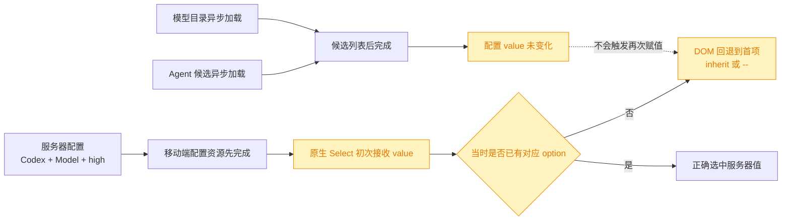
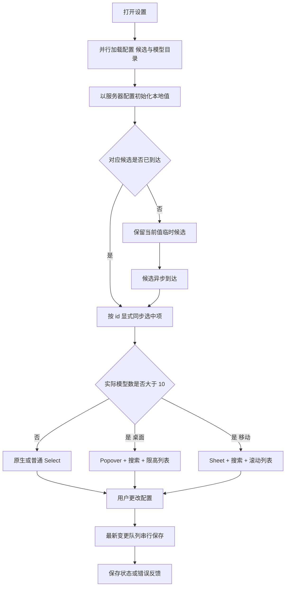
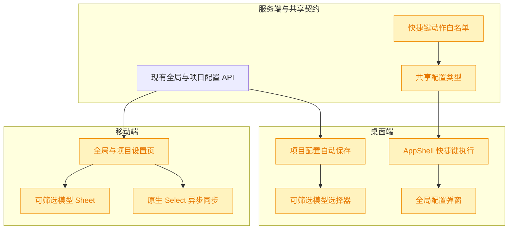

# Agent 设置体验优化

## 1. 背景

`@.yorz/specs/261022.feat.agent-model-reasoning-settings/spec.md` 已实现 Agent、模型与推理强度的服务端配置、运行时解析，以及桌面端和移动端三级联设置。现有能力可用，但设置入口、保存方式、长列表可用性和移动端异步回显仍有明显割裂，需要在不改变既有配置语义的前提下统一体验。

本次类型为 `refct`，原始需求包括：

- 添加打开全局配置的快捷键 `Ctrl+Shift+G`。
- 桌面端项目配置移除保存/取消按钮，像全局配置一样自动保存。
- 模型数量超过 10 个时允许筛选，并约束列表边界；桌面端与移动端都要适配。
- 修复移动端 Agent 设置未按服务器配置回显的问题。例如项目配置为 Codex、指定模型、`high` 时，界面不应显示“跟随系统、--、--”。

## 2. 需求

- 桌面端快捷键系统新增“全局配置”动作，默认绑定 `Ctrl+Shift+G`，可在全局配置中录制、重置并参与冲突校验。
- 桌面端项目配置中的 Agent、模型、推理强度在选择后立即保存；spec 目录在编辑提交时自动保存；弹窗不再展示保存和取消按钮，并反馈保存中、已保存和错误状态。
- 当实际模型候选数超过 10 个时，桌面端和移动端使用可筛选且有最大高度的选择面板；候选不超过 10 个时保留轻量选择交互。
- 筛选同时匹配模型显示名与 id，大小写不敏感；空值 `--` 始终可选；长名称保持单行省略，空结果有明确提示。
- 移动端全局和项目 Agent 三级联在配置、Agent 列表、模型目录异步到达的任意顺序下，最终都必须准确回显服务器值。
- 所有新增可见文案分别写入桌面端 `@src/gui/src/i18n/` 与移动端 `@src/gui-mobile/src/i18n/`，两端不得互相直引 UI 源码。

## 3. 现状分析

桌面端已有完整的可配置快捷键链路：服务端白名单保存动作绑定，`AppShell` 单点监听键盘事件，全局配置弹窗负责录制和冲突检查；当前动作集合只有新建 spec、页面最大化和项目设置，因此增加全局配置入口只需沿现有链路扩展一个动作。

桌面端全局配置已经使用 `createLatestMutationQueue` 串行执行整体 PUT，并以内联状态提示自动保存；项目配置仍把三个 Agent Select 和 spec 目录放在表单中，只在点击保存后一次性 PUT 并关闭弹窗。项目 API 是整体覆写语义且每次保存会 reload 项目实例，因此自动保存不能并发发送旧快照，必须复用最新变更队列并在重新打开前等待队列落盘。

两端目前都把模型候选完整交给普通 Select。OpenCode 可返回约 90 个模型：桌面 Kobalte Select 的浮层没有筛选和明确高度约束，移动端原生 Select 也无法提供一致的长列表检索体验。仓库已有两种成熟交互：桌面 Git 分支选择使用 Popover、Input 和限高列表；移动端 Git 分支选择使用 Sheet、搜索输入和可滚动列表，可以复用其交互范式而不新增组件依赖。

移动端错误回显不是服务端配置丢失，而是异步候选与原生受控 Select 的同步时序问题：项目配置先返回 `codex` 时，Agent 候选可能只有首项 `inherit`；浏览器会把 DOM 选中项回退到首项。稍后 Agent 或模型候选补齐，但绑定的配置值本身没有变化，Solid 不会再次写入同一个 `value`，于是界面持续显示首项。模型和推理强度也会在目录晚于配置返回时出现同类问题。

精确层：当前实现依据

- 快捷键：`src/gui/src/lib/shortcuts.ts` 定义三项动作和默认值；`src/gui/src/AppShell.tsx` 执行动作；`src/service/global-config.ts` 与 `src/service/routes/global-config.ts` 负责动作白名单和持久化。
- 自动保存参照：`src/gui/src/components/GlobalConfigDialog.tsx` 已使用 `createLatestMutationQueue`、`saving/saved` 状态和关闭重开竞态保护；`src/gui/src/components/ProjectConfigDialog.tsx` 仍使用 form、`DialogFooter`、保存/取消按钮和单次 `submit()`。
- 模型选择：桌面 `src/gui/src/components/SettingsSelect.tsx` 包装 Kobalte Select；移动端 `src/gui-mobile/src/components/SettingsControls.tsx` 使用原生 `<select>`，两者都没有长列表筛选。
- 可复用范式：桌面 `src/gui/src/components/GitPanel.tsx` 已实现 Popover 内搜索与限高滚动；移动端同名组件配合 `src/gui-mobile/src/components/Sheet.tsx` 实现触屏友好的筛选面板。
- 移动端配置页：`GlobalSettings.tsx` 与 `ProjectSettings.tsx` 的配置、Agent roster、模型目录是互相独立的异步 resource；其中 ProjectSettings 的初始 Agent 候选只有 `inherit`，能稳定触发错误回显。

## 4. 技术实现方案

### 4.1 扩展全局配置快捷键

在服务端、共享 API 类型和桌面端快捷键模块中新增稳定动作 id `globalSettings`，默认值为 `Ctrl+Shift+G`。该动作进入现有动作数组、默认绑定、归一化、冲突检测、PUT 白名单与双语标签，不另建第二套快捷键机制；旧配置缺少该字段时自动使用默认值。

`AppShell` 命中动作后切换 `GlobalConfigDialog` 的打开状态。它与项目设置、页面最大化同属 toggle 动作，即使焦点位于输入框也应可打开或关闭；录制模式仍由捕获阶段监听优先消费事件，避免同时触发实际动作。E2E 覆盖默认快捷键打开、再次按下关闭，以及自定义绑定/冲突行为没有回归。

### 4.2 项目配置改为自动保存

把 `ProjectConfigDialog` 从提交式表单改成持续编辑面板，复用全局配置的串行保存模型：Agent、模型或推理强度变化时先更新本地信号，再将当时完整的 `{ agent, specsDir }` 快照排入 `createLatestMutationQueue`。队列保证整体覆写请求按用户操作顺序落盘，只有最新 revision 可以更新保存状态或错误，避免快速级联选择时旧响应覆盖新值。

Agent 改变时仍清空模型和推理强度，模型改变时仍清空推理强度，并把清空后的完整状态作为同一轮保存快照。spec 目录属于文本输入，不在每个按键上触发项目 reload；改为在失焦或按 Enter 时校验并提交，空值归一为默认目录，包含 `..` 时仅显示本地错误且不写服务端。目录成功变化后保留“旧 spec 需手工迁移”的现有提示语义。

弹窗移除 `DialogFooter`、保存和取消按钮，通过弹窗关闭按钮、遮罩或 `Escape` 退出；标题区显示“保存中/已保存”，错误继续内联展示。关闭后队列继续完成，重新打开时先等待队列空闲再 GET，并用请求序号丢弃过期响应，避免刚关闭重开读到旧配置。

### 4.3 超过 10 个模型时启用筛选

两端的设置选择组件新增显式的可筛选模式，只由模型字段在 `catalog.models.length > 10` 时启用，Agent 与推理强度不因总 option 数误触发。过滤规则抽成各端平台无关的小函数或 memo：对 trim 后查询执行 `label` 与 `value` 的大小写不敏感包含匹配；查询为空时展示全部候选，`--` 空值项固定保留在顶部。

桌面端使用现有 shadcn-solid 风格的 Popover、Input、Button 组合实现可搜索选择器。触发器沿用当前尺寸和单行省略；面板宽度不超过视口，候选区设最大高度并独立滚动，点击候选后回调并关闭，当前项显示选中标记。这里不把输入框嵌进 Kobalte Select：仓库已有注释确认 Select 内输入会因键盘交互关闭，Popover 更符合现有稳定实现。

移动端在长列表模式下使用通用 Sheet：设置行变成打开 Sheet 的 44px 触控按钮，Sheet 顶部提供搜索框，下方显示可滚动候选和当前项标记；选择后立即回调并关闭。候选不超过 10 个时继续使用原生 Select，保持系统级轻量交互。

### 4.4 修复移动端异步配置回显

移动端原生选择路径增加显式 DOM 同步：组件 effect 同时依赖当前值和候选值集合，在目标 option 出现后重新设置 select 的 `value`。同时，配置值暂时不在异步 roster 中时补入一个临时候选，避免加载阶段错误显示 `inherit` 或空项；正式候选到达后以相同 id 的描述替换临时标签。

长列表 Sheet 路径不依赖原生 Select 的隐式选中状态，触发器始终从“配置值 + 最新候选”派生当前标签。全局和项目页面都保留“已保存但当前目录暂未返回该项”的兜底 option，因此 Agent、模型或推理强度目录失败时也不会把已存配置误画成 `--`。

### 4.5 兼容性、测试与影响范围

本次不改变 Agent 配置字段、模型目录接口或运行时解析语义。新增快捷键字段仍是可选覆盖；项目自动保存继续调用现有整体 PUT；筛选与移动端同步仅改变 UI。兼容性重点是保证旧全局配置能得到 `Ctrl+Shift+G` 默认值、目录加载失败时保留已存选择、快速切换不会回写旧快照，以及项目弹窗关闭重开不会读到队列之前的状态。

自动验证分为三层：快捷键单测和服务端配置/路由测试覆盖新增动作、默认值、归一化与冲突；选择器纯逻辑或组件测试覆盖阈值、label/id 筛选、空值、异步 option 回填；Playwright 同时覆盖桌面全局快捷键、桌面项目自动保存、超过 10 项的桌面/移动筛选，以及移动项目配置预置为 Codex/模型/high 后的准确回显。最后运行 `pnpm typecheck`、相关 Vitest、两端 build 和目标 E2E。

精确层：预计实现落点与验收重点

- 快捷键服务端与契约：`src/service/global-config.ts`、`src/service/routes/global-config.ts`、`src/gui-shared/api/index.ts`；新增 `globalSettings`，旧配置与缺省字段测试继续通过。
- 快捷键桌面端：`src/gui/src/lib/shortcuts.ts`、`src/gui/src/AppShell.tsx`、`src/gui/src/components/GlobalConfigDialog.tsx`、桌面中英文 i18n、`shortcuts.test.ts` 与 `shortcut-config.spec.ts`。
- 项目自动保存：`src/gui/src/components/ProjectConfigDialog.tsx` 与 `ProjectsSidebar.tsx`；复用 `@shared/lib/latest-mutation-queue.js`，删除 footer/save/cancel 路径，保留目录校验与迁移提示。
- 桌面长列表：扩展 `src/gui/src/components/SettingsSelect.tsx` 或拆出同目录可筛选组件，复用 `ui/popover.tsx`、`ui/input.tsx`、`ui/button.tsx`，新增筛选和空结果双语文案。
- 移动长列表与同步：`src/gui-mobile/src/components/SettingsControls.tsx`、`GlobalSettings.tsx`、`ProjectSettings.tsx`、移动端中英文 i18n；复用 `Sheet.tsx`，不得导入桌面端组件。
- E2E 通过路由拦截构造 11 个以上模型，避免依赖开发机实际 OpenCode provider；移动回显用项目配置 API 预置确定值后访问 `/m/settings/project` 验证。
- 完整验收：快速连续切换最终仅最新值落盘；目录输入失焦/Enter 自动保存；筛选面板不越界且长模型名省略；移动端在配置先到和候选先到两种顺序下都回显正确。

## 5. 待确认项

_暂无_

## 6. 任务清单

- [x] 扩展全局快捷键配置与桌面执行链路，新增 `globalSettings`/`Ctrl+Shift+G`、录制标签和冲突校验（验收：服务端配置测试、快捷键单测与默认打开/关闭 E2E 通过）
- [x] 将桌面项目配置改为串行自动保存，移除保存/取消按钮并保留目录校验、迁移提示和关闭重开竞态保护（验收：Agent 级联与目录提交无需按钮即可落盘，快速切换以最新值为准）
- [x] 为桌面模型选择实现超过 10 项启用的 Popover 筛选模式，支持 label/id 匹配、空值、空结果、限高滚动和长名称省略（验收：普通列表行为不变，构造 11 项以上候选可筛选并选择）
- [x] 为移动端模型选择实现超过 10 项启用的 Sheet 筛选模式，并修复配置值与异步候选到达顺序造成的原生 Select 错误回显（验收：全局/项目设置均准确回显服务器值，长列表可筛选选择）
- [x] 补充自动化验证并执行相关 Vitest、`pnpm typecheck`、桌面/移动构建和目标 Playwright E2E（验收：命令全部退出码 0，或记录不可执行的客观原因）

## 7. 执行记录

- 2026-10-23 13:33:42：新建 spec，完成现状分析、技术实现方案、图形化补充与待确认项自检；本阶段未修改产品代码。
- 2026-10-23 13:46:26：按自动模式进入 tasks，生成五项可执行任务；无待确认项，继续进入 execute。
- 2026-10-23 13:47:41：扩展服务端、共享类型与桌面快捷键动作，新增 `globalSettings` 默认绑定 `Ctrl+Shift+G`、双语标签和 AppShell toggle 执行；快捷键、全局配置及 service 测试共 60 项通过，E2E 用例已补充待统一运行。
- 2026-10-23 13:54:07：桌面项目配置改为最新变更队列串行自动保存，Agent 级联立即落盘，目录在失焦/Enter 时校验提交；移除保存/取消 footer，增加保存状态、目录迁移提示及关闭重开竞态保护。类型检查、桌面构建和目标 E2E 通过。
- 2026-10-23 13:54:07：桌面模型候选超过 10 项时切换为 Popover 搜索面板，支持 label/id 筛选、固定空值、空结果、限高滚动和省略展示；12 项模拟目录 E2E 已验证筛选选择与自动保存。
- 2026-10-23 13:54:07：移动设置控件增加原生 Select 异步候选重同步和当前值临时候选，长模型列表使用可搜索 Sheet；移动项目配置预置 Codex/fake-model-11/high、延迟返回 roster/catalog 的 E2E 准确回显并成功筛选切换模型。移动构建通过。
- 2026-10-23 13:56:44：补齐 Agent 设置 E2E，并为隔离的 Playwright 环境写入固定配对令牌与 storage/header，保持生产鉴权不变。最终验证通过：相关 Vitest 4 文件 63 项、`pnpm typecheck`、桌面与移动构建、快捷键和 Agent 设置 Playwright 4 项、`git diff --check`。
- 2026-10-23 13:56:44：全部非人工任务完成，无待确认项、批注或开放追加任务，spec 标记为 done。
