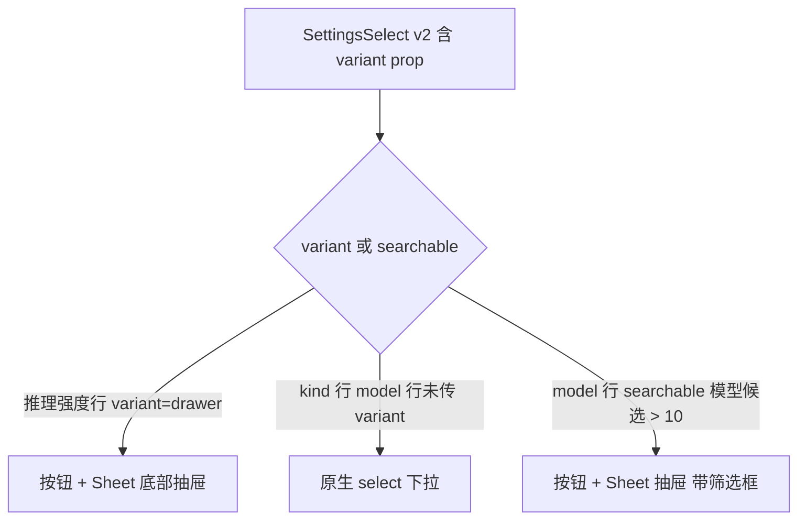
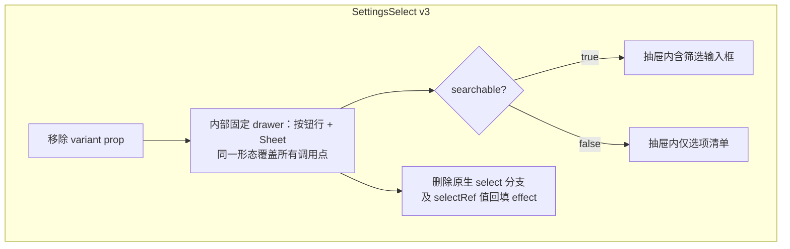
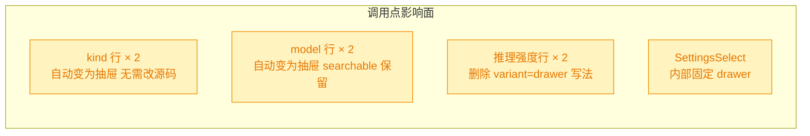

# 移动端推理强度设置统一为底部抽屉

## 1. 背景

261022.feat.agent-model-reasoning-settings 已在移动端全局设置（`@src/gui-mobile/src/pages/settings/GlobalSettings.tsx`）与项目设置（`@src/gui-mobile/src/pages/settings/ProjectSettings.tsx`）补齐 Agent 模型/推理强度级联选择。当前推理强度一行复用了通用 `SettingsSelect` 控件，其表现按 `searchable` 分叉：选项多时按钮 + 底部抽屉（Sheet），选项少时直接渲染原生 `<select>`。用户要求把推理强度设置统一为抽屉 UI，从底部弹出。

## 2. 需求

移动端中 agent model 的推理强度设置，统一为抽屉 UI 组件，从底部弹出来。

## 3. 现状分析

**第 2 轮重开时的基线**（第 1 轮已把推理强度行抽屉化）：

现状精确细节

- `src/gui-mobile/src/components/SettingsControls.tsx` 的 `SettingsSelect`：第 1 轮新增了 `variant?: 'native' | 'drawer'` 可选 prop（未传时按 `searchable` 取缺省）；原生 `select` 分支及配套的 `selectRef` 值回填 `createEffect` 仍在。
- `SettingsSelect` 仅被全局 / 项目两个设置页引用，共 6 行：kind × 2、model × 2、推理强度 × 2。
- kind 行、model 行（模型候选 ≤ 10 时）仍走原生 select，与推理强度行的抽屉并存，交互未统一。
- model 行的 `searchable={(catalog()?.models.length ?? 0) > 10}` 决定抽屉内是否渲染筛选框，该语义应保留。

## 4. 技术实现方案

需求升级为「三行总是抽屉」，`variant` 过渡 API 失去存在意义，改为组件内部固定 drawer：

- **`SettingsControls.tsx`**：删除 `variant` prop 与 `props.variant` 判定；`SettingsSelect` 内部固定为「按钮行 + 底部 Sheet」单一形态；`searchable` 语义收敛为「抽屉内是否渲染筛选输入框」；一并删除原生 `<select>` 标签、`selectRef` 与其值回填 `createEffect`（drawer 模式下按钮行显示 `selected()?.label ?? value()`，选项晚到/值缺失时回显原始值，无需回填 DOM）。
- **`GlobalSettings.tsx` / `ProjectSettings.tsx`**：kind / model 行不改源码、自动随组件变为抽屉；推理强度行删除 `variant="drawer"`（prop 已不存在）；model 行 `searchable` 表达式原样保留。
- **兼容性**：非 breaking，纯移动端 UI 层；配置读写语义、disabled 语义零改动。

**决策说明**

- **删除 `variant` 而非保留为可选 API**：需求设定「总是 drawer」且 `SettingsSelect` 无其它调用点，保留过渡 prop 只会产生默认即 drawer 的死代码。被否决备选：保留 prop 以便未来回退——现状无该诉求，YAGNI。
- **model 行保留 `searchable > 10`**：候选超一屏时筛选仍必要；候选少时抽屉内直接列清单比筛选用更低摩擦。被否决备选：model 行也传 searchable 常开——短列表多一次无谓输入框。

## 5. 待确认项

_暂无_

## 6. 任务清单

- [x] `SettingsControls.tsx` 的 `SettingsSelect` 增加 `variant` prop：drawer 模式在无 `searchable` 时也渲染按钮行 + 底部 Sheet，仅 `searchable` 时渲染筛选框（验收：typecheck 通过，既有 kind/model 行缺省行为不变）
- [x] `GlobalSettings.tsx` 推理强度行传入 `variant="drawer"`（验收：grep 确认，typecheck 通过）
- [x] `ProjectSettings.tsx` 推理强度行传入 `variant="drawer"`，inherit 折叠时仍 disabled（验收：grep 确认，typecheck 通过）
- [x] 运行 `pnpm typecheck` 验证整体类型（验收：命令退出码 0）
- [x] `SettingsControls.tsx` 移除 `variant` prop 并内部固定 drawer：删除原生 select 分支、`selectRef` 及其值回填 effect，`searchable` 仅决定是否渲染筛选框（验收：grep 无 variant 残留，typecheck 通过）
- [x] `GlobalSettings.tsx` / `ProjectSettings.tsx` 推理强度行删除 `variant="drawer"` 写法（验收：grep 无 variant 残留，typecheck 通过）
- [x] 运行 `pnpm typecheck` 验证整体类型（验收：命令退出码 0）

## 7. 执行记录

- 2026-10-23：`SettingsControls.tsx` 的 `SettingsSelect` 新增可选 `variant?: 'native' | 'drawer'` prop（缺省仍按 `searchable` 分叉，既有 kind/model 行零行为变化）；抽屉分支在无 `searchable` 时仅渲染选项清单、不渲染筛选框。
- 2026-10-23：`GlobalSettings.tsx` 与 `ProjectSettings.tsx` 的推理强度行传入 `variant="drawer"`，两页推理强度统一为底部抽屉；项目页 `inherit` 时的 disabled 语义保留（disabled props 原样）。
- 2026-10-23：验证 `pnpm typecheck`（tsc -b）退出码 0；改动文件过 prettier 无 diff。
- 2026-10-23：收尾——任务全部完成、无待确认项、无批注，标记 done。
- 2026-10-23（第 2 轮重开）：`SettingsSelect` 移除 `variant` prop，内部固定为「按钮行 + Sheet」单一抽屉形态；一并删除原生 `<select>` 分支、`selectRef` 及值回填 `createEffect`，未用的 `createEffect` import 同步清理；`searchable` 语义收敛为抽屉内筛选框开关。
- 2026-10-23（第 2 轮重开）：`GlobalSettings.tsx` / `ProjectSettings.tsx` 的推理强度行删除 `variant="drawer"`；kind / model 行不改源码，随组件固定 drawer 统一交互；model 行 `searchable={models > 10}` 原样保留。
- 2026-10-23（第 2 轮重开）：验证——grep 全部改动文件无 `variant` 残留；`pnpm typecheck`（tsc -b）退出码 0。
- 2026-10-23（第 2 轮重开）：收尾——第 2 轮任务全部完成、无待确认项、无批注，再次标记 done。
