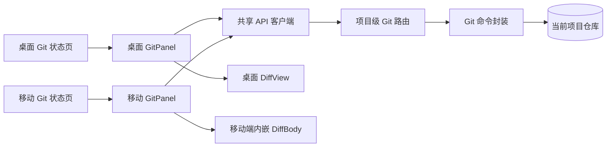
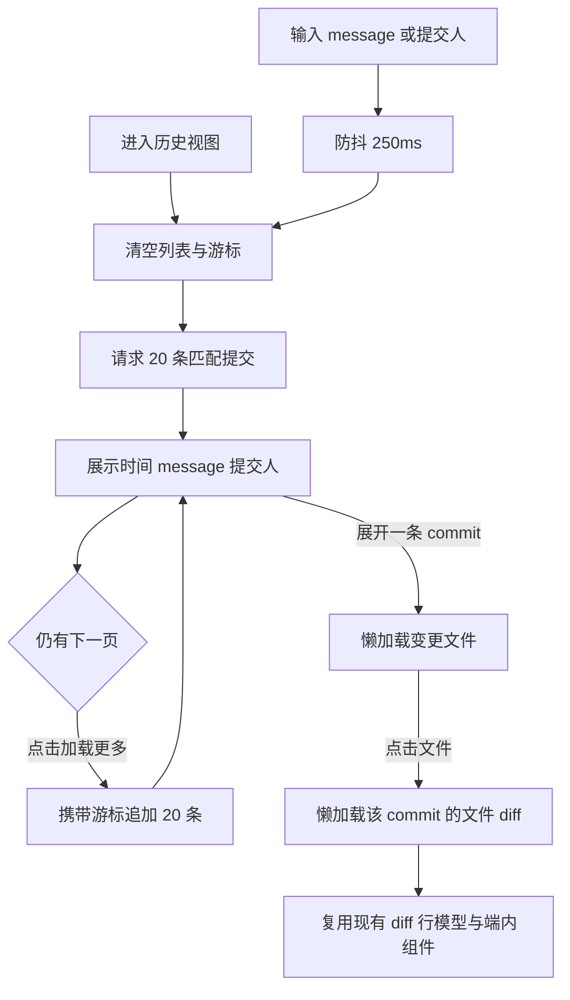
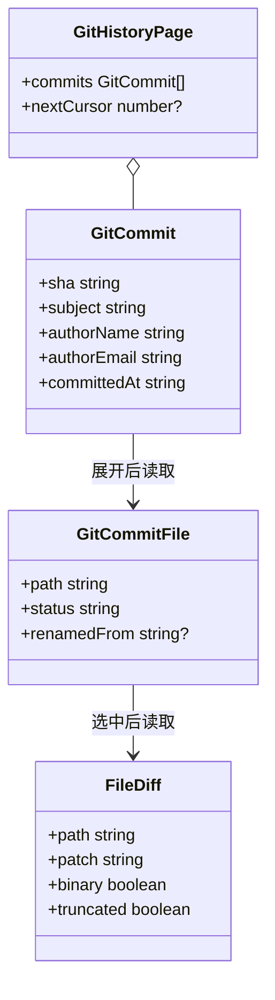
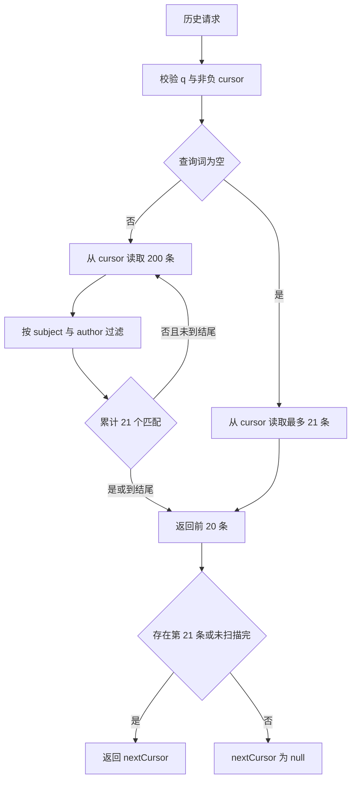
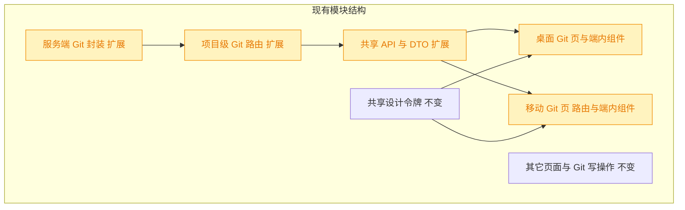

# 261030.feat.git-commit-history

## 1. 背景

当前桌面端与移动端 Git 页面只覆盖工作区状态、提交、分支及远端操作，无法在 YorZ 内查看当前仓库的历史提交。用户希望保留现有“状态”能力，并新增适配两端的历史提交浏览入口。

## 2. 需求

- 历史提交列表提供输入框，按提交 message、提交人模糊匹配。
- 每条记录展示相对时间（time ago）、message、提交人。
- 首次展示 20 条，点击列表底部“加载更多”后每次再加载 20 条。
- 提交项可展开查看该 commit 的变更文件，并可复用现有 Git 文件列表与 diff 能力查看文件差异。
- 桌面端：`@src/gui/src/pages/GitStatus.tsx` 引入 tab 组件；面包屑标题由“Git 状态”改为“Git”；默认“状态”tab 保留当前页面内容，新增“历史”tab。
- 移动端：`@src/gui-mobile/src/pages/ext/GitStatus.tsx` 的右上角菜单新增“历史”；历史页按现有变更列表、diff 交互做移动端适配；状态页保持不变。
- 两端新增可见文案分别写入各自的 i18n 配置，禁止互相直引前端源码。

## 3. 现状分析

### 3.1 现有 Git 能力链路

桌面端与移动端是两个独立 Solid 应用，但共同调用 `@shared/api` 中的项目级 Git API。服务端目前只提供工作区变更、工作区文件 diff、分支与仓库操作；“历史提交 → 某次提交的文件 → 某文件在该提交中的 diff”整条只读链路尚不存在。

精确层：现有实现位置与可复用点

- `src/service/git.ts` 已有统一的 `runGit` / `runGitRaw`、安全相对路径校验、patch 二进制识别与 512KB / 3000 行截断逻辑，但只实现 `listChanges()` 与基于工作区的 `fileDiff()`。
- `src/service/routes/git.ts` 已集中承载 `/git/changes`、`/git/diff`、分支、提交、丢弃、推拉与合并接口，可继续增加只读历史接口并复用 `GitError → 400` 的处理。
- `src/gui-shared/api/index.ts` 是两端共同的 DTO 与 API 客户端；桌面端 `src/gui/src/lib/api.ts` 只是兼容转发层。
- `src/gui/src/components/GitPanel.tsx` 的文件列表仍内嵌在面板中，diff 已抽成 `src/gui/src/components/DiffView.tsx`。
- `src/gui-mobile/src/components/GitPanel.tsx` 同时内嵌文件列表与 `DiffBody`；右上角 `MoreHorizontal` 已打开 `ActionSheet`，菜单现含推送、拉取、合并，适合按入口 props 注入“历史”。
- `src/gui-shared/lib/diff-view.ts` 已共享 unified diff 解析与高亮行模型，可继续作为两端 commit diff 的底层。
- 两端已依赖 `timeago.js`，且已有中英文 locale 注册范式，无需引入新依赖。

### 3.2 需求缺口

| 需求点      | 当前状态                | 需要补齐                                              |
| ----------- | ----------------------- | ----------------------------------------------------- |
| 提交记录    | 无历史查询 API 与 UI    | 当前 `HEAD` 可达提交的分页列表                        |
| 模糊匹配    | 无                      | 服务端对可见 message 与提交人做不区分大小写的包含匹配 |
| 每批 20 条  | 无                      | 固定页大小与“加载更多”游标                            |
| 展开提交    | 只会列工作区文件        | 按 commit 懒加载文件列表                              |
| commit diff | 只会比较工作区与 `HEAD` | 指定 commit 与其父提交（根提交为空树）的文件 diff     |
| 桌面入口    | 单一 Git 状态页         | 无障碍 Tabs，默认状态、历史次级                       |
| 移动入口    | 右上角已有更多菜单      | 仅扩展 Git 页增加历史入口与独立历史二级页             |

### 3.3 约束与边界

- 历史范围跟随当前检出的 `HEAD`，不混入其它本地或远端分支；切换分支后重新进入历史即读取新分支。
- 列表 message 使用 commit subject，搜索也匹配 subject，避免命中界面不可见的正文后让用户困惑。
- 提交人展示 author name；匹配 author name 与 author email，兼顾常见姓名和邮箱检索。
- 本需求是只读历史浏览，不包含 checkout commit、reset、revert、cherry-pick 或提交详情编辑。
- 两端只共享 DTO、API 与纯逻辑；页面组件各自实现，禁止跨端直引源码。

### 3.4 追加样式调整现状

追加任务中点名的 `section` 容器仅存在于桌面端 `GitHistoryPanel`：当前由外层容器统一承担 `rounded-xl border bg-card p-2`，内层历史记录列表只有圆角与边框。移动端历史页不存在该 `section` 或同组 class，因此本轮不改动移动端布局。

## 4. 技术实现方案

### 4.1 总体交互与数据流

历史页首次按固定 20 条读取。输入停止后以 250ms 防抖发起新搜索并清空旧列表；“加载更多”携带服务端返回的扫描游标追加下一批。展开 commit 时才读取文件，选择文件时才读取 diff，避免为未查看的提交提前执行 Git 命令。

### 4.2 共享数据模型与 API

`src/gui-shared/api/index.ts` 增加上述前三个 DTO，并增加 `getGitHistory(pid, query, cursor)`、`getGitCommitFiles(pid, sha)`、`getGitCommitFileDiff(pid, sha, path)`。两端只通过共享 API 调用，不复制请求拼装逻辑。

### 4.3 服务端历史读取

在现有项目级 Git 路由下新增三个只读接口：

| 方法 | 路径                                              | 输入                           | 输出                             |
| ---- | ------------------------------------------------- | ------------------------------ | -------------------------------- |
| GET  | `/api/projects/:projectId/git/history`            | query `q`、可选 `cursor`       | `GitHistoryPage`，固定最多 20 条 |
| GET  | `/api/projects/:projectId/git/history/:sha/files` | 40 位 commit SHA               | `{ files: GitCommitFile[] }`     |
| GET  | `/api/projects/:projectId/git/history/:sha/diff`  | 40 位 commit SHA、query `path` | 复用 `FileDiff`                  |

历史搜索按时间倒序扫描当前 `HEAD`：无查询时直接读取游标后的 21 条以判断是否还有下一页；有查询时按 200 条为一个受控批次扫描，对 `subject + authorName + authorEmail` 做 `toLocaleLowerCase()` 包含匹配，收集 21 个匹配项后停止。响应只返回前 20 条，并把“已扫描的原始提交数”作为 `nextCursor`；没有更多记录时返回 `null`。这样既保证每次展示 20 条，又避免一次性把大型仓库全部历史读入内存。

精确层：Git 命令与解析策略

- 历史批次：`git log HEAD --date=iso-strict --format=... --skip=<cursor> --max-count=<batch>`；使用 NUL 字段分隔解析 `sha / committedAt / authorName / authorEmail / subject`，避免空格、中文或换行破坏记录。
- 提交文件：`git diff-tree --root --no-commit-id --name-status -r -z -M <sha>`；解析普通增删改及 rename 的旧、新路径，统一映射为 `GitCommitFile`。
- commit diff：`git show --format= --find-renames <sha> -- <path>`；根提交由 `git show` 自然与空树比较。二进制判断与 patch 截断抽成内部公共函数，工作区 diff 与 commit diff 共用。
- `sha` 只接受 `/^[0-9a-f]{40}$/i`，`path` 继续通过 `assertSafeRelativePath()`；所有命令使用 `execFile` 参数数组，不拼 shell 字符串。
- 游标是本次查询下的原始扫描位置；客户端追加时按 SHA 去重，以容忍分页期间仓库新增提交造成的少量位置漂移。

### 4.4 桌面端方案

- 新增 `src/gui/src/components/ui/tabs.tsx`，基于现有 `@kobalte/core` Tabs 封装项目统一样式与键盘/ARIA 行为。
- `src/gui/src/pages/GitStatus.tsx` 将面包屑末级标题改为 i18n 文案“Git”，默认 tab 为“状态”；状态内容继续渲染原 `GitPanel`，并强制保留挂载，切换 tab 不丢失已勾选文件或尚未提交的 message。
- 新增 `src/gui/src/components/GitHistoryPanel.tsx`：搜索框、提交列表、相对时间、展开文件、加载/空/失败状态及“加载更多”。每次只展开一个 commit，展开另一个时清理旧 active file/diff，避免右侧展示与提交不一致。
- 从当前 `GitPanel` 抽取端内 `GitFileList` 行组件，让状态列表保留 checkbox 模式、历史列表使用只读模式；两者继续使用 `statusTone()`。
- 历史文件被选中后在右侧直接复用现有 `DiffView`；未选文件时列表占满可用宽度。
- 使用现有 `timeago.js` 中英文 locale 范式，将服务端 ISO 时间渲染为相对时间。
- 追加样式调整：从历史区域外层 `section` 移除 `rounded-xl border bg-card p-2`，保留其 flex/尺寸/间距布局类；将 `bg-card` 加到内层可滚动的历史记录列表容器，让搜索框和“加载更多”按钮不再被整体卡片背景包裹。

### 4.5 移动端方案

- 为 `src/gui-mobile/src/components/GitPanel.tsx` 增加可选 `onOpenHistory`；只有扩展页 `GitStatus` 传入，因此右上角 ActionSheet 新增“历史”，spec 作用域 Git 页不出现该入口，其余状态页交互不变。
- 新增路由 `/ext/git/history` 与页面 `src/gui-mobile/src/pages/ext/GitHistory.tsx`，返回动作固定回 `/ext/git`，不使用 `history.back()`。
- 历史页沿用 `Page fill`：提交列表独立 `.scroll-y`；展开后提交/文件区限制上半屏高度，diff 使用下半屏独立滚动，保持与当前 Git 状态页“列表在上、diff 在下”的操作口径。
- 抽取移动端端内 `GitFileList` 与 `DiffView`，现有状态页和历史页复用；仍以 `@shared/lib/diff-view` 解析/高亮，不直引桌面端组件。
- 搜索框使用 16px 字号避免 iOS 自动缩放；加载更多使用整行触控按钮并覆盖 loading / no-more 状态。

### 4.6 加载、竞态与错误处理

- 搜索序列号或 AbortController 只允许最新 query 回写；旧搜索晚返回时丢弃。
- 加载更多期间禁用按钮；同一 cursor 不重复请求，追加前按 SHA 去重。
- commit 文件与 diff resource 的 key 均包含 SHA；快速切换展开项/文件时，旧响应不能覆盖新选择。
- 文件列表与 diff 错误局部展示，不清空已加载的提交列表；重试通过再次展开或再次选择触发。
- 空仓库、无匹配结果、commit 无文件、二进制 diff、diff 截断均提供两端独立 i18n 文案。

### 4.7 兼容性与影响范围

新增接口均为只读且不改现有响应，现有 Git 状态操作保持兼容。受影响区域集中在项目级 Git 路由、共享 API，以及两端各自的 Git 页面/端内组件；没有跨端源码依赖，也不改变 `/` 与 `/m/` 挂载关系。

### 4.8 验证方案

- `src/service/__tests__/git.test.ts`：历史倒序、固定 20 条、游标续页、message/author 匹配、rename/root commit 文件解析、普通/二进制/截断 commit diff、非法 SHA/path。
- `src/service/__tests__/git-routes.test.ts`：三个接口的成功、空态、分页/过滤与 400/404 路径。
- 前端纯逻辑若抽出防抖外的分页合并/去重 helper，则在 `src/gui-shared` 增加单测；UI 以类型检查和两端构建保证独立工程边界。
- 执行相关 Vitest、`pnpm typecheck`、`pnpm build:gui`、`pnpm build:gui-mobile`，并对改动文件执行 Prettier。

> 决策说明：历史只读取当前 `HEAD`，而不是 `--all`。理由：页面已有明确当前分支上下文，混入其它分支会让时间线和“当前 commit 的变更”语义变得不确定；用户可先切换分支再看对应历史。

> 决策说明：搜索在服务端执行，而不是只过滤浏览器已加载的 20 条。理由：客户端局部过滤会漏掉尚未加载的匹配提交，不符合“模糊匹配列表内容”的完整预期。

> 决策说明：分页使用服务端扫描游标而不是总数 + 页码。理由：过滤搜索需要逐批扫描 Git 历史，游标可以接着上次位置继续并避免为计算总数完整遍历仓库；UI 只需要知道是否还能“加载更多”。

> 决策说明：移动端采用独立 `/ext/git/history` 二级路由，而不是在状态页内增加 tab。理由：用户明确要求从右上角菜单进入；独立页还能保持状态页组件与底部提交操作栏不变，并符合移动端现有显式返回约定。

> 决策说明：本轮只调整桌面端历史容器的 class 分工，不改标签结构、交互逻辑或移动端。理由：用户指定的 `section` 及完整样式组合与桌面端实现精确对应，移动端无同等结构。

## 5. 待确认项

_暂无_

## 6. 任务清单

- [x] 在 `src/service/git.ts` 实现当前 HEAD 历史分页/搜索、commit 文件列表与 commit 文件 diff（验收：固定 20 条游标分页，message/author 匹配，rename/root/binary/截断与非法输入有测试）
- [x] 在 `src/service/routes/git.ts` 增加三个项目级只读历史接口与参数校验（验收：路由测试覆盖成功、空态、分页过滤及 400/404）
- [x] 在 `src/gui-shared/api/index.ts` 增加历史 DTO 与三项 API 方法（验收：桌面端和移动端均只通过共享客户端调用且类型检查通过）
- [x] 为桌面端新增 Kobalte Tabs 封装并改造 `GitStatus` 为默认“状态”与“历史”双 tab（验收：面包屑显示“Git”，状态 tab 保持挂载，键盘/ARIA 由 Tabs 组件提供）
- [x] 实现桌面端 `GitHistoryPanel`，复用端内文件列表与 `DiffView`（验收：搜索、20 条加载更多、time ago、单 commit 展开、文件选择和 diff 状态可用）
- [x] 为移动端 Git 状态页右上角菜单注入“历史”入口并注册独立历史路由（验收：仅扩展 Git 页出现入口，状态页其余行为与 spec Git 页不变）
- [x] 实现移动端历史页面并复用端内文件列表/diff（验收：列表与 diff 分区独立滚动，搜索、分页、展开和相对时间适配窄屏）
- [x] 在桌面端与移动端各自 i18n 中补齐所有历史可见文案（验收：新增 UI 无硬编码用户文案，中英文词典同构）
- [x] 格式化并执行服务端相关测试、`pnpm typecheck` 与两端构建（验收：全部通过；若环境失败则在执行记录写明原因）
- [x] 调整桌面端 `GitHistoryPanel` 的容器样式层级（验收：外层 `section` 不再含 `rounded-xl border bg-card p-2`，历史记录列表容器含 `bg-card`，格式化、桌面端类型检查与 `git diff --check` 通过）

## 7. 追加任务

- [fixed] [refct] 2026-10-30 19:50:32 | 去掉 “历史” 页面中 section 容器的 rounded-xl border bg-card p-2 样式；
  - 描述：去掉 “历史” 页面中 section 容器的 rounded-xl border bg-card p-2 样式；
    历史记录列表容器元素增加 bg-card 样式

## 8. 执行记录

- 2026-10-30 19:28:33：新建 spec，进入 plan 阶段。
- 2026-10-30 19:29:27：完成现有代码、API、两端页面结构与移动端约定分析；完成技术实现方案、图形化补充及待确认项自检，当前无待确认项。
- 2026-10-30 19:30:24：完成 tasks 阶段拆解；待确认项为空，按规则进入 execute。
- 2026-10-30 19:37:28：完成服务端历史能力与共享 API：新增固定 20 条游标分页、message/author 搜索、commit 文件列表及按首父提交计算的文件 diff；覆盖根提交、rename、merge、二进制、截断与非法参数。
- 2026-10-30 19:37:28：完成桌面端：新增 Kobalte Tabs 封装、默认“状态”与“历史”双 tab、历史搜索/分页/展开，以及可复用文件列表和现有 DiffView 接入。
- 2026-10-30 19:37:28：完成移动端：扩展 Git 页右上角菜单新增“历史”，注册独立历史路由，抽取并复用移动端文件列表与 diff 组件，保持状态页原有操作链路。
- 2026-10-30 19:37:28：完成两端独立 i18n 文案；`pnpm typecheck`、桌面端构建与移动端 PWA 构建已通过，正在执行完整相关 Git 测试。
- 2026-10-30 19:39:15：最终验证通过：服务端相关 Vitest 2 个文件共 61 项全部通过；`pnpm typecheck`、`pnpm run build:gui`、`pnpm run build:gui-mobile`、`git diff --check` 均通过。
- 2026-10-30 19:39:15：任务全部完成，待确认项为空，标记 done。
- 2026-10-30 19:50:55：追加样式调整触发变更重开；完成现状、影响边界与实现方案分析，图形化复查后确认该单点 class 调整无需新增图表，待确认项为空。
- 2026-10-30 19:51:24：完成追加样式调整的 tasks 阶段拆解；待确认项为空，按规则进入 execute。
- 2026-10-30 19:51:49：完成桌面端历史容器样式调整：外层 `section` 移除 `rounded-xl border bg-card p-2`，内层历史记录列表容器增加 `bg-card`；Prettier、`pnpm typecheck` 与 `git diff --check` 均通过，追加任务标记为 `[fixed]`。
- 2026-10-30 19:51:49：任务全部完成，待确认项为空，标记 done。
