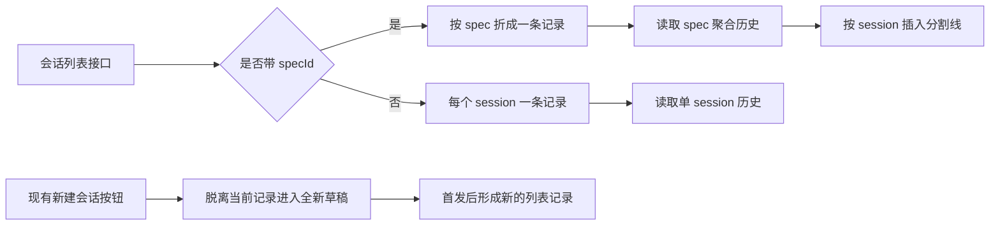
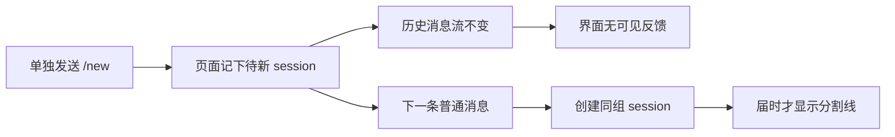
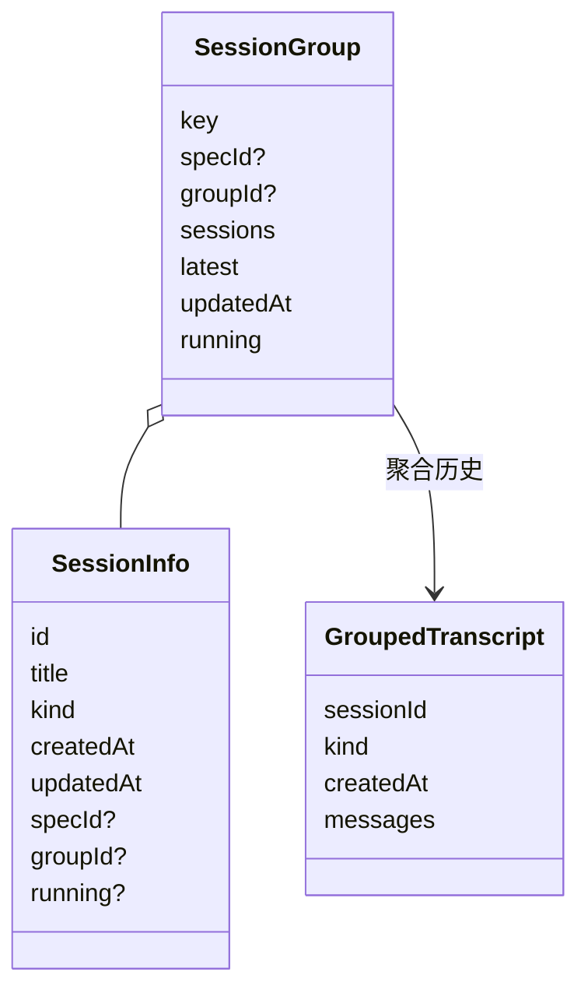
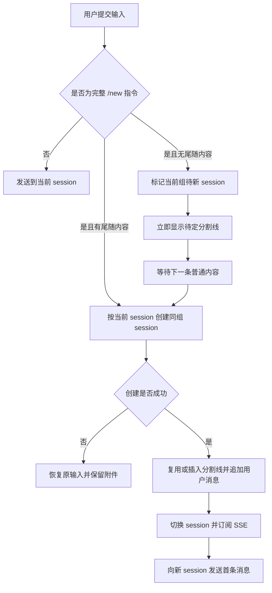
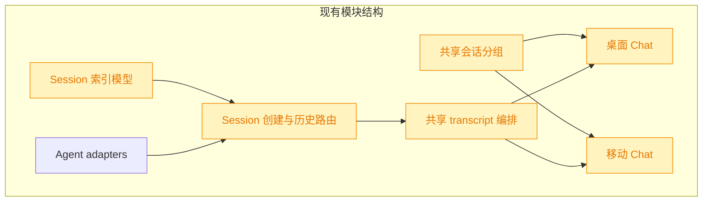

# 内置 /new 会话指令

## 1. 背景

当前会话列表的一条记录对应一个 session 组，Chat 消息区通过分割线展示组内不同 session。现有“新建会话”入口会创建新的列表记录，无法在当前组中主动结束上一 session 并开启下一 session。

## 2. 需求

- 桌面端与移动端均新增内置 `/new` 指令，并在斜杠指令候选中展示。
- 用户输入 `/new` 时，结束当前 session；用户之后发送的内容应提交到当前 session 组的新 session。
- 用户输入 `/new xxx` 时，结束当前 session，并将 `xxx` 直接发送给当前 session 组中新建的 session。
- 新旧 session 的消息继续显示在同一 Chat 面板内，并以现有 session 分割线隔开。

## 3. 现状分析

当前只有 spec 会话具备可持久化的组归属：一个 spec 的每轮执行各建一个 session，列表按 `specId` 折成一行，消息区从专用聚合接口读取各 session 的 transcript 并插入分割线。普通聊天没有组标识，每个 session 都独立成行、独立读取历史。

桌面端已有“回到空草稿、首发时建 session”的能力，但它刻意脱离当前行；移动端详情页也复用同一 transcript 编排。两端斜杠候选目前包含 `/yorz-debug`、`/yorz-spec` 和自定义指令，实际发送路径会把所有文本交给当前 session，尚无只在客户端改变 session 边界的内置命令。

现有实现在纯 `/new` 分支中只清空输入并把页面级 `newSessionPending` 设为真，共享 transcript 的消息流完全不变；因此除了不可见的内部状态，用户得不到任何反馈。直到下一条实际消息触发 `sendInNewSession` 并建号后，共享 transcript 才会同时追加分割线和用户气泡。

现有实现精确层

- `src/gui-shared/lib/session-groups.ts`：仅按 `specId` 聚合；无 `specId` 的 session 各自成组。
- `src/gui-shared/lib/chat-transcript.ts`：`specId` 存在时读取 spec 聚合历史，否则读取当前 session；草稿首发会创建全新 session。
- `src/service/session-store.ts`、`src/service/session-manager.ts`：索引只持久化 `specId`，仅提供按 spec 枚举与聚合 transcript 的能力。
- `src/service/routes/sessions.ts`：创建 session 的请求体只有标题和 Agent 类型；消息接口将斜杠文本解析为服务端内置或自定义指令。
- `src/gui/src/components/ChatPanel.tsx`：桌面端组列表、分割线与新建会话入口。
- `src/gui-mobile/src/pages/ChatDetail.tsx`：移动端复用共享 transcript，但详情元信息只推导 `specId`。

## 4. 技术实现方案

### 4.1 会话组模型

为普通聊天 session 增加可选持久化字段 `groupId`。新建的普通聊天首个 session 以自身 ID 作为 `groupId`；旧索引中没有该字段的 session 继续以自身 ID 作为隐式组，兼容现有数据。spec session 仍以 `specId` 为最高优先级归组，不重复写入普通聊天 `groupId`。

前端共享分组逻辑改为按 `specId`、`groupId`、session 自身 ID 的优先级生成行；组内 session 按创建时间升序，行标题、活跃时间和发送目标仍取最近活动成员。服务端新增按普通 `groupId` 枚举并聚合 transcript 的能力，返回结构与现有 spec 聚合历史一致，使共享 transcript 能复用分割线拼接逻辑。

### 4.2 同组新建接口

创建 session 的 API 请求体增加 `groupFromSessionId`，由服务端读取源 session 元信息并决定归属，避免客户端伪造或自行拼装组 ID：

- 源 session 属于 spec 时，新 session 继承 `specId`，继续落在该 spec 行内。
- 源 session 属于普通聊天时，新 session 继承源 `groupId`；旧 session 无字段时，以源 session ID 建立组并补齐索引。
- 新 session 沿用当前组标题，避免列表行标题因一次 `/new xxx` 突然改名；Agent 类型仍采用项目当前默认配置，与新建 session 的现有语义一致。
- 找不到源 session 时返回明确的客户端错误，不降级为新列表记录，防止用户以为仍在当前组。

普通聊天新增只读的组 transcript 接口；现有单 session 与 spec transcript 接口保持不变，旧客户端不受影响。

### 4.3 `/new` 状态与发送流程

新增平台无关的 `/new` 解析函数，并在桌面、移动端的内置候选中加入本地化说明。仅匹配完整命令名：`/new` 进入“当前组待新 session”状态，`/new` 后的空白与内容作为首条消息；`/newer` 等文本仍按普通消息发送。

`/new` 不立即请求服务端，继续沿用项目避免空 session 的约定，但共享 transcript 会立即在当前历史尾部放入一个仅存于内存的“待新 session”分割线。该分割线不写入 transcript 缓存，不会在重新进入会话时伪造已持久化的 session。

用户下一次发送普通内容时，共享 transcript 基于当前 session 创建同组 session，并把已显示的待定分割线原位替换为真实 session 分割线，避免重复。`/new xxx` 则仍在同一次提交中创建、插入真实分割线并发送。建号失败时保留待定分割线和待新 session 状态，让用户可修改或重试原输入。

当前 session 正在运行、草稿首发正在建号或附件仍在上传时，沿用现有发送门禁。纯 `/new` 不消耗附件，附件保留给新 session 的首条实际消息；重复输入纯 `/new` 不叠加分割线。创建失败时恢复用户原始输入，创建成功但发送失败时沿用现有错误气泡语义。

### 4.4 两端接入与状态清理

桌面端在选择其他列表行、点击现有“新建会话”按钮或切换项目时清除“待同组新 session”状态；移动端在详情页生命周期内维护同一状态，并在路由切换后自然清理。两端都调用共享 transcript 的同组首发方法，避免复制创建、订阅、乐观消息和错误恢复逻辑。

所有新增可见文字分别加入桌面端与移动端 `zh-CN` / `en` 国际化配置，不在组件中硬编码。

### 4.5 兼容性与影响范围

`groupId` 是可选字段，旧索引无需迁移；旧 session 在首次使用 `/new` 时才补齐普通组关系。现有 spec 分组与 API 继续保留，普通单 session 在没有 `groupId` 时仍走原读取路径。变更不修改 Agent adapter 的 session 能力，只扩展 YorZ 自己的索引、路由和前端编排。

实施文件与验证精确层

- 数据与服务：`src/service/agent-sdk/types.ts`、`src/service/session-store.ts`、`src/service/session-manager.ts`、`src/service/routes/sessions.ts`。
- 共享前端：`src/gui-shared/api/index.ts`、`src/gui-shared/lib/session-groups.ts`、`src/gui-shared/lib/chat-transcript.ts`，并新增共享 `/new` 解析单元。
- 桌面端：`src/gui/src/components/ChatPanel.tsx`、`src/gui/src/i18n/zh-CN.ts`、`src/gui/src/i18n/en.ts`。
- 移动端：`src/gui-mobile/src/pages/ChatDetail.tsx`、`src/gui-mobile/src/i18n/zh-CN.ts`、`src/gui-mobile/src/i18n/en.ts`。
- 自动验证覆盖 session store/manager、路由请求、普通聊天分组、`/new` 解析、共享 transcript 同组首发以及移动端候选展示；最后执行相关 Vitest、`pnpm typecheck` 与两端构建。
- 追加需求仅修改 `src/gui-shared/lib/chat-transcript.ts`、两端纯 `/new` 提交分支与共享 transcript 定向测试；分割线复用现有渲染和国际化信息，不新增可见文案。

## 5. 待确认项

_暂无_

## 6. 任务清单

- [x] 扩展 SessionInfo 与 SessionStore 的普通聊天 `groupId` 持久化、查询和旧数据回退（验收：store/manager 单元测试覆盖首 session、自身组及旧 session 归组）
- [x] 实现 SessionManager 的同组新建与普通组 transcript 聚合（验收：普通组和 spec 组均创建独立 session，聚合结果按创建时间排序）
- [x] 扩展 session 路由和共享 API 的同组创建、普通组历史读取契约（验收：路由测试覆盖成功、源 session 不存在和历史响应）
- [x] 扩展共享会话分组并新增 `/new` 命令解析器（验收：单元测试覆盖 `specId` / `groupId` / 旧 session 优先级及 `/new` 边界输入）
- [x] 扩展共享 transcript 的同组首发流程（验收：测试覆盖保留旧历史、插入分割线、切换 session、发送成功与建号失败）
- [x] 接入桌面端 `/new` 候选、待新 session 状态和国际化文案（验收：桌面端 `/new` 与 `/new xxx` 均走同组首发，切组/新建/切项目会清理状态）
- [x] 接入移动端 `/new` 候选、待新 session 状态和国际化文案（验收：移动端两种输入语义一致，候选端到端测试可见 `/new`）
- [x] 运行格式化、相关 Vitest、TypeScript 类型检查与桌面/移动端构建（验收：全部命令通过，结果写入执行记录）
- [x] 在共享 transcript 实现待定分割线，并接入桌面端与移动端的纯 `/new` 分支（验收：指令后立即可见且不建号，重复指令不叠加，首发成功后无重复分割线，建号失败保留待定边界）
- [x] 补充待定分割线的共享 transcript 回归测试并运行定向 Vitest、类型检查与两端构建（验收：新增用例与相关验证命令全部通过）

## 7. 追加任务

- [fixed] [refct] 2026-10-30 18:36:06 | 单独发送 /new 指令时，历史消息记录面板需要显示分割线，不然 UI 没有任何反应，用户会产生疑惑
  - 描述：单独发送 /new 指令时，历史消息记录面板需要显示分割线，不然 UI 没有任何反应，用户会产生疑惑

## 8. 执行记录

- 2026-10-30 18:04：为普通聊天 session 增加 `groupId`，新 session 默认以自身 ID 建组；SessionStore 支持按普通组查询和旧数据回退。
- 2026-10-30 18:04：SessionManager 与 session 路由支持根据源 session 创建同组 session，并提供普通组 transcript 聚合接口；spec 源 session 继续继承 `specId`。
- 2026-10-30 18:04：共享前端按 `specId` / `groupId` 聚合列表行，新增精确 `/new` 解析器及 transcript 同组首发流程，保留历史并乐观插入分割线和用户消息。
- 2026-10-30 18:04：定向 Vitest 通过，6 个测试文件共 76 项全部成功。
- 2026-10-30 18:09：桌面端与移动端均接入 `/new` 和 `/new xxx`，加入中英文国际化文案；纯 `/new` 延迟建号并保留附件，尾随内容直接在同组新 session 首发。
- 2026-10-30 18:09：全量 Vitest 通过，104 个测试文件中 1028 项通过、2 项跳过；补充的旧 session 首次归组测试通过。
- 2026-10-30 18:09：`pnpm typecheck`、`pnpm build:gui`、`pnpm build:gui-mobile` 全部通过；移动端补全 Playwright 9 项全部通过，确认 `/new` 候选可见。
- 2026-10-30 18:09：所有非人工任务完成，待确认项为空，无批注与开放追加任务，spec 收尾为 done。
- 2026-10-30 18:41：共享 transcript 支持纯 `/new` 后立即显示一条不建号、不进缓存的待定分割线；两端提交分支已接入，重复指令不叠加，实际建号后原位替换为真实边界。
- 2026-10-30 18:41：定向 Vitest 3 项通过；全量 Vitest 104 个测试文件中 1030 项通过、2 项跳过；`pnpm typecheck`、`pnpm build:gui`、`pnpm build:gui-mobile` 全部通过。
- 2026-10-30 18:41：本轮追加任务已标记 fixed，所有非人工任务完成，spec 收尾为 done。
