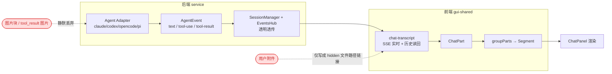
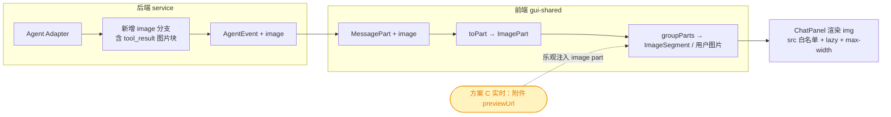
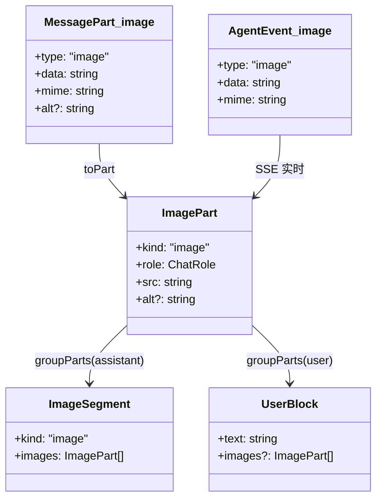
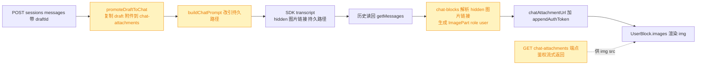
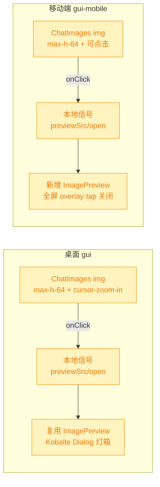

# 在 Chat 消息组件中渲染图片（方案 B + C）

## 1. 背景

`src/gui/src/components/ChatPanel.tsx` 渲染历史消息时无法展示图片。两类图片都显示不出来：

1. 用户选择的本地图片（通过附件上传）；
2. 部分模型 / 工具支持输出图片（典型如截图类工具的 `tool_result` 图片块）。

目标是在消息组件中实现图片渲染，落地此前讨论确定的方案 B + C。

## 2. 需求

- **方案 B（结构化图片 part，推荐主干）**：端到端引入 `image` 类型的 `MessagePart`，打通「模型 / 工具输出图片」在 UI 中的渲染；沿现有分层改造 wire 类型 → `toPart` → `groupParts` → ChatPanel segment 渲染，并在 service adapter 侧把被丢弃的图片块映射为 image part。
- **方案 C（用户附件回显）**：用户选择 / 粘贴的本地图片在用户气泡中以图片形式回显；需覆盖「发送时乐观渲染」与「历史重读一致」两种情形。
- 安全：图片 `src` 限制协议白名单（`https:`、`data:image/`、本地鉴权端点）；`loading="lazy"`；`max-width` 约束布局。

## 3. 现状分析

当前消息链路在**类型层面就没有图片通道**：`MessagePart` / `AgentEvent` 联合类型只有 `text` / `tool-use` / `tool-result`。四个 adapter 的 content-block→part 映射都只认 text + tool，其余块（含模型图片、工具 `tool_result` 里的图片、thinking）在 adapter 边界被**静默丢弃**。前端 `groupParts` 也只折叠 text/tool 两类 segment。

此外有两条与方案 C 强相关的既有设计：

- **用户附件以"文件路径引用"注入，而非视觉块**：GUI 把附件上传到 spec-drafts 临时目录，发送时在 hidden prompt 里拼 ``，让 Agent 用文件工具按路径读取；该 hidden 段在渲染前被 `stripHiddenPrompt` 删除，所以用户气泡从不展示图片。
- **YorZ 不持久化对话正文**：`session-store` 只存会话元数据，transcript 正文每次实时读回自各 Agent SDK 自带存储；用户 prompt 文本也由 SDK 存储，YorZ 侧没有可供历史重读的 parts 副本。

精确层：关键文件与行号（现状证据）

- wire/事件类型：`src/service/agent-sdk/types.ts:70-88`（`AgentEvent` / `MessagePart` 无 image 变体）；前端镜像 `src/gui-shared/api/index.ts:350-353`。
- claude-adapter：`src/service/agent-sdk/claude-adapter.ts` send 流循环 `211-228`（assistant 仅 text/tool_use，user 仅 tool_result，无 else）；`getMessages` `333-351`（同样仅三类）；`toolResultText` `54-68`（content 数组只取 `.text`，丢弃 image 块）。
- 其它 adapter 同样无 image 分支：`codex-adapter.ts:299-323/391-424`、`opencode-adapter.ts:52/77/93-94/190-202`、`pi-adapter.ts:246-293/474-520`。
- 透传：`events-hub.ts:331-341`（`session-msg` 原样透传 AgentEvent）。
- 用户附件路径注入：`src/service/routes/sessions.ts:40-61`（`buildChatPrompt`，image 用 ``，整段进 hidden）；draft 服务端点 `src/service/routes/spec-drafts.ts:98-121`（`GET .../spec-drafts/:draftId/attachments/:storedName`）。
- 前端折叠/渲染：`src/gui-shared/lib/chat-blocks.ts:131-138(toPart)/263-347(groupParts)`；`ChatPanel.tsx:1048-1070`（assistant segment 仅 text/tools）、`1037-1039`（user 气泡纯文本）。
- 实时/读回/乐观：`chat-transcript.ts:502-505(读回)/621-631(SSE 事件)/538-548,800,863,915(乐观 user part)`。
- 附件控制器：`gui-shared/lib/attachments.ts:168`（image 已建 `previewUrl` objectURL）。
- 持久化事实：`session-store.ts:5-9`（只存元数据，正文实时读回自 SDK）。

### 3.1 追加需求（refct）：消息图片不可点击放大，可能被缩小

方案 B+C 落地后消息图片已能渲染，但渲染处对图片做了尺寸约束，且无任何点击交互：

- 桌面：`ChatPanel.tsx:128-144` 的共用组件 `ChatImages` 渲染 ``——`max-h-64`（256px）会把大图缩小，且 `` **无 `onClick`**，无法看原图。user 气泡（`:1077-1079`）与 assistant 图片段（`:1114`）都复用它。
- 移动端：`MessageList.tsx:34-47` 的同名 `ChatImages` 完全同构（同样 `max-h-64 max-w-full`、无 `onClick`），调用点在 `:79-81`（user）与 `:112`（assistant）。
- **输入框已有可复用的预览能力（仅桌面）**：桌面 `ImagePreview.tsx:10-38` 是基于 Kobalte `Dialog`（`ui/dialog.jsx`）的极简灯箱，props 为受控 `{ src?; alt?; open; onOpenChange }`，图片 `max-h-[80vh] max-w-[80vw] object-contain`，ESC / 点遮罩 / 关闭按钮均可关闭；`AttachmentList.tsx:38-47,63,96-101` 以本地信号持有 `previewSrc/previewAlt/previewOpen`，缩略图 `cursor-zoom-in` + `onClick=openPreview` 触发。
- **移动端无灯箱可复用**：`gui-mobile/src/components/ui/` 仅有 `button.tsx`，无 Dialog；输入框 `ChatComposer.tsx:109-114` 的附件缩略图本身也**没有**点击预览。现有 `MermaidViewer.tsx` 是 SVG 专用全屏查看器（自绘 pan/pinch），非图片灯箱、不宜直接复用。

## 4. 技术实现方案

总体：新增一类 `image` part，贯通「后端 adapter 映射 → wire/事件类型 → 前端折叠 → ChatPanel 渲染」；方案 C 的实时回显由前端乐观注入复用该通道；方案 C 的历史一致策略见 `## 5 待确认项`（抉择后再定稿本节下游任务）。

### 4.1 目标链路

### 4.2 类型与数据模型改造（方案 B 主干）

新增 `image` 变体，`data`（data URL / http(s) URL）承载图像，`alt` 可选；`AgentEvent` 同步加 `image` 事件用于实时流。前端 `ChatPart` 增 `ImagePart`，`Segment` 增 `ImageSegment`，用户图片进 `UserBlock`。

> 决策记录：新增 union 变体为**加法式**改动（非 breaking）；受影响点为所有对 `MessagePart`/`AgentEvent`/`Segment` 做穷尽分派的消费者（adapter 映射、groupParts、ChatPanel、测试），均需补 image 分支。配色标 🟡 affected，无 🔴 breaking。

### 4.3 后端 adapter 映射（方案 B）

- `claude-adapter`：send 流循环与 getMessages 增 image 分支；`toolResultText` 旁路出图片块（content 数组里的 `{type:'image',source}`）→ 生成 image 事件 / part。base64 源转 `data:<mime>;base64,<data>`，url 源原样透传。
- 其它 adapter（codex/opencode/pi）：至少保证类型新增后编译通过；能低成本映射的同样补 image 分支，无图片能力的保持原样（文档说明）。
- `events-hub` / `session-manager`：已对 AgentEvent 透明透传，预期无需改造（新事件类型自动流过）。

> 决策记录：方案 B 对 Claude 的**具体落点**是 `tool_result` 图片块（如截图工具），这是当前被 `toolResultText` 丢弃、用户最可感知的真实收益；Claude 文本生成本身当前不产图，但通道建成后对支持出图的模型/工具通用。

### 4.4 前端折叠与渲染（方案 B + C 实时）

- `toPart`：image wire part → `ImagePart`。
- `groupParts`：assistant 的 image part 并入 `ImageSegment`（与 text/tools 并列，位置稳定）；user 的 image part 挂到当前 `UserBlock.images`。
- `chat-transcript`：SSE `image` 事件 → `pushPart(ImagePart)`（复用现有缓冲/顺序保证）；**方案 C 实时**：send 乐观阶段把 `attachments` 里 image 的 `previewUrl` 注入乐观 `UserBlock.images`，发送后随历史读回被真实内容替换。
- `ChatPanel`：assistant bubble 增 `asImage` 分支渲染 ``；user 气泡在文本下方渲染 `images`。统一 `` + `max-width:100%` 容器。
- `markdown`：`image` 渲染规则增 `src` 协议白名单（`https:` / `data:image/` / 本地鉴权端点），拦截其它协议——保护 assistant markdown 文本里的 ``。
- **mobile**：`chat-blocks`/`chat-transcript` 为 `gui-shared` 共享，mobile 聊天页需镜像补 image segment 渲染。

### 4.5 安全与性能

- `src` 白名单在 markdown 规则与 `` 渲染处双重约束：仅放行 `https:`、`data:image/`、`blob:`（乐观 previewUrl）、同源 `/api/...` 鉴权端点；其余协议拦截。
- `` / `<a href>` 无法携带 `x-yorz-pair-token` 头，持久化图片 URL 一律经 `appendAuthToken()` 追加 `?token=`（复用 `markdown.ts` 既有机制）。
- 模型/工具图片若为大 base64，v1 以 data URL 直渲（实现简单、可用）；DOM/内存占用的优化（落盘 + 服务 URL）记为后续项，不阻塞 v1。**若后续对模型图片落盘，落点同样在 `.yorz/tmp`（gitignored），不得进 specs 目录。**

### 4.6 方案 C「历史重读一致」落地（读回重写 + 持久化）

用户抉择：采用 `## 5` 的候选 1（读回重写 + 持久化），且明确约束——**chat 图片（用户发送的、模型输出的）一律存入项目 `.yorz/tmp`（已 gitignored，见 `.gitignore:14`），不进 `.yorz/specs`（后者随 git 提交）**。

**存储键改用 `draftId` 而非 `sessionId`（自主技术决策）**：`AttachmentStore` 以 draft 为单位（`.yorz/tmp/drafts/<draftId>/attachments`），而 `sessionId` 在 `session-manager.send` 中可能被 `reconcile()` 改写（`session-manager.ts:511-514/616-630`，codex/pi 由 SDK 分配真实 id），且 `handle.sessionId` 返回的仍是原 sid（`:597`）；以 sessionId 为键会产生目录/URL 错位。draftId 稳定、已内嵌于 transcript 的 `` 路径，天然规避 reconcile 与 draft 24h TTL 清理两个坑，且持久化粒度（每消息）是「会话级」的超集，完全满足历史一致。

落地链路：

- **发送时**：`sessions.ts` 的 POST messages 在消费 draftId 时，先 `promoteDraftToChat(draftId)` 把该 draft 的附件复制到 `.yorz/tmp/chat-attachments/<draftId>/attachments/`（非 TTL 清理根），再令 `buildChatPrompt` 的 `dir` 指向该持久路径——模型按路径读取不变、路径在 draft 被清理后依然有效。
- **新增端点**：`GET /projects/:projectId/chat-attachments/:draftId/:storedName`，鉴权（`need(c)`）后 `inline` 流式返回（对标 `spec-drafts.ts:98-115`）。
- **历史读回重写**：`chat-blocks` 对 user 消息文本，在 `stripHiddenPrompt` 之前解析 hidden 块里指向 `…/chat-attachments/<draftId>/attachments/<name>` 的 `` 图片链接 → 生成 `ImagePart`（role user，src 经 `chatAttachmentUrl` + `appendAuthToken`），挂到 `UserBlock.images`，再剥除文本。
- **乐观回显**：发送路径（`send`/`sendInNewSession`/`sendFromDraft`/`beginOptimisticRound`）注入 role user 的 `ImagePart`，src 取附件控制器的本地 `previewUrl`（objectURL）；发送后随历史读回被持久 URL 替换。

> 决策记录：`## 5.1 [choice] 方案 C「历史重读一致」实现策略` —— 用户抉择候选 1（读回重写 + 持久化），理由（用户备注）：chat 图片默认不入 git，须存项目 `.yorz` 临时目录，区别于会提交 git 的 spec 引用图片。
>
> 决策记录：持久化存储键采用 `draftId` 而非 `sessionId` —— 自主技术决策（准入门槛内可查证），理由：规避 `session-manager.reconcile` 对 sessionId 的改写与 `handle.sessionId` 回传原 sid 导致的目录/URL 错位，兼顾 draft 24h TTL；draftId 稳定且已内嵌 transcript 路径，持久化粒度为会话级超集。
>
> 决策记录：chat 持久化根为 `.yorz/tmp/chat-attachments`（与 24h TTL 的 `drafts` 根分离，v1 不做自动清理，接受 gitignored 下增长），后续清理策略记为非阻塞后续项。

### 4.7 追加需求（refct）：消息图片点击放大预览

目标：消息里的图片缩略图保持原尺寸约束（`max-h-64` 避免撑破气泡），但**点击后以灯箱放大查看原图**，交互对齐输入框附件的预览体验，且尽量复用现有预览组件。两端共用的 `ChatImages` 是唯一改动落点，user / assistant 两条路径自动覆盖。

- **桌面（复用，首选）**：在 `ChatPanel.tsx` 的 `ChatImages` 内持有 `previewSrc/previewAlt/previewOpen` 本地信号（对标 `AttachmentList`），缩略图加 `cursor-zoom-in` + `onClick` 打开，底部渲染一个 `<ImagePreview>`。直接复用桌面既有 `ImagePreview`，零新增组件。
- **移动端（等价实现）**：`gui-mobile` 无 Dialog 可复用，新增轻量 `src/gui-mobile/src/components/ImagePreview.tsx`——`fixed inset-0` 全屏 overlay，`` 最大化显示，点遮罩/关闭按钮关闭，`touch-action: pinch-zoom` 交由系统捏合缩放（比 MermaidViewer 自绘手势轻量，满足「看原图」诉求）；`MessageList.tsx` 的 `ChatImages` 同样加信号 + `onClick` + 渲染该组件。签名与桌面 `ImagePreview` 对齐（`{ src?; alt?; open; onOpenChange }`），保持两端一致。
- **不改动**：`ImagePart`/`ImageSegment`/`UserBlock.images` 类型与 `isRenderableImageSrc` 守卫沿用（灯箱 `src` 同样取已过白名单的 `img.src`，无新协议面）；缩略图尺寸约束 `max-h-64 max-w-full` 保留（仅补点击放大，不改默认版式）。

> 决策记录：追加需求「消息图片点击放大」—— 自主技术决策（准入门槛内可查证）。桌面直接复用现有 `ImagePreview`（Kobalte Dialog 灯箱，输入框附件同款）；移动端因无 Dialog/灯箱可复用，按「最好复用」的软约束补一个签名对齐的等价全屏查看器，维持与既有「桌面/移动端渲染一致」的工程约定（方案 B+C 即两端并行落地）。改动收敛在两端各一个 `ChatImages`，类型与安全守卫零改动。

## 5. 待确认项

_暂无_

## 6. 任务清单

- [x] 后端类型：`src/service/agent-sdk/types.ts` 的 `AgentEvent` 与 `MessagePart` 各加 `image` 变体（`{type:'image';data:string;mime:string;alt?:string}`，event 无 alt）（验收：`tsc --noEmit` 通过，无穷尽分派告警）
- [x] claude-adapter 映射：`claude-adapter.ts` 的 `ContentBlock` 补 `source`/image 字段；send 流 assistant 分支与 user `tool_result` 分支旁路 image 块 → yield image 事件；`getMessages` 同步产出 image part；`toolResultText` 跳过 image 块只取文本；base64 源转 `data:<mime>;base64,<data>`、url 源原样（验收：新增单测覆盖 tool_result 图片块 → image 事件/part）
- [x] 其它 adapter 编译保障：`codex-adapter.ts`/`opencode-adapter.ts`/`pi-adapter.ts` 在类型新增后编译通过；无低成本图片来源则不加分支并在文件注释说明（验收：`tsc --noEmit` 通过）
- [x] 附件持久化：`attachment-store.ts` 新增 chat 持久根 `.yorz/tmp/chat-attachments`，加 `chatAttachmentsDir(draftId)`、`promoteDraftToChat(draftId)`（cp draft 附件到持久根，幂等）、`readChatAttachment(draftId,storedName)`（验收：新增单测覆盖复制+读取+安全名校验）
- [x] 发送落持久化：`sessions.ts` POST messages 消费 draftId 时先 `promoteDraftToChat`，`buildChatPrompt` 的 `dir` 改为 `.yorz/tmp/chat-attachments/${draftId}/attachments`（验收：更新 `sessions-route.test.ts` 断言 hidden 块路径指向 chat-attachments）
- [x] 新增服务端点：`GET /projects/:projectId/chat-attachments/:draftId/:storedName`，`need(c)` 鉴权后 `inline` 流式返回（对标 spec-drafts.ts:98-115），并在 `server.ts` 挂载（验收：新增路由单测返回 200 + 正确 Content-Type）
- [x] 前端 wire 类型：`gui-shared/api/index.ts` 的 `MessagePart` 加 `image` 变体并加 `chatAttachmentUrl(pid,draftId,storedName)` helper；`gui-shared/api/sse.ts` 的 `SessionEvent` 加 `image` 变体（验收：`tsc --noEmit` 通过）
- [x] 前端折叠模型：`gui-shared/lib/chat-blocks.ts` 加 `ImagePart`（含 role/src/alt）入 `ChatPart`、`ImageSegment` 入 `Segment`、`images?` 入 `UserBlock`；`toPart` 加 image 分支；新增 hidden 块图片链接解析 helper 并接入 `messagesToParts`（user 图片→ImagePart·role user·chatAttachmentUrl+token）；`groupParts` 把 assistant image 并入 ImageSegment、user image 挂 `UserBlock.images`（验收：新增 groupParts 图片用例，含 user 附件链接读回与 assistant image 段）
- [x] 实时与乐观：`gui-shared/lib/chat-transcript.ts` SSE 加 `image` 事件 → `pushPart(ImagePart·role assistant)`；`send`/`sendInNewSession`/`sendFromDraft` 注入 role user 的 ImagePart；发送签名扩展可选 `images` 入参（验收：`tsc -b` 通过，乐观注入经 codex-swap 测试快照覆盖）
- [x] markdown 白名单：`gui-shared/lib/markdown.ts` image 规则（chat 上下文即无 specId 时）加 `src` 协议白名单（`https:`/`data:image/`/`blob:`/同源 `/`），拦截其它协议（验收：新增 markdown.test 用例断言 `javascript:`/`http:`/`file:` 被拦截、合法协议放行）
- [x] 桌面渲染：`gui/src/components/ChatPanel.tsx` user 气泡文本下方渲染 `UserBlock.images`、assistant 渲染 `ImageSegment`，统一 ``+`max-w-full`+src 守卫；发送处把附件 image 的 draft 服务 URL 作为乐观 images 传入 send（验收：`build:gui` 通过）
- [x] 移动端渲染：`gui-mobile/src/components/MessageList.tsx` 同步 user images 与 ImageSegment 渲染；`gui-mobile/src/pages/ChatDetail.tsx` 发送处传乐观 images（验收：`build:gui-mobile` 通过）
- [x] 全量校验：运行仓库 typecheck + 相关单测（service + gui-shared）并记录结果；修复暴露的编译/测试失败（验收：typecheck 与新增/受影响测试全绿）
- [x] 桌面点击预览：`gui/src/components/ChatPanel.tsx` 的 `ChatImages` 加本地 `previewSrc/previewAlt/previewOpen` 信号（对标 `AttachmentList`），缩略图 `` 加 `cursor-zoom-in` + `onClick` 打开预览，组件内渲染复用的 `<ImagePreview>`；缩略图 `max-h-64` 约束保留（验收：`build:gui` 通过，点击 user/assistant 图片弹出 ImagePreview 灯箱）
- [x] 移动端灯箱组件：新增 `gui-mobile/src/components/ImagePreview.tsx`——`fixed inset-0` 全屏 overlay，`` + `touch-action: pinch-zoom`，点遮罩/关闭按钮关闭，props 签名对齐桌面（`{ src?; alt?; open; onOpenChange }`）（验收：`build:gui-mobile` 通过）
- [x] 移动端点击预览：`gui-mobile/src/components/MessageList.tsx` 的 `ChatImages` 加信号 + 缩略图 `onClick` + 渲染新增 `ImagePreview`，覆盖 user images 与 ImageSegment（验收：`build:gui-mobile` 通过，点击消息图片全屏查看原图）
- [x] 校验与记录：运行 `build:gui` + `build:gui-mobile`（如有相关单测一并跑）并记录结果（验收：两端构建成功）

## 7. 追加任务

- [fixed] [refct] 2026-10-31 17:41:44 | 当前图片可能被缩小，需要像 chat 输入框上的图片一样，点击预览，最好复用预览组件
  - 描述：当前图片可能被缩小，需要像 chat 输入框上的图片一样，点击预览，最好复用预览组件

## 8. 执行记录

- `tsc -b` 全量类型检查通过（修复 `chat-transcript-codex-swap.test.ts` 对 `Segment` 新增 `ImageSegment` 的穷尽分派）。
- 后端：`types.ts` 加 image 变体；`claude-adapter.ts` 加 `imageFromSource`/`imagesFromToolResult`，send 流 + `getMessages` 旁路 assistant/tool_result 图片块为 image 事件/part，`toolResultText` 跳过 image 块（否则被 JSON 串成垃圾文本）；`attachment-store.ts` 加 `chat-attachments` 持久根与 `promoteDraftToChat`/`readChatAttachment`；`sessions.ts` 发送时 promote 并改 `buildChatPrompt` 路径；`spec-drafts.ts` 新增 `GET chat-attachments/:draftId/:storedName` 端点（已随 `createSpecDraftsRoutes` 挂载于 server.ts:150）。
- 前端：`api/index.ts` 加 `MessagePart.image` 与 `chatAttachmentUrl`；`api/sse.ts` 加 `SessionEvent.image`；`chat-blocks.ts` 加 `ImagePart`/`ImageSegment`/`UserBlock.images`/`isRenderableImageSrc`/`parseAttachmentImages`，`toPart`+`groupParts`+`messagesToParts` 接入；`chat-transcript.ts` SSE image 事件 + 三条发送路径乐观注入（读回用 `appendAuthToken(chatAttachmentUrl)`，乐观用 `appendAuthToken(draftAttachmentUrl)` 以避开 `reset()` 对 blob 的 revoke）；`markdown.ts` chat 上下文启用 src 白名单；`ChatPanel.tsx` 与 mobile `MessageList.tsx` 渲染 ``（lazy + max-w + 守卫），`ChatPanel`/`ChatDetail` 发送处注入乐观 images。
- 测试：新增 chat-blocks 图片用例（toPart/assistant 段/user 气泡/hidden 链接读回）、attachment-store chat 持久化用例、sessions `buildChatPrompt` 路径用例、claude-adapter 图片 send/getMessages 用例、markdown 白名单用例；更新 markdown 一条用例为新安全契约（chat 上下文拒绝非白名单相对 src）。
- 验证：`npx vitest run` 全量 1052 passed / 2 skipped（唯一 1 failed 为 `git-routes.test.ts` 在满并发下的 5s 超时抖动，单独重跑 20/20 通过，与本次改动无关）；`build:gui`、`build:gui-mobile` 均构建成功。
- 说明：方案 B 的落点为 Claude `tool_result`/模型 image 块；codex/opencode/pi 无低成本图片来源，类型新增后保持原样（无穷尽断言，编译通过）。chat 图片持久化根 `.yorz/tmp/chat-attachments` 位于 gitignored 的 `.yorz/tmp` 下，v1 不自动清理（后续项）。
- 收尾：任务全部完成，标记 done。

### 8.1 追加任务（refct·图片点击预览）执行记录

- 桌面：`ChatPanel.tsx` 的 `ChatImages` 改为带 `previewSrc/previewAlt/previewOpen` 本地信号的组件，缩略图 `` 加 `cursor-zoom-in` + `onClick=openPreview`，组件内渲染复用的桌面 `ImagePreview`（Kobalte Dialog 灯箱，与输入框附件同款）；新增 `import { ImagePreview }`。`max-h-64 max-w-full object-contain` 缩略约束保留，仅补点击放大。user 气泡与 assistant 图片段复用同一 `ChatImages`，一处改动全覆盖。
- 移动端：新增 `gui-mobile/src/components/ImagePreview.tsx`——`fixed inset-0 z-[70]` 全屏 overlay（对齐 MermaidViewer 的 z 层），`` 最大化显示，点遮罩/右上角 `X` 关闭，overlay `touch-action: pinch-zoom` 交系统捏合缩放、图片本体 `touch-action: none` 防穿透误关；props 签名 `{ src?; alt?; open; onOpenChange }` 与桌面一致。`MessageList.tsx` 的 `ChatImages` 同步加信号 + `onClick` + 渲染该组件，补 `createSignal`/`ImagePreview` 导入。
- 类型/安全零改动：灯箱 `src` 仍取已过 `isRenderableImageSrc` 白名单的 `img.src`，无新协议面。
- 验证：`npm run build:gui` ✓（built in 9.63s）、`npm run build:gui-mobile` ✓（70 modules + SW 生成）。
- 决策：桌面直接复用现有 `ImagePreview`；移动端无 Dialog 可复用，按「最好复用」软约束补签名对齐的等价全屏查看器，维持两端渲染一致的工程约定。
- 收尾：追加任务完成，`[open]→[fixed]`，标记 done。
