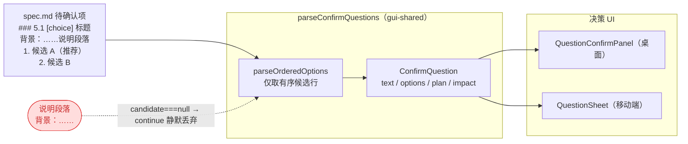
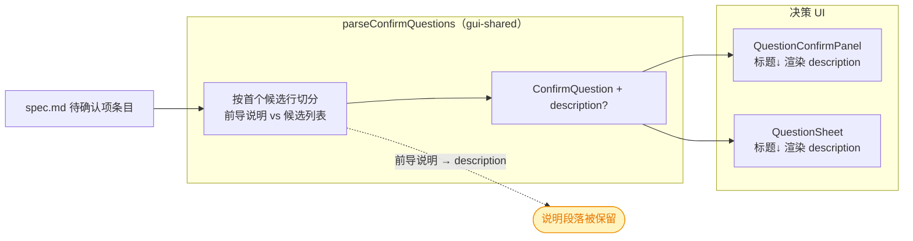
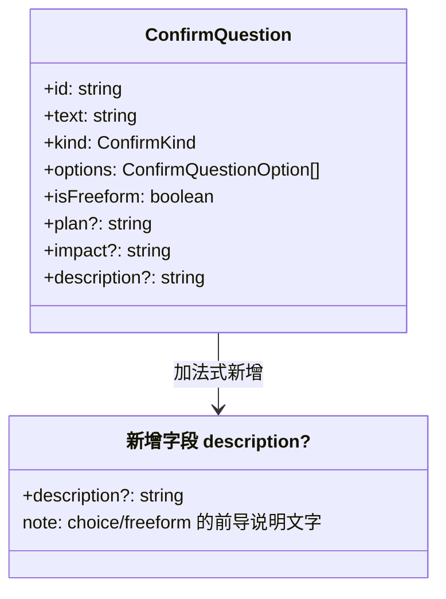

# 修复待确认项决策 UI 丢失问题描述

## 1. 背景

`src/gui/src/pages/SpecDetail.tsx` 会把 spec 文档「待确认项」章节渲染成决策 UI（`QuestionConfirmPanel`），方便用户在 GUI 上直接抉择。

但当前渲染只呈现 **三级标题文本** 与 **候选项（radio）**，丢失了标题与候选列表之间的 **说明文字**。

示例：`.yorz/specs/261031.feat.chat-message-image/spec.md` 的 `### 5.1 [choice] …` 条目，其下的「背景：YorZ 不持久化对话 parts……」整段说明在渲染到决策 UI 后消失，用户在 GUI 上看不到抉择所需的上下文。

期望：该说明文字显示在决策卡片的标题下方。

## 2. 需求

- 解析「待确认项」中 `[choice]` / freeform 条目时，保留标题与有序候选列表之间的说明文字（可能含「背景：…」等多行段落）。
- 决策 UI（桌面 `QuestionConfirmPanel` 与移动端 `QuestionSheet`）在标题下方、候选项上方渲染该说明文字。
- 不改变既有解析行为：候选项、推荐标记、freeform 退化、confirm 的 `方案/影响` 字段均保持不变。

## 3. 现状分析

链路：`spec.md` → `parseConfirmQuestions`（解析为 `ConfirmQuestion[]`）→ 决策面板渲染。问题出在**解析层丢弃**与**类型层缺字段**：

- 解析：`src/gui-shared/lib/question-parse.ts` 的 `parseConfirmQuestions` 对 `choice`/`freeform` 走 `parseOrderedOptions`，该函数**只收集匹配有序候选正则 `ORDERED_CANDIDATE_RE` 的行**，其余行（含「背景：…」说明段落）在 `if (candidate === null) continue` 处被**静默丢弃**。
- 类型：`ConfirmQuestion` 接口只有 `text` / `kind` / `options` / `isFreeform` / `plan` / `impact`，**没有承载说明文字的字段**，因此即便解析保留，UI 也无处读取。
- 桌面渲染：`src/gui/src/components/QuestionConfirmPanel.tsx` 的列表项只渲染 `<p class="qcp-question">{q.text}</p>` 与候选 `RadioGroup`，不渲染任何说明。
- 移动端渲染：`src/gui-mobile/src/components/QuestionSheet.tsx` 同样只渲染 `<h3>{q.text}</h3>` 与候选，不渲染说明。
- `confirm` 型例外：其正文由 `**方案**` / `**影响**` 结构化字段（`parseConfirmFields`）承载并已渲染，本问题不涉及。



<details>
<summary>精确层：关键文件与行号（现状证据）</summary>

- 类型定义：`src/gui-shared/lib/question-parse.ts:15-26`（`ConfirmQuestion` 无说明字段）。
- 丢弃点：`src/gui-shared/lib/question-parse.ts:138-166`（`parseOrderedOptions`，`145-147` 行 `if (candidate === null) continue` 丢弃非候选行）。
- 分型入口：`src/gui-shared/lib/question-parse.ts:87-120`（`classify`，`110-119` 为 choice/freeform 分支）。
- confirm 字段解析（对照，不改）：`src/gui-shared/lib/question-parse.ts:122-136`（`parseConfirmFields`）。
- 桌面渲染：`src/gui/src/components/QuestionConfirmPanel.tsx:152-153`（`<p class="qcp-question">{q.text}</p>`，其后直接是候选 `RadioGroup`）。
- 移动端渲染：`src/gui-mobile/src/components/QuestionSheet.tsx:180`（`<h3>{q.text}</h3>`）。
- shim 复用：`src/gui/src/lib/question-parse.ts:1-2` 仅 re-export gui-shared 实现；移动端经 `@shared/lib/question-parse.js` 共用。
- 示例触发条目：`.yorz/specs/261031.feat.chat-message-image/spec.md:168-174`。
- 既有单测：`src/gui/src/lib/__tests__/question-parse.test.ts`。

</details>

## 4. 技术实现方案

总体：在 `ConfirmQuestion` 增加可选 `description` 字段，解析层把 choice/freeform 条目中「候选列表之前的说明文字」收进该字段，桌面与移动端决策 UI 在标题下方渲染它。改动为**加法式**，不触碰既有候选 / 推荐 / freeform / confirm 逻辑。

### 4.1 目标链路



### 4.2 类型与数据模型（gui-shared）

在 `ConfirmQuestion` 增加可选字段：



- `description?: string`：仅在 choice/freeform 条目存在前导说明时赋值；无说明时字段**缺省**（`undefined`），避免破坏既有 `toEqual` 快照。

### 4.3 解析层改造（gui-shared/lib/question-parse.ts）

- 在 `classify` 的 choice/freeform 分支（现 `110-119`）调用新增辅助函数 `extractDescription(raw.bodyLines)`，把结果写入 `description`。
- `extractDescription` 规则：
  - 收集 `bodyLines` 中**第一条有序候选行之前**的所有行；freeform（无任何候选行）则收集全部 `bodyLines`。
  - 去掉首尾空白行后，以 `\n` 连接；结果为空串时返回 `undefined`（不设字段）。
  - 不改动 `parseOrderedOptions`：候选解析逻辑完全保持原样，`description` 与候选相互独立（前者取候选前文本，后者取候选行）。
- `confirm` 分支不改：其正文已由 `**方案**/**影响**` 承载（见决策记录）。

> 决策记录：前导说明的边界取「首个有序候选行之前」，而非「全部非候选行」。理由：候选行之间或之后的零散文本极少见且语义不定，限定在候选前能稳定对应用户书写的「背景/说明」段落，避免把候选后的噪声误并入说明。

### 4.4 桌面渲染（QuestionConfirmPanel.tsx）

在 `<p class="qcp-question">{q.text}</p>` 之后、候选 `RadioGroup` 之前插入：

```tsx
<Show when={q.description}>
  <p class="qcp-question-desc m-0 whitespace-pre-wrap break-words text-muted-foreground">
    {q.description}
  </p>
</Show>
```

> 决策记录：说明文字不再强制 `text-sm`，保持决策卡片默认文字大小（继承容器 font-size），仅保留 `text-muted-foreground` 弱化色与换行/换行控制。理由：`text-sm` 使说明比候选项更小、层级反而被压低，去掉后与默认正文一致更易读。移动端 `QuestionSheet` 的 `text-xs` 是移动端既有风格，不在本次「去掉 text-sm」范围内，保持不变。

### 4.5 移动端渲染（QuestionSheet.tsx）

在 `<h3 ...>{q.text}</h3>` 之后插入同构的说明段落（沿用移动端既有 `text-xs text-muted-foreground` 风格）：

```tsx
<Show when={q.description}>
  <p class="mb-2 whitespace-pre-wrap break-words text-xs text-muted-foreground">{q.description}</p>
</Show>
```

> 决策记录：说明文字按**纯文本**渲染（与现有 `q.text` 标题一致），用 `whitespace-pre-wrap` 保留换行；**不解析 markdown**，故 `**文件路径引用**` 会原样显示星号。理由：标题本就是纯文本，保持一致且改动最小；引入 markdown 渲染管线会显著扩大改动面并引入 XSS/样式治理成本，超出本次 fix 范围，可作后续增强项。

> 决策记录：`description` 仅覆盖 choice/freeform（共用 `parseOrderedOptions` 路径）；`confirm` 型正文已由结构化 `**方案**/**影响**` 字段承载，其标题与字段之间的前导说明较少见，不纳入本次最小改动范围。

### 4.6 测试

在 `src/gui/src/lib/__tests__/question-parse.test.ts` 增补用例：

- choice：标题下、候选前的「背景：…」段落被解析进 `description`，且候选不受影响。
- choice：无前导说明时 `description` 为 `undefined`。
- choice：多行前导说明（含空行）被正确连接、去除首尾空白。
- freeform：无候选时整段正文进入 `description`。

## 5. 待确认项

_暂无_

## 6. 任务清单

- [x] 在 `src/gui-shared/lib/question-parse.ts` 的 `ConfirmQuestion` 增加可选 `description?: string` 字段（验收：tsc 编译通过）
- [x] 在 `src/gui-shared/lib/question-parse.ts` 新增 `extractDescription(bodyLines)` 并在 `classify` 的 choice/freeform 分支写入 `description`，不改动 `parseOrderedOptions`（验收：新增单测通过，既有单测不回归）
- [x] 在 `src/gui/src/components/QuestionConfirmPanel.tsx` 标题 `{q.text}` 之后、候选 `RadioGroup` 之前渲染 `q.description`（验收：类型检查通过、条件渲染 `<Show when={q.description}>`）
- [x] 在 `src/gui-mobile/src/components/QuestionSheet.tsx` 标题 `{q.text}` 之后渲染 `q.description`（验收：类型检查通过）
- [x] 在 `src/gui/src/lib/__tests__/question-parse.test.ts` 增补 choice 前导说明/无说明/多行说明/freeform 说明 4 类用例（验收：`vitest` 全绿）
- [x] 运行单测与类型检查并记录结果（验收：测试全绿、tsc --noEmit 无新增错误）

## 7. 追加任务

- [fixed] [refct] 2026-10-31 11:39:42 | 去掉 text-sm 样式，保持默认文字大小即可
  - 描述：去掉 text-sm 样式，保持默认文字大小即可

## 8. 执行记录

- `src/gui-shared/lib/question-parse.ts`：`ConfirmQuestion` 新增可选 `description?: string`；新增 `extractDescription(bodyLines)`（收集首个有序候选行之前的正文，去首尾空白行，以 `\n` 连接，空则 `undefined`）；`classify` 的 choice/freeform 分支用展开语法 `...(description ? { description } : {})` 写入，保证无说明时字段缺省，`parseOrderedOptions` 未改动。
- `src/gui/src/components/QuestionConfirmPanel.tsx`：在 `{q.text}` 标题后、候选 `RadioGroup` 前插入 `<Show when={q.description}>` 的说明段落（`whitespace-pre-wrap break-words text-sm text-muted-foreground`）。
- `src/gui-mobile/src/components/QuestionSheet.tsx`：在 `<h3>{q.text}</h3>` 后插入同构说明段落（`text-xs text-muted-foreground`）。
- `src/gui/src/lib/__tests__/question-parse.test.ts`：新增 4 条用例（choice 前导说明捕获且不污染候选、无说明为 `undefined`、多行说明连接去空白、freeform 全文进 description）。
- 验证：`npx vitest run src/gui/src/lib/__tests__/question-parse.test.ts` → 25 passed；`npx tsc -b` → EXIT=0，无新增类型错误。
- 收尾：全部非 manual 任务完成，待确认项 `_暂无_`、无批注、无追加任务，标记 `done`。
- 追加任务（refct，去掉 text-sm）：`src/gui/src/components/QuestionConfirmPanel.tsx:155` 的说明段落 class 去掉 `text-sm`，仅保留 `qcp-question-desc m-0 whitespace-pre-wrap break-words text-muted-foreground`，说明文字恢复默认文字大小。移动端 `QuestionSheet` 的 `text-xs` 为移动端既有风格，不在范围内，保持不变。验证：`npx tsc -b` → EXIT=0，无新增类型错误；条目标记 `[open] → [fixed]`，再次收尾为 `done`。
