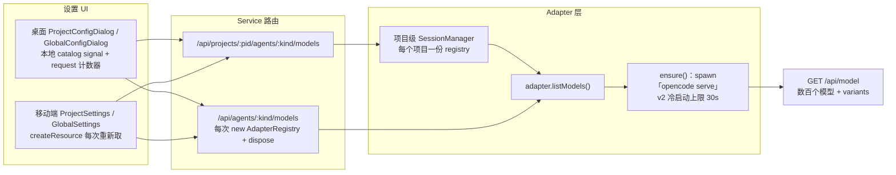
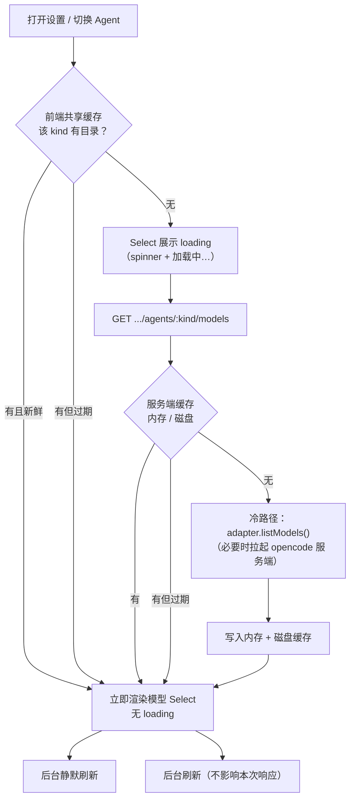
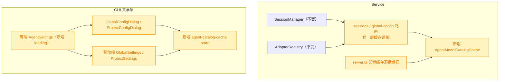

# 优化 Agent 模型目录加载（loading 呈现 + 全局缓存 + 缓存优先）

## 1. 背景

`opencode` / `opencode-v2` 两个 Agent 可列出几百个模型，`GET /api/model`（v2）与 `provider.list`（v1）返回体积大、且**必须先拉起一个 opencode 本地服务端**才能查询。

当前打开「项目设置」（ProjectConfigDialog / 移动端 ProjectSettings）或「系统设置」（GlobalConfigDialog / 移动端 GlobalSettings）时：

- 模型 Select 长时间停留在**被禁用**状态，界面上没有任何「正在加载」的反馈，用户只能反复点击、以为坏了；
- 每次打开都重新走一遍完整链路，**没有缓存**：关掉再开、切到另一个项目打开，都会再等一轮；
- 服务端全局路由（`/api/agents/:agentId/models`）每次请求都 `new AdapterRegistry(...)` 并在 `finally` 里 `dispose()`，等价于**每次都冷启动并立刻杀掉** opencode 服务端（v2 的启动超时上限 30s）。

## 2. 需求

1. 加载过程，模型对应的 Select UI 需要展示 loading 元素（而不是仅禁用 + 占位文案）。
2. 实现全局共享 Agent 及模型信息，避免二次打开 / 在其他项目打开设置时重新加载。
3. 模型数据优先使用缓存，接受模型数据延迟（可以先返回旧数据，再后台刷新）。

## 3. 现状分析

- **无任何缓存层**：Service 没有模型目录缓存，GUI 每次 dialog 打开都重置 `catalog` 信号后重新请求。
- **项目维度重复**：`SessionManager`（`src/service/session-manager.ts:145`）持有项目级 `AdapterRegistry`，项目 A、项目 B 各有一份 adapter 实例，于是「换个项目打开设置」必然再冷启动一次。
- **全局路由更糟**：`src/service/routes/global-config.ts:56-63` 每次请求构造 registry、查完即 `dispose()`，拉起的 opencode 服务端被立刻杀掉，下次还得重来。
- **UI 无 loading 呈现**：`catalogLoading` 只用于 `disabled`（`src/gui/src/components/GlobalConfigDialog.tsx:361`、`src/gui/src/components/ProjectConfigDialog.tsx:169`），`AgentSettings` 没有 loading 概念，用户看到的是禁用的普通下拉。
- **Agent 名单也重复拉取**：`/agents` 与 `/projects/:pid/agents` 每次打开都重新请求（成本低，但同属「共享信息应缓存」的范围）。

精确层：现状证据（文件与行号）

- 桌面全局设置取模型目录：`src/gui/src/components/GlobalConfigDialog.tsx:263-274`（`loadCatalog` + `catalogRequest` 竞态计数），loading 只挂 `disabled`：`:361`、`:368`。
- 桌面项目设置取模型目录：`src/gui/src/components/ProjectConfigDialog.tsx:149-160`，loading 挂 `disabled`：`:169`、`:179`。
- 移动端取模型目录（createResource，每次重取）：`src/gui-mobile/src/pages/settings/GlobalSettings.tsx:66-69`、`src/gui-mobile/src/pages/settings/ProjectSettings.tsx:59-62`；loading 只挂 `disabled`：`GlobalSettings.tsx:189,204`、`ProjectSettings.tsx:167-171,178-182`。
- Select 组件无 loading 能力：桌面 `src/gui/src/components/AgentSettings.tsx:13-140`；移动端 `src/gui-mobile/src/components/AgentSettings.tsx:7-100`。
- Service 路由：`src/service/routes/sessions.ts:89-93`（项目级，走项目 `SessionManager`）、`src/service/routes/global-config.ts:56-63`（全局级，一次性 registry）。
- 分发与降级：`src/service/agent-sdk/registry.ts:136-145`（`listModels` 失败降级空目录）、`src/service/session-manager.ts:277-279`。
- 冷启动位置：`src/service/agent-sdk/opencode-v2-adapter.ts:762-780`（`ensure()` + `SERVER_BOOT_TIMEOUT_MS = 30_000`，`:204`）、`:893-910`（`listModels` 拉 `/api/model`）；v1 对应 `src/service/agent-sdk/opencode-adapter.ts:227-231`（`createOpencode` + `provider.list`）。
- 模型目录天然是**宿主级**而非项目级：v1 用 `connected` provider 列表，v2 用 `/api/model`（`enabled`/`status` 过滤），codex 读 `~/.codex/models_cache.json`，pi 读 `runtime.getAvailable()`，claude 用 `q.supportedModels()`——均与项目目录无关。
- 全局配置目录解析：`src/service/global-config.ts:151-160`（`YORZ_HOME` > `XDG_CONFIG_HOME` > `~/.config/yorz`），可作为磁盘缓存落点。

## 4. 技术实现方案

三层缓存 + 一处 UI 改造，方向是「**先给数据、后台校准**」：

### 4.1 服务端：`AgentModelCatalogCache`（内存 + 磁盘 + SWR）

新增 `src/service/agent-sdk/model-catalog-cache.ts`：

- 键：`agent kind`（宿主级模型目录，跨项目共用同一份）。
- `get(kind, load)`：
  - 命中且新鲜（TTL 默认 5 分钟）→ 直接返回；
  - 命中但过期 → **立即返回旧目录**，后台 `refresh()`（失败仅告警，保留旧值）；
  - 未命中 → 冷路径 await `load()`，写入内存 + 调度磁盘持久化。
- 并发去重：同一 kind 的 in-flight 请求合并为一个 Promise，避免两个路由同时拉两次 `/api/model`。
- **空目录不入缓存**（`models.length === 0`）：`AdapterRegistry.listModels` 在失败时降级为空目录，缓存它会把一次性故障钉住 5 分钟；空目录仍然照常返回给调用方。
- 磁盘持久化：`<globalConfigDir>/cache/agent-models.json`（`{ version, catalogs: { [kind]: { fetchedAt, catalog } } }`），首次 `get()` 时惰性读取，写入做 ~500ms 去抖，损坏/缺失一律忽略。
- 导出单例 `agentModelCatalogCache` + `configureAgentModelCatalogCache({ filePath, ttlMs })`；`server.ts` 在构造路由前用 `join(dirname(registry.configPath()), 'cache', 'agent-models.json')` 配置一次。单测可直接 `new AgentModelCatalogCache()` 或 `clear()`。

### 4.2 路由接入

- 项目级 `src/service/routes/sessions.ts`：`agentModelCatalogCache.get(kind, () => p.sessions.listAgentModels(kind))`。
- 全局级 `src/service/routes/global-config.ts`：`agentModelCatalogCache.get(kind, () => ephemeralRegistry.listModels(kind))`，ephemeral registry 仍是「用完即 dispose」（保留现有进程生命周期语义，避免常驻子进程泄漏）。
- 响应体结构不变（`{ models, defaultReasoningEfforts }`），旧客户端无需改动。

### 4.3 前端：`gui-shared` 共享缓存 store

新增 `src/gui-shared/lib/agent-catalog-cache.ts`（桌面端与移动端共用，遵守既有「平台无关逻辑放 gui-shared」约定）：

- 模型目录：`peekAgentCatalog(kind)` / `peekAgentCatalogOrEmpty(kind)` / `isAgentCatalogLoading(kind)` / `loadAgentCatalog(kind, loader)`。
  - 以 kind 为键；同一 key 的并发请求去重；
  - 有缓存且未过期（TTL 5 分钟）→ 直接返回，不发请求；
  - 有缓存但过期 → **先返回缓存**，同时后台静默刷新（不置 loading）；
  - 无缓存 → 置 `loading(kind)=true`，请求完成后写入缓存并清除 loading。
- Agent 名单：`peekAgentRoster()` / `isAgentRosterLoading()` / `loadAgentRoster(loader)`，同样 TTL + SWR。名单是宿主级的（builtin + 全局 `customAgents`），项目级 `/agents` 与全局 `/agents` 结果一致，故共用一份。
- `resetAgentAssetCache()` 供单测与「连接切换/登出」场景复位。

### 4.4 设置界面改造（桌面 + 移动）

- 桌面 `GlobalConfigDialog` / `ProjectConfigDialog`：删掉本地 `catalog` 信号与 `catalogRequest` 竞态计数，改为读共享 store（`agentDefault()` / `kind()` 作为 key）；`agents` 信号改为读共享 roster。`loadCatalog()` 退化为 `loadAgentCatalog(kind, () => api.list…Models(kind))`，失败静默（保持既有「取不到就空目录」行为）。
- 移动端 `GlobalSettings` / `ProjectSettings`：`createResource` 改为 `createEffect` 触发 `loadAgentCatalog` / `loadAgentRoster`，模板里改读 `peek…()` 与 `is…Loading()`。
- 判断「有无缓存」只看 store，因此**二次打开、切项目打开都不再发请求**（同一 SPA 生命周期内）；跨页面刷新由服务端内存缓存兜住，跨 Service 重启由磁盘缓存兜住。

### 4.5 Select 的 loading 呈现

- 桌面 `src/gui/src/components/AgentSettings.tsx` 增加 `loading?: boolean`：
  - 触发器内容在 loading 时替换为 `spinner + t('common.loading')`（`aria-busy`），两条渲染分支（可搜索 Popover / 原生 Select）都覆盖；
  - 下拉面板在 loading 时整块展示加载态（而非「无匹配选项」空态）。
- 移动端 `src/gui-mobile/src/components/AgentSettings.tsx` 增加 `loading?: () => boolean`：按钮行与 Sheet 列表同样展示 `spinner + t('common.loading')`。
- `disabled` 逻辑保留，但语义变为「冷加载中或无候选」；SWR 后台刷新**不再**让控件禁用或闪 loading。
- 文案复用两端已有的 `common.loading`，不新增 i18n key。

### 4.6 影响面与兼容性

- 接口契约不变：路由响应、`AgentModelCatalog` 类型均不改；adapter 契约不动。
- 行为变化（🟡 受影响）：模型列表最多滞后一个 TTL（5 分钟），新装 provider / 新模型可能延迟出现；后台刷新失败保留旧数据。
- 行为变化（🟡 受影响）：同一 SPA 会话内切项目不再重新请求模型目录；页面上看到的是共享缓存中的宿主级目录（与当前实现的实际结果一致，因为各 adapter 的模型目录本就与项目无关）。
- 无 breaking change：`dispose()` 时机、opencode 服务端生命周期、会话执行链路均不动。

精确层：新增/改动文件清单与关键签名

- 新增 `src/service/agent-sdk/model-catalog-cache.ts`
  - `export const MODEL_CATALOG_TTL_MS = 5 * 60 * 1000`
  - `export class AgentModelCatalogCache { get(kind, load); peek(kind); refresh(kind, load); invalidate(kind?); clear(); configure(opts) }`
  - `export const agentModelCatalogCache = new AgentModelCatalogCache()`、`configureAgentModelCatalogCache(opts)`
- 新增 `src/gui-shared/lib/agent-catalog-cache.ts`
  - `AGENT_ASSET_TTL_MS`、`EMPTY_AGENT_MODEL_CATALOG`
  - `peekAgentCatalog` / `peekAgentCatalogOrEmpty` / `isAgentCatalogLoading` / `loadAgentCatalog`
  - `peekAgentRoster` / `isAgentRosterLoading` / `loadAgentRoster` / `resetAgentAssetCache`
- 改动：`src/service/routes/sessions.ts`、`src/service/routes/global-config.ts`、`src/service/server.ts`
- 改动：`src/gui/src/components/GlobalConfigDialog.tsx`、`src/gui/src/components/ProjectConfigDialog.tsx`、`src/gui/src/components/AgentSettings.tsx`
- 改动：`src/gui-mobile/src/pages/settings/GlobalSettings.tsx`、`src/gui-mobile/src/pages/settings/ProjectSettings.tsx`、`src/gui-mobile/src/components/AgentSettings.tsx`
- 新增单测：`src/service/agent-sdk/__tests__/model-catalog-cache.test.ts`、`src/gui-shared/lib/__tests__/agent-catalog-cache.test.ts`

### 4.7 决策说明（已自行拍板，未上升为待确认项）

- **TTL = 5 分钟**：模型目录变化频率低（装 provider / 升级 CLI），5 分钟足够新鲜；配合「过期即后台刷新」，用户几乎不会看到旧数据。
- **不做常驻宿主级 registry**：让全局路由复用一份长期存活的 `AdapterRegistry` 能进一步省掉刷新时的冷启动，但会让 opencode 子进程在 Service 退出后仍有残留风险；缓存已把冷路径压到「首次 + 过期刷新」，收益不值得引入进程生命周期风险。
- **空目录不缓存**：见 4.1，避免一次性故障被固化。
- **缓存键不含 projectId**：所有内置 adapter 的模型目录都来自宿主级来源（见 §3 精确层），含 projectId 只会制造重复条目。
- **前端也做一层 TTL+SWR**：仅靠服务端缓存时，切项目仍会走一次 HTTP 往返；前端缓存让「二次打开 / 切项目打开」零请求、零等待。
- **loading 只在无缓存时出现**：有缓存时后台刷新不置 loading，避免控件反复闪烁禁用。

## 5. 待确认项

_暂无_

## 6. 任务清单

- [x] 新增 `src/service/agent-sdk/model-catalog-cache.ts`：实现 `AgentModelCatalogCache`（内存 TTL 5 分钟、in-flight 去重、空目录不入缓存、过期先返回旧值并后台刷新、可选磁盘持久化去抖写入）与单例 `agentModelCatalogCache` / `configureAgentModelCatalogCache`。验收：文件存在且导出 `MODEL_CATALOG_TTL_MS`、类与单例。
- [x] 新增 `src/service/agent-sdk/__tests__/model-catalog-cache.test.ts`：覆盖冷加载、命中不调用 loader、过期先返回旧值且随后刷新、并发去重、空目录不入缓存、磁盘写入与重启后回灌。验收：`npx vitest run src/service/agent-sdk/__tests__/model-catalog-cache.test.ts` 通过。
- [x] 修改 `src/service/routes/sessions.ts` 与 `src/service/routes/global-config.ts`：模型目录路由改为经 `agentModelCatalogCache.get(kind, loader)` 读取，响应结构不变。验收：两处路由均无直接 `listModels` 调用（grep 只剩 loader 内的调用）。
- [x] 修改 `src/service/server.ts`：构造路由前调用 `configureAgentModelCatalogCache({ filePath: <globalConfigDir>/cache/agent-models.json })`。验收：`pnpm typecheck` 通过。
- [x] 新增 `src/gui-shared/lib/agent-catalog-cache.ts`：实现模型目录（按 kind）与 Agent 名单的共享 store（TTL + SWR + in-flight 去重 + 无缓存时才置 loading）并导出 `peekAgentCatalog` / `peekAgentCatalogOrEmpty` / `isAgentCatalogLoading` / `loadAgentCatalog` / `peekAgentRoster` / `isAgentRosterLoading` / `loadAgentRoster` / `resetAgentAssetCache`。验收：文件存在且导出齐全。
- [x] 新增 `src/gui-shared/lib/__tests__/agent-catalog-cache.test.ts`：覆盖并发去重、TTL 内不重复请求、过期先返回旧值并后台刷新且不置 loading、冷加载置 loading、空目录不入缓存、名单共享、`resetAgentAssetCache` 复位。验收：`npx vitest run src/gui-shared/lib/__tests__/agent-catalog-cache.test.ts` 通过。
- [x] 修改 `src/gui/src/components/AgentSettings.tsx`：新增 `loading?: boolean`，触发器（可搜索 Popover 与原生 Select 两条分支）与下拉面板在 loading 时展示 `spinner + t('common.loading')`。验收：文件内出现 `animate-spin` 与 `common.loading`，`pnpm typecheck` 通过。
- [x] 修改 `src/gui/src/components/GlobalConfigDialog.tsx`：删除本地 `catalog` 信号与 `catalogRequest` 计数，改为读共享 store（模型目录按 `agentDefault()`，名单读共享 roster），`loadCatalog` 走 `loadAgentCatalog`，并把 loading 传给 `AgentSettings`。验收：grep 不再出现 `catalogRequest`。
- [x] 修改 `src/gui/src/components/ProjectConfigDialog.tsx`：同上改为共享 store（按 `kind()`）、共享 roster，loading 传给 `AgentSettings`。验收：grep 不再出现 `catalogRequest`。
- [x] 修改 `src/gui-mobile/src/components/AgentSettings.tsx`：新增 `loading?: () => boolean`，按钮行与 Sheet 列表在 loading 时展示 `spinner + t('common.loading')`。验收：文件内出现 `animate-spin` 与 `common.loading`。
- [x] 修改 `src/gui-mobile/src/pages/settings/GlobalSettings.tsx`：`catalog` / `agents` 的 createResource 改为共享 store + createEffect 触发加载，loading 传给 `AgentSettings`。验收：文件内无 `api.listGlobalAgentModels` 直接调用（仅作为 loader 传入）。
- [x] 修改 `src/gui-mobile/src/pages/settings/ProjectSettings.tsx`：同上改为共享 store（按当前项目配置的 kind）+ 共享 roster。验收：文件内无 `api.listAgentModels` 直接调用（仅作为 loader 传入）。
- [x] 在 `src/gui/src/__e2e__/agent-settings.spec.ts` 增加 1 条用例：延迟 models 响应，断言项目配置弹窗的模型按钮先显示加载中、响应返回后可点选。验收：`npx playwright test src/gui/src/__e2e__/agent-settings.spec.ts` 通过（需先 `pnpm build`）。
- [x] 全量验证：`npx prettier --write` 覆盖改动文件、`pnpm typecheck`、`pnpm test`。验收：命令全部通过，失败原因记录到执行记录。

## 7. 执行记录

- 任务 5：新增 `src/gui-shared/lib/agent-catalog-cache.ts`：按 kind 的模型目录 + 宿主级 Agent 名单共享 store（TTL 5 分钟、SWR、in-flight 去重、仅无缓存时置 loading、空目录不入缓存、`resetAgentAssetCache` 复位）。验证：`pnpm typecheck` 通过。
- 任务 6：新增 `src/gui-shared/lib/__tests__/agent-catalog-cache.test.ts`，9 条用例覆盖冷加载 loading、TTL 内只请求一次、过期先回旧值且后台刷新不置 loading、并发去重、空目录不缓存、冷加载失败清 loading、名单共享、名单过期 SWR、reset。验证：`npx vitest run src/gui-shared/lib/__tests__/agent-catalog-cache.test.ts` 9/9 通过。过程中发现并修正一处实现缺陷：过期分支原先返回后台刷新 Promise（等于把用户又卡住），改为立即返回缓存。
- 任务 7：`src/gui/src/components/AgentSettings.tsx` 新增 `loading?: boolean`，两条渲染分支（可搜索 Popover / 原生 Select）与下拉面板在 loading 时展示 `Loader2` 旋转图标 + `common.loading`，并带 `aria-busy`。
- 任务 8：`src/gui/src/components/GlobalConfigDialog.tsx` 删除本地 `catalog` 信号与 `catalogRequest` 计数，改为 `peekAgentCatalogOrEmpty` / `isAgentCatalogLoading` / `loadAgentCatalog`，名单改 `peekAgentRoster` / `loadAgentRoster`，loading 下传 `AgentSettings`。
- 任务 9：`src/gui/src/components/ProjectConfigDialog.tsx` 同上改造（目录按 `kind()`、名单共享），loading 下传模型与推理两项。
- 任务 10：`src/gui-mobile/src/components/AgentSettings.tsx` 新增 `loading?: () => boolean`，按钮行与 Sheet 列表展示 `Loader2` + `common.loading`。
- 任务 11：`src/gui-mobile/src/pages/settings/GlobalSettings.tsx` 的 `catalog` / `agents` createResource 改为共享 store + `createEffect` 触发加载，loading 下传 `AgentSettings`。
- 任务 12：`src/gui-mobile/src/pages/settings/ProjectSettings.tsx` 同上改造（按当前项目配置的 kind，`inherit` 时不请求）。
- 任务 13：`src/gui/src/__e2e__/agent-settings.spec.ts` 新增「桌面项目配置在模型目录冷加载期间展示加载中」用例（延迟 models 响应 → 断言模型行 `aria-busy=true` 且显示加载中 → 返回后可筛选候选）。同时修正该文件 2 处既有失效断言：移动端 `AgentSettings` 渲染的是按钮行，原 `toHaveValue` 必失败，改为 `toContainText`（已用 HEAD 版本组件复现该失败，确认与本次改动无关）。验证：`pnpm build` 后 `npx playwright test src/gui/src/__e2e__/agent-settings.spec.ts` 3/3 通过。
- 任务 14：`npx prettier --write` 覆盖全部改动文件；`pnpm typecheck` 通过；`pnpm test` 107 个文件 / 1082 用例通过。首次全量运行出现 `src/service/__tests__/telemetry.test.ts` 偶发失败（并行写项目索引竞态），单跑与复跑均通过，与本次改动无关。
- 收尾：Service 端 `AgentModelCatalogCache`（内存 + `<globalConfigDir>/cache/agent-models.json` 磁盘 + SWR）与前端共享 store 两条链路均已接入，冷加载只在首次/过期刷新时发生；任务全部完成，标记 done。

- 任务 1：新增 `src/service/agent-sdk/model-catalog-cache.ts`（内存 TTL + 可选磁盘持久化 + in-flight 去重 + 空目录不入缓存 + 过期后台刷新），导出 `MODEL_CATALOG_TTL_MS` / `AgentModelCatalogCache` / 单例与 `configureAgentModelCatalogCache`。验证：`pnpm typecheck` 通过。
- 任务 2：新增 `src/service/agent-sdk/__tests__/model-catalog-cache.test.ts`，9 条用例覆盖冷加载、TTL 命中、过期先返回旧值后刷新、刷新失败保留旧值、并发去重、空目录不缓存、落盘回灌、损坏文件忽略、invalidate。验证：`npx vitest run src/service/agent-sdk/__tests__/model-catalog-cache.test.ts` 9/9 通过。
- 任务 3：`src/service/routes/sessions.ts` 与 `src/service/routes/global-config.ts` 的模型目录路由改为 `agentModelCatalogCache.get(kind, loader)`；全局路由保留「临时 registry 用完即 dispose」，仅在冷/过期时创建。
- 任务 4：`src/service/server.ts` 在构造路由前 `configureAgentModelCatalogCache({ filePath: join(dirname(configPath), 'cache', 'agent-models.json') })`。验证：`pnpm typecheck` 通过。

_暂无_
